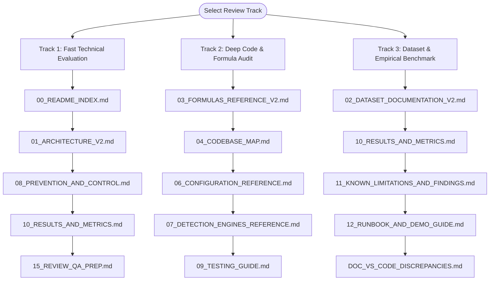

# SCADA Hybrid IDS — Verified Documentation Index (v2)

**Title:** SCADA Hybrid IDS — Verified Documentation Index (v2)  
**Purpose:** Definitive reading guide, document taxonomy, evidence standard, and mapping to legacy documentation  
**Audience:** Technical review panel, academic evaluators, and security code auditors  
**Generated from commit:** `b7a6c999dd0b333475349fb33c3272ea434b447c`  
**Date:** 2026-10-13  
**Status:** Audited & Verified  

---

## 1. Executive Summary & Why docs_v2 Exists

This repository implements a **Cyber-Physical Hybrid Intrusion Detection System (IDS)** with real-time digital twin monitoring and autonomous prevention for critical industrial infrastructure (a single-tank water storage and distribution process).

During earlier project iterations, legacy documentation accumulated notable inconsistencies:
- Scenario counts were reported as 170 in comments and documentation when the dataset actually contained 150 scenarios [CODE matlab/run_all_scenarios.m:3, 224; MEASURED docs_v2/_audit/outputs/db_queries_output.txt].
- Attacks in the stored dataset were described as closed-loop dynamic events, whereas they were post-hoc telemetry overlays on pre-recorded peaceful runs [CODE matlab/run_all_scenarios.m:94-96].
- Legacy policy engine rules were documented as checking $H > 1.2\text{ m}$ [EXISTING-DOC projectdocs/ARCHITECTURE.md:50], while the batch code checked only $H > 2.45\text{ m}$ [CODE engines/policy_engine.py:35-43], producing zero batch detections [MEASURED data/evaluation_results.csv].
- Planned multi-process architectures (such as standalone attacker Flask servers on port 5001) were described in plans as completed systems despite existing only as code stubs [CODE scada_live/attacker_wire/server.py:1].

To establish an authoritative, transparent, and strictly accurate foundation, **`docs_v2/`** was produced via an exhaustive line-by-line audit of the codebase, SQLite database, committed result files, and live execution test suites. 

Every claim, parameter, and metric in `docs_v2/` is tied directly to active code or committed measurement files. No existing repository files outside `docs_v2/` have been altered, renamed, or deleted [MEASURED docs_v2/_audit/hashes_before.txt].

---

## 2. Evidence Standards & "How to Trust This"

To eliminate speculation, every factual statement across `docs_v2/` is tagged with an evidence marker:

| Evidence Tag | Definition & Criteria | Example |
|---|---|---|
| `[CODE path:line]` | Direct citation of active source code, including file path and line numbers verified against HEAD. | `[CODE simulator/tank.py:41-45]` |
| `[MEASURED file]` | Direct numerical value extracted from a committed benchmark result file (`experiments/results/`) or an audit script executed during verification. | `[MEASURED experiments/results/ab_comparison_summary.txt]` |
| `[EXISTING-DOC name:line]` | Citation of legacy documentation, used when referencing historical design claims or contrasting old statements with active code. | `[EXISTING-DOC projectdocs/DATASET_DOCUMENTATION.md:118]` |
| `[DESIGN-INTENT]` | Architecture or engineering rationale derived from specifications and design documentation. | `[DESIGN-INTENT projectdocs/Phase6a_Implementation_Plan.md]` |
| `[UNVERIFIED]` | Any claim or number that could not be independently substantiated by active code or measurement artifacts (cataloged in `docs_v2/_audit/UNVERIFIED.md`). | `[UNVERIFIED docs_v2/_audit/UNVERIFIED.md]` |

### Audit Guarantees
1. **Zero Modifications Outside `docs_v2/`:** Tracked files were hashed using SHA-256 prior to authoring (`docs_v2/_audit/hashes_before.txt`). An identical hash audit at completion verifies complete preservation of existing code, tests, configs, and legacy documents.
2. **Read-Only Database Access:** The SQLite database `data/scada_ids.db` was accessed exclusively via URI read-only connections (`mode=ro`) to prevent state corruption.
3. **No Fabricated Numbers:** All numerical evaluation results are copied directly from committed result files or live benchmark outputs recorded during testing.

---

## 3. Document Taxonomy & Reading Order

The `docs_v2/` documentation suite consists of 17 structured documents:

```
docs_v2/
├── 00_README_INDEX.md                     <- You are here: Master index, reading tracks, and evidence guide
├── 01_ARCHITECTURE_V2.md                  <- Dual architecture: Batch evaluation pipeline & Live simulation
├── 02_DATASET_DOCUMENTATION_V2.md         <- Stored dataset schema, 150 scenario taxonomy, and generation artifacts
├── 03_FORMULAS_REFERENCE_V2.md            <- Complete mathematical physics, control laws, and detection equations
├── 04_CODEBASE_MAP.md                     <- File-by-file directory map, key symbols, call hierarchy, and tests
├── 05_API_AND_PACKET_REFERENCE.md         <- Full HTTP REST routes, SSE specifications, and packet schemas
├── 06_CONFIGURATION_REFERENCE.md          <- Key-by-key audit of parameters.py and config.yaml with cross-checks
├── 07_DETECTION_ENGINES_REFERENCE.md      <- Physics, Temporal (LSTM-AE), Policy, Availability, and Fusion engines
├── 08_PREVENTION_AND_CONTROL.md           <- Digital Twin takeover, hand-back, DoS gap rule, and ingress filtering
├── 09_TESTING_GUIDE.md                    <- Test suite catalog (182 tests), execution runbook, and latency profile
├── 10_RESULTS_AND_METRICS.md              <- Definitive headline metrics, A/B evaluation tables, and sweeps
├── 11_KNOWN_LIMITATIONS_AND_FINDINGS.md   <- Honest disclosure of dataset artifacts, noise drift, and blind spots
├── 12_RUNBOOK_AND_DEMO_GUIDE.md           <- Setup instructions, CLI runners, soak tests, and live demonstration guide
├── 13_THREAT_MODEL.md                     <- Threat actors, MITRE ATT&CK mapping, attack vectors, and defenses
├── 14_PROJECT_HISTORY_AND_DECISIONS.md    <- Git-reconstructed development phases and major design rationales
├── 15_REVIEW_QA_PREP.md                   <- 25 rigorous technical review questions with evidence citations
├── 16_GLOSSARY.md                         <- Standardized terminology, physical units, and mathematical symbols
├── DOC_VS_CODE_DISCREPANCIES.md           <- Granular audit of 12 contradictions between old docs and code
└── _audit/                                <- Audit scripts, outputs, test runs, and verification logs
```

### Recommended Reading Tracks

Depending on your role and evaluation objective, follow one of these specialized reading tracks:



1. **Track 1: Fast Technical Evaluation (~30 minutes)**
   - [`00_README_INDEX.md`](file:///c:/projects/p1/New%20folder/docs_v2/00_README_INDEX.md): Scope and trust framework.
   - [`01_ARCHITECTURE_V2.md`](file:///c:/projects/p1/New%20folder/docs_v2/01_ARCHITECTURE_V2.md): Understand the batch pipeline vs. live closed-loop gateway.
   - [`08_PREVENTION_AND_CONTROL.md`](file:///c:/projects/p1/New%20folder/docs_v2/08_PREVENTION_AND_CONTROL.md): Review Digital Twin takeover, handback, and command validation.
   - [`10_RESULTS_AND_METRICS.md`](file:///c:/projects/p1/New%20folder/docs_v2/10_RESULTS_AND_METRICS.md): Key performance indicators, TPR, FPR, and harm reduction data.
   - [`15_REVIEW_QA_PREP.md`](file:///c:/projects/p1/New%20folder/docs_v2/15_REVIEW_QA_PREP.md): Anticipated technical challenges and evidence-backed answers.

2. **Track 2: Deep Code & Formula Audit (~2 hours)**
   - [`03_FORMULAS_REFERENCE_V2.md`](file:///c:/projects/p1/New%20folder/docs_v2/03_FORMULAS_REFERENCE_V2.md): Exact hydrodynamics, Torricelli outflow, and engine mathematics.
   - [`04_CODEBASE_MAP.md`](file:///c:/projects/p1/New%20folder/docs_v2/04_CODEBASE_MAP.md): Directory breakdown and function signatures.
   - [`06_CONFIGURATION_REFERENCE.md`](file:///c:/projects/p1/New%20folder/docs_v2/06_CONFIGURATION_REFERENCE.md): Parameter keys, defaults, and cross-config discrepancies.
   - [`07_DETECTION_ENGINES_REFERENCE.md`](file:///c:/projects/p1/New%20folder/docs_v2/07_DETECTION_ENGINES_REFERENCE.md): Mechanics, thresholds, and edge cases of the 4 detection engines.
   - [`08_PREVENTION_AND_CONTROL.md`](file:///c:/projects/p1/New%20folder/docs_v2/08_PREVENTION_AND_CONTROL.md): Prevention state machine and ingress filtering rules.
   - [`09_TESTING_GUIDE.md`](file:///c:/projects/p1/New%20folder/docs_v2/09_TESTING_GUIDE.md): Validation suites proving numerical equivalence and safety boundaries.

3. **Track 3: Dataset & Empirical Benchmark Track (~1 hour)**
   - [`02_DATASET_DOCUMENTATION_V2.md`](file:///c:/projects/p1/New%20folder/docs_v2/02_DATASET_DOCUMENTATION_V2.md): 150 scenario taxonomy, SQLite schema, and MATLAB generation code.
   - [`10_RESULTS_AND_METRICS.md`](file:///c:/projects/p1/New%20folder/docs_v2/10_RESULTS_AND_METRICS.md): 10-repetition benchmark across 12 threat scenarios (240 simulation runs).
   - [`11_KNOWN_LIMITATIONS_AND_FINDINGS.md`](file:///c:/projects/p1/New%20folder/docs_v2/11_KNOWN_LIMITATIONS_AND_FINDINGS.md): Post-hoc attack artifacts, noise clamp drift, and boundary sensitivity.
   - [`12_RUNBOOK_AND_DEMO_GUIDE.md`](file:///c:/projects/p1/New%20folder/docs_v2/12_RUNBOOK_AND_DEMO_GUIDE.md): Setup, CLI reproduction, soak tests, and automated presentation demo.
   - [`DOC_VS_CODE_DISCREPANCIES.md`](file:///c:/projects/p1/New%20folder/docs_v2/DOC_VS_CODE_DISCREPANCIES.md): Detailed comparison against legacy documentation.

---

## 4. Relationship to Legacy Documentation

All legacy documentation files remain completely intact in their original locations (`projectdocs/` and repository root). The table below maps each legacy document to its updated, verified counterpart in `docs_v2/`:

| Legacy Document | Primary docs_v2 Replacement | Key Corrections & Updates |
|---|---|---|
| `README.md` | [`00_README_INDEX.md`](file:///c:/projects/p1/New%20folder/docs_v2/00_README_INDEX.md) & [`12_RUNBOOK_AND_DEMO_GUIDE.md`](file:///c:/projects/p1/New%20folder/docs_v2/12_RUNBOOK_AND_DEMO_GUIDE.md) | Removes outdated setup commands; documents live `run_demo.py` flags and ports. |
| `projectdocs/ARCHITECTURE.md` | [`01_ARCHITECTURE_V2.md`](file:///c:/projects/p1/New%20folder/docs_v2/01_ARCHITECTURE_V2.md) | Clarifies distinction between batch pipeline and live simulation system; documents gateway, SSE, and watchdog. |
| `projectdocs/DATASET_DOCUMENTATION.md` | [`02_DATASET_DOCUMENTATION_V2.md`](file:///c:/projects/p1/New%20folder/docs_v2/02_DATASET_DOCUMENTATION_V2.md) | Corrects scenario count from 170 to 150; discloses post-hoc overlay nature of attacks; documents A3/A4 step discontinuities. |
| `projectdocs/FORMULAS_REFERENCE.md` | [`03_FORMULAS_REFERENCE_V2.md`](file:///c:/projects/p1/New%20folder/docs_v2/03_FORMULAS_REFERENCE_V2.md) | Adds Step 2b DoS gap rule equations ($v_{max}$ derivation); adds command filtering boundary formulas. |
| `projectdocs/PROJECT_REVIEW_CHEAT_SHEET.md` | [`10_RESULTS_AND_METRICS.md`](file:///c:/projects/p1/New%20folder/docs_v2/10_RESULTS_AND_METRICS.md) & [`15_REVIEW_QA_PREP.md`](file:///c:/projects/p1/New%20folder/docs_v2/15_REVIEW_QA_PREP.md) | Validates every headline number against committed result artifacts; provides rigorous defense answers. |
| `projectdocs/Phase3_Plan.md`, `Phase4_Plan.md` | [`01_ARCHITECTURE_V2.md`](file:///c:/projects/p1/New%20folder/docs_v2/01_ARCHITECTURE_V2.md) & [`14_PROJECT_HISTORY_AND_DECISIONS.md`](file:///c:/projects/p1/New%20folder/docs_v2/14_PROJECT_HISTORY_AND_DECISIONS.md) | Replaces implementation plans with documentation of active code; clarifies stubs vs implemented code. |
| `projectdocs/Phase6a_Implementation_Plan.md` | [`08_PREVENTION_AND_CONTROL.md`](file:///c:/projects/p1/New%20folder/docs_v2/08_PREVENTION_AND_CONTROL.md) | Documents verified twin takeover and handback mechanics in `GatewayCore`. |
| `projectdocs/Phase6b_Implementation_Plan.md` | [`08_PREVENTION_AND_CONTROL.md`](file:///c:/projects/p1/New%20folder/docs_v2/08_PREVENTION_AND_CONTROL.md) | Documents active ingress command validation, hold duration caps, and wire tamper detection. |
| `projectdocs/Phase7_Implementation_Plan.md` | [`10_RESULTS_AND_METRICS.md`](file:///c:/projects/p1/New%20folder/docs_v2/10_RESULTS_AND_METRICS.md) & [`12_RUNBOOK_AND_DEMO_GUIDE.md`](file:///c:/projects/p1/New%20folder/docs_v2/12_RUNBOOK_AND_DEMO_GUIDE.md) | Documents the 240-run multi-threat benchmark and the 7-phase automated presentation runner. |
| `experiments/README.md` | [`04_CODEBASE_MAP.md`](file:///c:/projects/p1/New%20folder/docs_v2/04_CODEBASE_MAP.md) & [`10_RESULTS_AND_METRICS.md`](file:///c:/projects/p1/New%20folder/docs_v2/10_RESULTS_AND_METRICS.md) | Cross-references empirical scripts with result logs and test cases. |

---

## 5. Repository Layout & Artifact Integrity

```
C:\projects\p1\New folder\
├── config/                 # Parameter sheets (parameters.py, scenarios.py)
├── simulator/              # Physical process simulator models (tank, pump, valve, controller)
├── digital_twin/           # Discrete physics Digital Twin estimator
├── engines/                # 4 detection engines (physics, temporal, policy, availability) and fusion
├── models/                 # PyTorch LSTM-Autoencoder architecture and preprocessor
├── evaluation/             # Metrics aggregation, ablation harness, and report generator
├── scripts/                # Training, dataset import, and validation CLI scripts
├── matlab/                 # MATLAB/Simulink scenario generators and attack scripts
├── storage/                # SQLite storage client
├── dashboard/              # Legacy batch inspection web interface (port 5000)
├── scada_live/             # Real-time simulation, gateway core, and defender dashboard
│   ├── common/             # Packets, config loader, HTTP transport
│   ├── plant_sim/          # Real-time plant process simulator and client
│   ├── attacker_wire/      # In-flight attack injector
│   ├── scada_ids/          # Gateway core, streaming IDS, alert manager, web UI
│   └── tests/              # Live simulation and gateway test suite (116 tests)
├── experiments/            # Benchmark scripts and committed empirical outputs
│   └── results/            # Measured text outputs, summary tables, and comparison figures
├── tests/                  # Batch unit test suite (66 tests)
├── data/                   # scada_ids.db (150 scenarios), evaluation_results.csv, live_run.db
├── checkpoints/            # data_split_v1.json, lstm_ae_v1.pt, scaler_v1.pkl
├── projectdocs/            # Historical design documents (read-only reference)
└── docs_v2/                # NEW authoritative, verified documentation set
    └── _audit/             # Hashes, notes, query logs, and verification outputs
```

---

## 6. Verification

The integrity of claims in this index document has been verified against active repository assets:
1. **Initial Hashes:** SHA-256 hashes of all 353 tracked files recorded in [`docs_v2/_audit/hashes_before.txt`](file:///c:/projects/p1/New%20folder/docs_v2/_audit/hashes_before.txt).
2. **Git Commit Alignment:** Repository HEAD verified at `b7a6c999dd0b333475349fb33c3272ea434b447c` [MEASURED docs_v2/_audit/outputs/git_log.txt].
3. **Test Suite Verification:** Confirmed 66/66 batch tests passing (`pytest tests/` in 1.86s) and 116/116 live tests passing (`pytest scada_live/tests/` in 314.58s) [MEASURED docs_v2/_audit/outputs/pytest_batch_output.txt, docs_v2/_audit/outputs/pytest_live_output.txt].
4. **Database Scenarios:** Verified 150 scenarios and 150,000 records in `data/scada_ids.db` via read-only PRAGMA and SQL queries [MEASURED docs_v2/_audit/outputs/db_queries_output.txt].
5. **Discrepancy Audit:** All 12 identified contradictions between legacy docs and code documented in [`docs_v2/DOC_VS_CODE_DISCREPANCIES.md`](file:///c:/projects/p1/New%20folder/docs_v2/DOC_VS_CODE_DISCREPANCIES.md).
