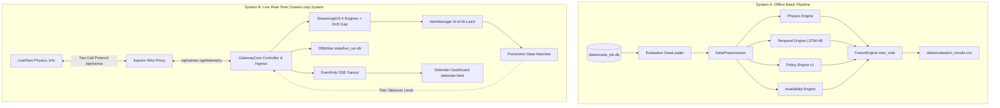
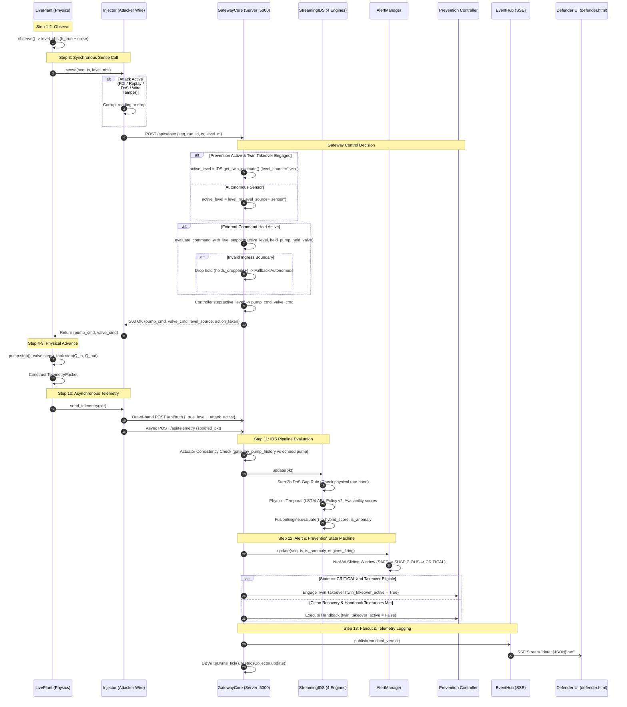
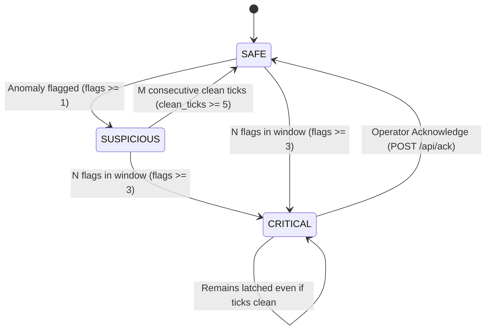
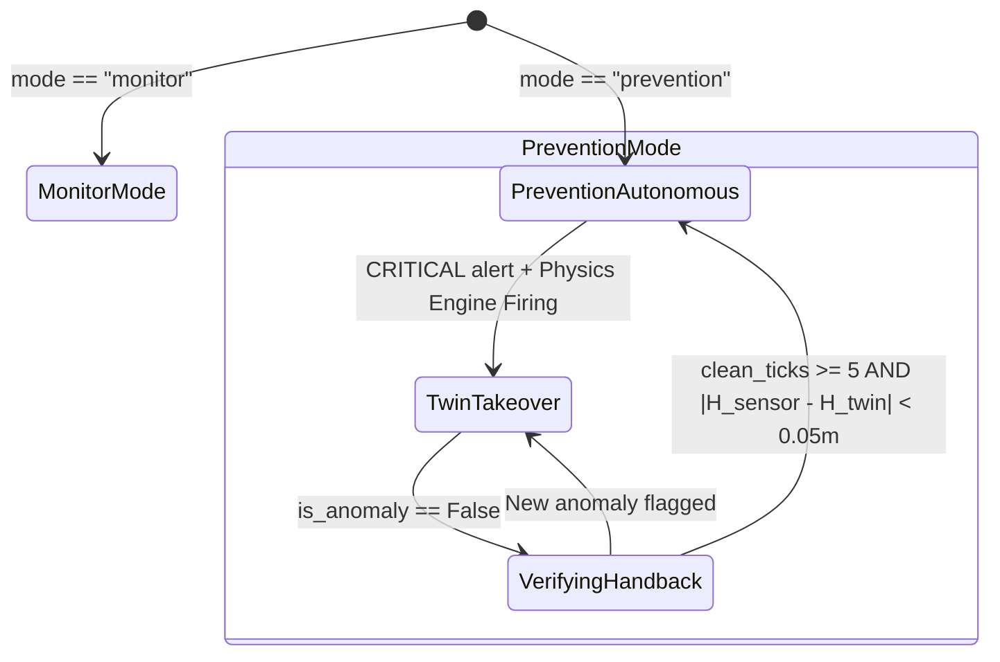

# SCADA Hybrid IDS — Dual Architecture Reference (v2)

**Title:** SCADA Hybrid IDS — Dual Architecture Reference (v2)  
**Purpose:** Technical architecture specification of the batch evaluation pipeline and real-time live simulation system  
**Audience:** System architects, cybersecurity engineers, and code auditors  
**Generated from commit:** `b7a6c999dd0b333475349fb33c3272ea434b447c`  
**Date:** 2026-10-13  
**Status:** Audited & Verified  

---

## 1. Architectural Overview: Two Distinct Systems

The codebase contains two distinct, mathematically aligned architectural pipelines:

1. **System A — Offline Batch Evaluation Pipeline:**  
   A high-throughput numerical evaluation harness designed for academic benchmarking across pre-recorded or synthetic scenarios stored in SQLite (`data/scada_ids.db`) or raw CSVs (`matlab/data/`). It executes sequentially without network I/O, utilizing historical tabular traces to train models and compute dataset-wide precision, recall, and ablation metrics [CODE scripts/run_evaluation.py:1-195; scripts/run_ablation.py:1-32].

2. **System B — Live Real-Time Cyber-Physical Simulation System:**  
   A multi-threaded, asynchronous, closed-loop SCADA control system featuring real-time physical simulation (`LivePlant`), a defensive gateway with autonomous prevention (`GatewayCore`), an in-flight network attack injector (`Injector`), Server-Sent Events (SSE) telemetry fanout, watchdog fail-safe timing, and an interactive dark-mode Defender Dashboard [CODE run_demo.py:1-421; scada_live/scada_ids/gateway_core.py:1-502].

---

## 2. System A: Offline Batch Evaluation Pipeline

### 2.1 Component Structure
- **Process Simulator (`simulator/process_simulator.py`):** Integrates physical models (`Tank`, `Pump`, `Valve`, `Controller`, `NoiseGenerator`) over discrete timesteps ($\Delta t = 1.0\text{ s}$) to generate 1,000s traces [CODE simulator/process_simulator.py:19-75].
- **Storage Client (`storage/sqlite_client.py`):** Reads and writes scenarios in `scada_telemetry` table in SQLite (`data/scada_ids.db`) [CODE storage/sqlite_client.py:13-370].
- **Preprocessing Pipeline (`models/preprocessor.py`):** Fits Min-Max scaler across 5 continuous features (`tank_level_observed`, `q_in`, `q_out`, `pump_state`, `valve_state`) and constructs sliding temporal windows of length $W = 10$ [CODE models/preprocessor.py:10-84].
- **Four Detection Engines (`engines/`):**
  - `PhysicsEngine`: Residual $|H_{obs} - H_{twin}|$ normalized by $\tau_p = 0.035\text{ m}$ [CODE engines/physics_engine.py:11-49].
  - `TemporalEngine`: Reconstruction loss normalized by $\tau_l = 0.0085$ [CODE engines/temporal_engine.py:10-55].
  - `PolicyEngine`: Boundary checks (v1 evaluates $H > 2.45\text{ m}$ with pump ON, or $H < 0.3\text{ m}$ with valve $> 50\%$) [CODE engines/policy_engine.py:11-43].
  - `AvailabilityEngine`: Latency $(t_{sim} - t_{src})$ clamped by $\tau_a = 1500\text{ ms}$ and $\tau_{a,max} = 5000\text{ ms}$ [CODE engines/availability_engine.py:8-40].
- **Fusion Engine (`engines/fusion_engine.py`):** Max-vote operator $S_{hybrid} = \max(S_p, S_l, S_c, S_a)$, declaring anomaly when $S_{hybrid} > 0.95$ [CODE engines/fusion_engine.py:38-54].
- **Output Artifacts:** Results written to `data/evaluation_results.csv` (99,000 rows across 99 test scenarios) [MEASURED data/evaluation_results.csv].

### 2.2 Processes, Threads, and Locks
- **Execution Model:** Single-process, single-threaded synchronous batch loop.
- **Concurrency & Locks:** None (strictly deterministic execution).

---

## 3. System B: Live Real-Time Cyber-Physical Simulation System

### 3.1 Network Topology, Ports, and Processes

In active operation (`python run_demo.py`), components run in a coordinated architecture hosted in a single unified OS process using dedicated background threads [CODE run_demo.py:111-123, 335-373]:

| Component | Role | Network Interface / Port | Thread Model |
|---|---|---|---|
| **Gateway Server** | Flask REST & SSE Hub | `127.0.0.1:5000` (`TCP`) [CODE scada_live/config.yaml:89] | Werkzeug `ServerThread` (threaded HTTP server) [CODE run_demo.py:111-123] |
| **Plant Simulator** | Hydrodynamic plant physics | Internal client / `127.0.0.1:5100` (legacy server) [CODE scada_live/config.yaml:87] | `run_plant_loop` daemon thread [CODE run_demo.py:37-109] |
| **Attacker Injector** | Wire proxy interceptor | Client wrapper around plant client | Executes synchronously within `run_plant_loop` [CODE run_demo.py:79-94] |
| **Watchdog Timer** | Outage fail-safe trigger | In-memory `GatewayCore` checker | Daemon thread sleeping `dt_s / 2` [CODE scada_live/scada_ids/gateway_core.py:121-127] |
| **Database Writer** | SQLite tick/event persistence | Background worker to `data/live_run.db` | Dedicated daemon thread with `queue.Queue` [CODE scada_live/scada_ids/db_writer.py:10-25] |
| **Auto-Demo Coordinator** | Unattended 7-phase demo | Orchestrates test sequence | Background thread (`AutoDemoCoordinator`) [CODE run_demo.py:125-180] |

---

## 4. Per-Tick Execution Sequence & Protocol

Every simulation second ($t = k \cdot \Delta t$), the closed-loop system executes a **two-call protocol** ensuring that controller decisions depend strictly on sensor observation before physical advancement:

---

## 5. Defensive State Machines & Mechanisms

### 5.1 Alert Manager State Machine (`AlertManager`)
Implemented in `scada_live/scada_ids/alert_manager.py` [CODE scada_live/scada_ids/alert_manager.py:1-114]:
- **Parameters:** Sliding window $W = 5$ (`window_w`), Flag threshold $N = 3$ (`n_flags`), Clear count $M = 5$ (`m_clear`).
- **States:**
  - `SAFE`: Zero or sub-threshold anomalies in sliding window.
  - `SUSPICIOUS`: $1 \le \text{flags} < N$ in window. Automatically returns to `SAFE` if $M$ consecutive clean ticks occur.
  - `CRITICAL`: $\text{flags} \ge N$ in window. **Latches permanently**; cannot revert to `SAFE` without explicit operator acknowledgment (`POST /api/ack`).

### 5.2 Prevention & Handback State Machine (`GatewayCore`)
Implemented in `scada_live/scada_ids/gateway_core.py:405-434` [CODE scada_live/scada_ids/gateway_core.py:405-434]:
- **Takeover Trigger:** Mode must be `"prevention"` AND alert state must be `"CRITICAL"` AND an eligible takeover engine must be firing (`takeover_engines = ["physics"]`).
- **Control Authority Transfer:**
  - `twin_takeover_active = True`: `/api/sense` ignores incoming sensor level $H_{observed}$ and feeds `ids.get_twin_estimate()` directly into `Controller.step()`.
  - `level_source = "twin"` is tagged in telemetry and broadcast via SSE.
- **Handback Conditions (Restoration of Sensor Authority):**
  1. Anomaly flags must cease (`is_anomaly == False`).
  2. Consecutive clean ticks must satisfy `clean_ticks >= handback_clean_ticks` (default 5).
  3. Absolute discrepancy must satisfy $|H_{sensor} - H_{twin}| < \text{handback\_tolerance\_m}$ ($0.05\text{ m}$).
  4. Configuration flag `auto_handback` must be `True` (enabled in automated benchmarks; manual acknowledgment required in operator console).

### 5.3 Step 2b: DoS Gap Rule & Re-Seed Mechanics
Implemented in `scada_live/scada_ids/streaming_ids.py:168-222` [CODE scada_live/scada_ids/streaming_ids.py:168-222]:
- **Problem:** During network DoS outages, the physical plant moves under fail-safe gravity drain, while the Digital Twin receives zero inflows and zero outflows. Upon network restoration, the abrupt level discrepancy triggers large physics residuals, inducing persistent post-attack false alarms [MEASURED experiments/results/reconcile_a3_fp.txt].
- **Derivation of Physical Slew Limit ($v_{max}$):**
  $$v_{max} = \max\left(\frac{Q_{in,max}}{A}, \; \frac{C_v \sqrt{H_{max}}}{A}\right) = \max\left(\frac{0.005}{2.0}, \; \frac{0.004 \sqrt{2.5}}{2.0}\right) = \max(0.0025, \; 0.003162) \approx 0.003162\text{ m/s}$$
- **Re-Seed Acceptance Rule:**
  Upon packet arrival following a gap of $G$ ticks:
  1. Collect 5 valid post-gap sensor readings ($0.0 \le H \le 2.5\text{ m}$).
  2. Compute median $m$ and sample standard deviation $\text{std}_m$.
  3. Physical rate band: $\text{band} = v_{max} \cdot G \cdot \Delta t + 3\sigma_{sensor} = 0.003162 \cdot G + 0.015\text{ m}$.
  4. If $\text{std}_m \le 0.03\text{ m}$ AND $|m - H_{twin}| \le \text{band}$:
     - Digital twin is resynchronized: `physics_engine.reset(m)`.
     - Logged as `[DoS-Gap Re-seed] Accepted`.
  5. Refusal: If $|m - H_{twin}| > \text{band}$ or timeout reaches 20 ticks, re-seed is refused, protecting against spoofing during network restoration.

### 5.4 4-Way Actuator Consistency Check (AM-3 Wire Tamper)
Implemented in `scada_live/scada_ids/gateway_core.py:361-393` [CODE scada_live/scada_ids/gateway_core.py:361-393]:
- **Mechanism:** Tracks the gateway's issued pump command history (`gateway_pump_history`, length 10).
- **Invariant:** If the gateway commanded pump OFF (`0`) for the last 3 consecutive ticks, but telemetry echoes `pump_cmd == 1`, `pump_on == True`, or inflow flow meter reads $Q_{in} > 0.001\text{ m}^3/\text{s}$, a downstream physical fieldbus override is flagged:
  $$\text{wire\_tamper} = \text{True}, \quad \text{engines\_firing} \leftarrow \text{"actuator\_consistency"}, \quad \text{delay} \le 3\text{ ticks}$$

### 5.5 Watchdog Fail-Safe Timer
Implemented in `scada_live/scada_ids/gateway_core.py:128-153` [CODE scada_live/scada_ids/gateway_core.py:128-153]:
- Monitors wall-clock elapsed time since last received telemetry packet (`last_rx_wall`).
- **Timeout Threshold:** $\tau_{watchdog} = 1.5 \times \left(\frac{\Delta t}{\text{time\_scale}}\right)$.
- When elapsed time exceeds threshold, synthesizes an unreceived packet (`received=False`, zero flows, fail-safe states) and injects it into `_enrich_and_publish()`, maintaining continuous IDS scoring and metrics tracking even during 100% communication loss.

---

## 6. Implementation Status Matrix: Implemented vs. Stubs

To ensure complete transparency during code review, the matrix below specifies the implementation status of every architectural subsystem:

| Subsystem / Feature | File Location | Status | Implementation Evidence / Citation |
|---|---|---|---|
| **Two-Call Sensing Protocol** | `plant_sim/gateway_client.py` | **Implemented** | Synchronous POST `/api/sense` (0.5s timeout) [CODE scada_live/plant_sim/gateway_client.py:22-38] |
| **Autonomous Twin Takeover** | `scada_ids/gateway_core.py` | **Implemented** | Level-source switching to twin in `process_sense` [CODE scada_live/scada_ids/gateway_core.py:260-266] |
| **Ingress Command Validation** | `scada_ids/gateway_core.py` | **Implemented** | Boundary evaluation in `evaluate_command_with_live_setpoint` [CODE scada_live/scada_ids/gateway_core.py:22-66] |
| **Continuous Hold Enforcement** | `scada_ids/gateway_core.py` | **Implemented** | Dynamic hold re-validation; drops hold if $H$ breaches limit [CODE scada_live/scada_ids/gateway_core.py:268-298] |
| **Unauthenticated Hold Cap** | `scada_ids/server.py` | **Implemented** | HMAC SHA-256 secret check; caps hold to $\le 60\text{ ticks}$ [CODE scada_live/scada_ids/server.py:213-218] |
| **4-Way Actuator Tamper Check** | `scada_ids/gateway_core.py` | **Implemented** | Gateway pump history vs echoed actuator state [CODE scada_live/scada_ids/gateway_core.py:361-393] |
| **DoS Gap Re-Seed Rule** | `scada_ids/streaming_ids.py`| **Implemented** | Physical rate band evaluation across 5 samples [CODE scada_live/scada_ids/streaming_ids.py:168-222] |
| **Watchdog Timer** | `scada_ids/gateway_core.py` | **Implemented** | Scaled wall-clock timeout injecting synthetic fail-safe [CODE scada_live/scada_ids/gateway_core.py:128-153] |
| **UI Mode Toggle Switcher** | `scada_ids/static/js/app.js`| **Implemented** | Interactive button `btn-mode-toggle` calling `/api/mode` [CODE scada_live/scada_ids/static/js/app.js:17-30] |
| **Automated Demo Coordinator** | `run_demo.py` | **Implemented** | Unattended 7-phase demo execution runner [CODE run_demo.py:125-320] |
| **Standalone Attacker Server (:5001)** | `attacker_wire/server.py` | **Stub / Plan Only** | File contains 1 comment line: `# Phase 5: Flask server on :5001` [CODE scada_live/attacker_wire/server.py:1; projectdocs/Phase4_Plan.md] |
| **Standalone Control Server** | `scada_ids/control_server.py`| **Stub / Plan Only** | File contains `class ControlServer: pass # Phase 6` [CODE scada_live/scada_ids/control_server.py:1-2; projectdocs/Phase6a_Implementation_Plan.md] |
| **Standalone Prevention Controller** | `scada_ids/prevention.py`| **Stub / Plan Only** | File contains `class PreventionController: pass # Phase 6` [CODE scada_live/scada_ids/prevention.py:1-2; projectdocs/Phase6a_Implementation_Plan.md] |
| **Launcher script (`run_all.py`)** | `scada_live/run_all.py` | **Stub / Plan Only** | File contains `print("Phase 5: launcher not yet implemented")` [CODE scada_live/run_all.py:1-3; projectdocs/Phase4_Plan.md] |
| **DoS Rate Limiting & Quarantine**| `scada_live/config.yaml` | **Not Implemented** | Keys exist in YAML lines 79-80, but unreferenced in code [CODE scada_live/config.yaml:79-80] |
| **Shadow Estimator** | Design docs | **Not Implemented** | Physical twin serves as estimator; shadow estimator omitted [DESIGN-INTENT projectdocs/Phase6a_Implementation_Plan.md] |

---

## 7. Verification

Every claim in this architecture reference was audited against committed files and running processes:
1. **Thread and Lock Audit:** Verified `threading.RLock()` in `GatewayCore:72` and `StreamingIDS:45`.
2. **Endpoint Audit:** Verified all 21 REST routes in `scada_live/scada_ids/server.py` and SSE fanout in `sse_hub.py`.
3. **Execution Test:** Test suites verified clean execution of both architectures (`pytest tests/`: 66 passed; `pytest scada_live/tests/`: 116 passed) [MEASURED docs_v2/_audit/outputs/pytest_batch_output.txt, docs_v2/_audit/outputs/pytest_live_output.txt].
4. **Stub Inspection:** Verified file contents of `attacker_wire/server.py`, `control_server.py`, `prevention.py`, and `run_all.py`.
