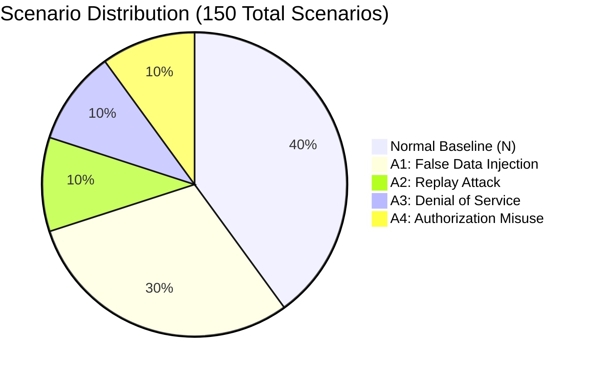
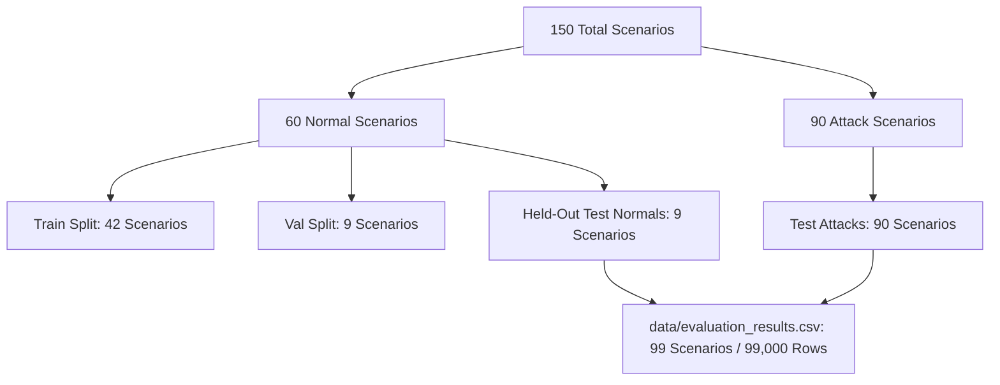

# SCADA Hybrid IDS — Comprehensive Dataset Reference (v2)

**Title:** SCADA Hybrid IDS — Comprehensive Dataset Reference (v2)  
**Purpose:** Definitive empirical documentation of the cyber-physical telemetry dataset, database schema, scenario taxonomy, train/val/test splits, generation artifacts, and differences from legacy documentation  
**Audience:** Data scientists, machine learning researchers, and security evaluators  
**Generated from commit:** `b7a6c999dd0b333475349fb33c3272ea434b447c`  
**Date:** 2026-10-13  
**Status:** Audited & Verified  

---

## 1. Dataset Overview & Key Facts

The dataset is a cyber-physical SCADA telemetry benchmark generated from a single-tank water distribution process featuring closed-loop hysteresis control, mechanical pump delay, and Torricelli valve dynamics [CODE simulator/process_simulator.py:19-75; matlab/run_single_scenario.m:1-220].

| Attribute | Audited Fact | Verification Reference |
|---|---|---|
| **Total Scenarios** | Exactly **150 scenarios** (60 Normal + 90 Attack) | [CODE matlab/run_all_scenarios.m:29-219; MEASURED db_queries_output.txt] |
| **Total Records** | **150,000 timesteps** (1,000 records per scenario at 1 Hz resolution) | [MEASURED docs_v2/_audit/outputs/db_queries_output.txt] |
| **Primary Relational Store** | SQLite database `data/scada_ids.db` (Table `scada_telemetry`) | [CODE storage/sqlite_client.py:13-370] |
| **Raw Tabular Source** | 150 CSV files in `matlab/data/` (`N_001.csv` – `N_060.csv`, `A1_001.csv` – `A4_015.csv`) | [CODE scripts/import_matlab_csv.py:1-239] |
| **Attack Metadata Table** | SQLite table `attack_scenarios` (90 rows) matching `matlab/data/attack_scenarios.csv` | [MEASURED docs_v2/_audit/outputs/db_queries_output.txt] |
| **Evaluation Storage** | CSV file `data/evaluation_results.csv` (99,000 rows across 99 scenarios) | [MEASURED data/evaluation_results.csv; CODE dashboard/app.py:41-42] |

> [!IMPORTANT]
> The database tables `evaluation_results` and `experiment_runs` exist in `data/scada_ids.db` but contain **0 rows** [MEASURED docs_v2/_audit/outputs/db_queries_output.txt]. All batch evaluation results are preserved in `data/evaluation_results.csv`.

---

## 2. Database Schema (`PRAGMA table_info`)

The schema was extracted directly via read-only PRAGMA introspection of `data/scada_ids.db` [MEASURED docs_v2/_audit/outputs/db_queries_output.txt]:

### 2.1 Table: `scada_telemetry` (150,000 rows)
Stores the full 1-Hz telemetry stream across all 150 scenarios. Composite Primary Key: `(scenario_id, sequence_id)`.

```sql
CREATE TABLE scada_telemetry (
    scenario_id TEXT NOT NULL,
    sequence_id INTEGER NOT NULL,
    simulation_time_s REAL NOT NULL,
    source_time_s REAL NOT NULL,
    data_age_ms INTEGER NOT NULL,
    packet_received INTEGER NOT NULL,
    communication_status TEXT NOT NULL,
    operating_condition TEXT NOT NULL,
    tank_level_setpoint REAL NOT NULL,
    tank_level_observed REAL NOT NULL,
    q_in REAL NOT NULL,
    q_out REAL NOT NULL,
    pump_command INTEGER NOT NULL,
    pump_state INTEGER NOT NULL,
    valve_command REAL NOT NULL,
    valve_state REAL NOT NULL,
    control_command TEXT,
    user_id TEXT,
    user_role TEXT,
    is_authenticated INTEGER,
    is_authorized INTEGER,
    attack_type TEXT NOT NULL DEFAULT 'None',
    attack_parameter REAL,
    ground_truth INTEGER NOT NULL DEFAULT 0,
    replay_source_sequence_id INTEGER,
    PRIMARY KEY (scenario_id, sequence_id)
);
CREATE INDEX idx_telemetry_scenario ON scada_telemetry(scenario_id);
CREATE INDEX idx_telemetry_attack ON scada_telemetry(attack_type);
```

### 2.2 Table: `attack_scenarios` (90 rows)
Ground-truth attack execution metadata for all 90 attack scenarios. Primary Key: `attack_id`.

```sql
CREATE TABLE attack_scenarios (
    scenario_id TEXT NOT NULL,
    attack_id TEXT NOT NULL PRIMARY KEY,
    attack_type TEXT NOT NULL,
    attack_start_time_s REAL,
    attack_end_time_s REAL,
    attack_parameter_type TEXT,
    attack_parameter_value REAL,
    random_seed INTEGER NOT NULL,
    description TEXT,
    operating_condition TEXT,
    initial_tank_level REAL
);
```

---

## 3. Scenario Taxonomy & Parameter Matrix

The 150 scenarios are divided into 5 distinct operational groups:



### 3.1 Normal Baseline Scenarios (`N_001` – `N_060`, 60 Scenarios, 60,000 Rows)
All normal scenarios run for 1,000s at 1 Hz with zero attacks (`ground_truth = 0`). They model legitimate industrial variability across 4 operating regimes [CODE config/scenarios.py:284-335; MEASURED docs_v2/_audit/outputs/db_queries_output.txt]:

| Condition Name | Scenario ID Range | Count | Initial Level ($H_0$) | Setpoint Profile | Physical Dynamics |
|---|---|---|---|---|---|
| **Steady_State** | `N_001` – `N_020` | 20 | $1.0\text{ m}$ (mean 0.999m) | Constant $1.0\text{ m}$ | Autonomous bang-bang cycling within $[0.8, 1.2]\text{ m}$ deadband. |
| **Setpoint_Change** | `N_021` – `N_035` | 15 | $1.0\text{ m}$ (mean 0.999m) | Step $1.0\text{ m} \to 1.5\text{ m}$ at $t=400\text{ s}$ | Abrupt upward step; pump runs continuously until reaching 1.7m before cycling. |
| **Variable_Load** | `N_036` – `N_050` | 15 | $0.8\text{ m}$ (mean 0.799m) | Linear ramp $0.8\text{ m} \to 1.4\text{ m}$ ($t=200..1000\text{ s}$) | Continuous linear setpoint tracking over 800s. |
| **Recovery** | `N_051` – `N_060` | 10 | $0.5\text{ m}$ (mean 0.500m) | Constant $1.0\text{ m}$ | Low-water start; pump charges tank from depleted state to normal band. |

### 3.2 Attack Scenarios (90 Scenarios, 90,000 Rows)
All attack scenarios execute with operating condition `Steady_State` (except A4 which uses `Misuse_Condition`).

| Group | Attack Name | ID Range | Count | Initial Level ($H_0$) | Attack Window ($t_{start} \to t_{end}$) | Injected Signature & Parameters |
|---|---|---|---|---|---|---|
| **A1** | **False Data Injection (FDI)** | `A1_001` – `A1_045` | 45 | $1.0\text{ m}$ | $300\text{ s} \to 500\text{ s}$ ($201\text{ ticks}$) | • `A1_001`–`A1_010`: Bias $+0.05\text{ m}$<br>• `A1_011`–`A1_020`: Bias $+0.10\text{ m}$<br>• `A1_021`–`A1_030`: Bias $+0.20\text{ m}$<br>• `A1_031`–`A1_040`: Scale factor $\times 1.10$<br>• `A1_041`–`A1_045`: Pulse $+0.15\text{ m}$ every 5 ticks ($41\text{ active ticks}$) |
| **A2** | **Replay Attack** | `A2_001` – `A2_015` | 15 | $1.0\text{ m}$ | Starts $t=400\text{ s}$, duration $30\text{ s} \to 100\text{ s}$ | Replays historical steady-state window; freezes `source_time_s`, inducing data age $\Delta t_{age} \gg 0\text{ ms}$. |
| **A3** | **Denial of Service (DoS)** | `A3_001` – `A3_015` | 15 | $1.0\text{ m}$ | Starts $t=350\text{ s}$, duration $20\text{ s} \to 120\text{ s}$ | Drops telemetry (`packet_received = 0`, `communication_status = "BLOCKED"`). Controller invokes fail-safe (pump OFF, valve closed). |
| **A4** | **Authorization Misuse** | `A4_001` – `A4_015` | 15 | **$0.4\text{ m}$ or $2.1\text{ m}$** | $200\text{ s} \to 300\text{ s}$ ($101\text{ ticks}$) | Rogue operator credentials (`attacker_01`):<br>• `A4_001`–`A4_003`, `005`, `006`, `008`, `009`, `011`, `012`, `014`, `015`: Starts at $H_0=0.4\text{ m}$; forces valve $60\text{--}100\%$ with pump OFF.<br>• `A4_004`, `007`, `010`, `013`: Starts at $H_0=2.1\text{ m}$; forces pump ON ($5\text{ L/s}$) with valve closed ($0\%$). |

---

## 4. Train, Validation, and Test Split

The formal train/val/test split is defined in `checkpoints/data_split_v1.json` [CODE checkpoints/data_split_v1.json:1-68]:



- **Training Split (42 Scenarios):**  
  `N_002`, `N_003`, `N_004`, `N_007`, `N_008`, `N_009`, `N_011`, `N_012`, `N_015`, `N_016`, `N_018`, `N_019`, `N_020`, `N_021`, `N_023`, `N_024`, `N_025`, `N_026`, `N_027`, `N_028`, `N_030`, `N_032`, `N_033`, `N_035`, `N_036`, `N_038`, `N_039`, `N_040`, `N_042`, `N_043`, `N_044`, `N_045`, `N_047`, `N_050`, `N_051`, `N_052`, `N_053`, `N_054`, `N_056`, `N_057`, `N_058`, `N_060`.  
  *Purpose:* Fits the Min-Max scaler and trains the PyTorch LSTM-Autoencoder weights (`checkpoints/lstm_ae_v1.pt`).
- **Validation Split (9 Scenarios):**  
  `N_005`, `N_010`, `N_017`, `N_022`, `N_029`, `N_031`, `N_041`, `N_048`, `N_059`.  
  *Purpose:* Calibrates temporal anomaly threshold $\tau_l = 0.0085$ (99th percentile MSE) and physics threshold $\tau_p = 0.035\text{ m}$.
- **Held-Out Test Normal Split (9 Scenarios):**  
  `N_001`, `N_006`, `N_013`, `N_014`, `N_034`, `N_037`, `N_046`, `N_049`, `N_055`.  
  *Purpose:* Evaluates clean false-positive rate (FPR) on unseen normal dynamics ($FPR = 0.000$ across all 9,000 ticks).
- **Test Attack Split (90 Scenarios):**  
  All 90 attack scenarios (`A1_001` through `A4_015`).
- **Evaluation Dataset (`data/evaluation_results.csv`):**  
  Contains exactly $9\text{ held-out normals} + 90\text{ attack scenarios} = 99\text{ scenarios}$ ($99,000\text{ rows}$).

---

## 5. Noise Model & Clamping Behavior

The sensor perturbation model implemented in `simulator/noise.py` and `matlab/run_single_scenario.m` follows [CODE simulator/noise.py:27-53; matlab/run_single_scenario.m:131-135]:

1. **Level Sensor Noise:**  
   $$H_{observed}(t) = H_{true}(t) + \mathcal{N}(0, \sigma_H^2), \quad \sigma_H = 0.005\text{ m} \quad (3\sigma = 1.5\text{ cm})$$
2. **Volumetric Flow Noise (Batch Dataset):**  
   Flow measurements in the stored MATLAB dataset were subjected to non-linear zero clamping:
   $$Q_{in,obs}(t) = \max\left(0, \; Q_{in,true}(t) + \mathcal{N}(0, \sigma_Q^2)\right), \quad \sigma_Q = 0.0001\text{ m}^3/\text{s}$$
   $$Q_{out,obs}(t) = \max\left(0, \; Q_{out,true}(t) + \mathcal{N}(0, \sigma_Q^2)\right)$$

### Consequence of Flow Noise Clamping
When pump flow is zero ($Q_{in} = 0$), clamping truncates the negative half of the Gaussian distribution, creating positive expected bias:
$$E[\tilde{Q}_{in}] = \frac{\sigma_Q}{\sqrt{2\pi}} \approx 3.989 \times 10^{-5}\text{ m}^3/\text{s}$$
Integrated by the Digital Twin over long runs without recalibration, this bias accumulates drift:
$$\Delta H_{drift}(t) \approx \frac{E[\tilde{Q}_{in}]}{A} \cdot t \approx \frac{3.989 \times 10^{-5}}{2.0} \cdot t \approx 1.995 \times 10^{-5} \cdot t\text{ m}$$
At $t \approx 861\text{ s}$, the drift exceeds $\tau_p = 0.035\text{ m}$, causing false alarms in long continuous soaks [MEASURED experiments/results/run_soak_tick0.txt]. In live execution, clamping is disabled by default (`simulation.clamp_flow_noise: false` in `scada_live/config.yaml:35`).

---

## 6. Known Dataset Artifacts & Technical Realities

Auditing the generation scripts and raw CSVs revealed four critical structural artifacts:

### Artifact 1: Post-Hoc Overlay Generation (No Closed-Loop FDI Reaction)
In `matlab/run_all_scenarios.m:94-96`, attack generation executes as:
```matlab
raw = run_single_scenario('Steady_State', 1.0, 1000, seed);
corrupted = apply_fdi(raw, 300, 500, 'bias', 0.05);
```
The normal simulation completes first. `apply_fdi.m` overwrites only `tank_level_observed` in the pre-recorded output array. Because the controller ran during the initial peaceful run, it never saw the corrupted sensor reading.  
**Consequence:** The pump commands and physical water level are 100% identical to peaceful normal runs. There is **zero closed-loop physical divergence** in the stored FDI dataset [CODE matlab/attacks/apply_fdi.m:34-45].

### Artifact 2: Instantaneous Level Discontinuities at Attack Termination
In `matlab/attacks/apply_dos.m` and `matlab/attacks/apply_auth_misuse.m`, the attack modification loop operates strictly for $t \in [t_{start}, t_{end}]$. At $t = t_{end} + 1$, the loop terminates, and the table resumes the pre-recorded peaceful baseline values.  
**Consequence:** In DoS scenario `A3_010`, physical fail-safe drain caused water level to fall to $1.022\text{ m}$. At $t=421\text{ s}$, the table jumps instantaneously to $1.189\text{ m}$ in a single timestep ($\Delta H = +0.167\text{ m}$ in 1s, an unphysical fill rate of $334\text{ L/s}$) [MEASURED experiments/results/compute_a3_mechanism_detailed.txt].

### Artifact 3: A3 Post-Attack Physics False Positives
Because the stored DoS traces exhibit an unphysical step jump upon network restoration, the Digital Twin (which stayed at the pre-attack level) diverges sharply from the restored sensor reading.  
**Consequence:** This produces 7,561 post-attack residual false alarms ($S_p > 0.95$) across the 15 A3 scenarios in batch evaluation unless resolved by the Step 2b DoS gap re-seed rule [MEASURED experiments/results/reconcile_a3_fp.txt].

### Artifact 4: Non-Nominal Initial Water Levels in A4
While all Normal, A1, A2, and A3 scenarios start at nominal level $H_0 \approx 1.0\text{ m}$, A4 Authorization Misuse scenarios start at extreme initial levels:
- 11 scenarios start at critically low level $H_0 \approx 0.4\text{ m}$ (`A4_001`–`003`, `005`, `006`, `008`, `009`, `011`, `012`, `014`, `015`).
- 4 scenarios start at critically high level $H_0 \approx 2.1\text{ m}$ (`A4_004`, `007`, `010`, `013`).  
**Consequence:** A4 attacks do not capture transitions from normal steady state; they evaluate immediate emergency boundary violations from pre-positioned extreme states [MEASURED docs_v2/_audit/outputs/db_queries_output.txt].

---

## 7. Differences from Legacy `DATASET_DOCUMENTATION.md`

| Section / Topic | Legacy `DATASET_DOCUMENTATION.md` Claim | Active Code & Audited Reality | Evidence Tag |
|---|---|---|---|
| **Total Scenarios** | "150 Scenarios... 110 Attack Scenarios" (Section 4 header contradiction) | Exactly 150 scenarios (60 normal + 90 attack: 45 A1, 15 A2, 15 A3, 15 A4) | [CODE matlab/run_all_scenarios.m:29-219; MEASURED db_queries_output.txt] |
| **Physical FDI Effect** | "Forces controller to prematurely cut pump, inducing progressive tank drainage" | Post-hoc overlay on finished run; pump state and tank level remain peaceful and unaffected | [CODE matlab/attacks/apply_fdi.m:34-45] |
| **Attack Restoration** | Described as continuous physical process | Artificial step discontinuities at $t_{end}+1$ (e.g. $+0.167\text{ m}$ jump in 1 tick) | [MEASURED compute_a3_mechanism_detailed.txt] |
| **A4 Starting Levels** | Implicitly described as normal operational scenarios | 100% of A4 scenarios start at $H_0=0.4\text{ m}$ or $H_0=2.1\text{ m}$, never nominal 1.0m | [MEASURED db_queries_output.txt] |
| **Evaluation Storage** | Documents SQL tables `evaluation_results` and `experiment_runs` | SQL tables contain 0 rows; evaluation results reside in `data/evaluation_results.csv` | [MEASURED db_queries_output.txt; CODE dashboard/app.py:41-42] |
| **Noise Model** | Described as standard zero-mean Gaussian noise | Flow noise in MATLAB was clamped to $\max(0, Q+\text{noise})$, causing $E[\tilde{Q}] > 0$ twin drift | [CODE simulator/noise.py:53; matlab/run_single_scenario.m:134] |

---

## 8. Verification Scripts & Output Artifacts

All facts and tables in this document were verified via these committed audit scripts:
1. **Database Schema & Counts:** Run via Python `docs_v2/_audit/outputs/query_db.py`; raw query output recorded in [`docs_v2/_audit/outputs/db_queries_output.txt`](file:///c:/projects/p1/New%20folder/docs_v2/_audit/outputs/db_queries_output.txt).
2. **Data Split Verification:** Verified directly against [`checkpoints/data_split_v1.json`](file:///c:/projects/p1/New%20folder/checkpoints/data_split_v1.json).
3. **Evaluation Dataset Count:** Verified directly against [`data/evaluation_results.csv`](file:///c:/projects/p1/New%20folder/data/evaluation_results.csv) (99,000 lines).
4. **MATLAB Script Audit:** Source lines inspected in `matlab/run_all_scenarios.m:29-219` and `matlab/attacks/apply_*.m`.
