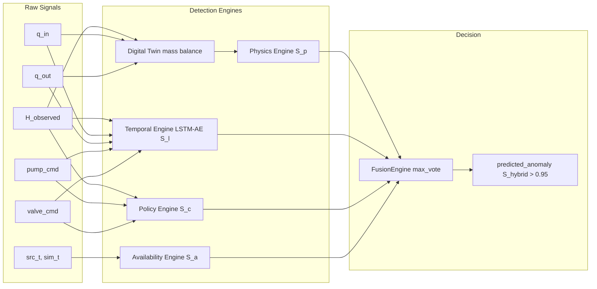

# SCADA Hybrid IDS — Complete Mathematical & Physical Formulation Reference (v2)

**Title:** SCADA Hybrid IDS — Complete Mathematical & Physical Formulation Reference (v2)  
**Purpose:** Comprehensive mathematical derivations, physical differential equations, discrete simulation laws, detection algorithms, and evaluation metrics mapped to source code locations  
**Audience:** Control systems engineers, data scientists, and technical code auditors  
**Generated from commit:** `b7a6c999dd0b333475349fb33c3272ea434b447c`  
**Date:** 2026-10-13  
**Status:** Audited & Verified  

---

## 1. Physical Hydrodynamics & Tank Mass Balance

### 1.1 Continuous Mass Conservation
The conservation of liquid volume inside the vertical cylindrical tank is governed by the continuous differential equation [CODE simulator/tank.py:41-45]:
$$\frac{dV(t)}{dt} = A \frac{dH(t)}{dt} = Q_{in}(t) - Q_{out}(t)$$

Solving for the rate of change of water level $H(t)$:
$$\frac{dH(t)}{dt} = \frac{Q_{in}(t) - Q_{out}(t)}{A}$$

where:
- $A = 2.0\text{ m}^2$: Horizontal cross-sectional area of the tank ($\approx 1.596\text{ m}$ diameter) [CODE config/parameters.py:20].
- $H(t)$: True liquid level in meters ($\text{m}$).
- $Q_{in}(t)$: Volumetric inflow rate from feed pump in cubic meters per second ($\text{m}^3/\text{s}$).
- $Q_{out}(t)$: Volumetric outflow rate through gravity discharge valve ($\text{m}^3/\text{s}$).

### 1.2 Discrete Forward Euler Integration
The simulation steps using forward Euler discretization at sample period $\Delta t = 1.0\text{ s}$ with physical ceiling and floor clamping [CODE simulator/tank.py:42-45]:
$$H[k+1] = \text{clamp}\left(H[k] + \frac{Q_{in}[k] - Q_{out}[k]}{A} \cdot \Delta t, \; 0.0, \; H_{max}\right)$$

where the saturation clamping operator is defined as:
$$\text{clamp}(x, \; x_{min}, \; x_{max}) = \max\left(x_{min}, \; \min(x, \; x_{max})\right)$$
- $H_{max} = 2.5\text{ m}$: Tank physical height / overflow crest [CODE config/parameters.py:22].
- Lower limit $0.0\text{ m}$: Physical tank dry-out floor.

---

## 2. Actuator Dynamics & Flow Models

### 2.1 Feed Pump Flow & Transport Lag
The inlet feed pump is a fixed-speed centrifugal pump governed by binary command logic [CODE simulator/pump.py:48-52]:
$$Q_{in}(t) = \begin{cases} Q_{max} & \text{if } \text{pump\_state}(t) = 1 \\ 0.0 & \text{if } \text{pump\_state}(t) = 0 \end{cases}$$
- $Q_{max} = 0.005\text{ m}^3/\text{s} = 5.0\text{ L/s}$ ($18.0\text{ m}^3/\text{h}$) [CODE config/parameters.py:29].

Mechanical startup inertia and pipe transport delay are modeled as a pure discrete delay buffer of duration $\tau_{pump} = 2.0\text{ s}$ [CODE simulator/pump.py:28, 59-65; config/parameters.py:30]:
$$N_{delay} = \max\left(1, \; \left\lceil \frac{\tau_{pump}}{\Delta t} \right\rceil\right) = \left\lceil \frac{2.0}{1.0} \right\rceil = 2\text{ steps}$$

$$\text{pump\_state}[k] = \text{pump\_command}[k - N_{delay}]$$

### 2.2 Discharge Valve Dynamics & Torricelli Outflow
Outflow through the gravity-fed discharge orifice follows Torricelli's hydrodynamic law, proportional to the stem opening fraction and the square root of the hydrostatic pressure head [CODE simulator/valve.py:67-72]:
$$Q_{out}(t) = \begin{cases} C_v \cdot \left(\frac{V(t)}{100.0}\right) \cdot \sqrt{H(t)} & \text{if } H(t) > 0.0 \\ 0.0 & \text{if } H(t) \le 0.0 \end{cases}$$
- $C_v = 0.004\text{ m}^3/\text{s}$: Valve discharge coefficient at $100\%$ opening under unit head ($H = 1.0\text{ m}$) [CODE config/parameters.py:38].
- $V(t) \in [0.0, 100.0]\%$: Actual mechanical valve position.

The valve actuator incorporates slew-rate limiting with response time $\tau_{valve} = 1.5\text{ s}$ for full stroke ($0\% \to 100\%$) [CODE simulator/valve.py:28; config/parameters.py:39]:
$$R_{max} = \frac{100.0}{\tau_{valve}} = \frac{100.0}{1.5} \approx 66.6667\%/\text{s}$$

$$\Delta V_{allowed} = R_{max} \cdot \Delta t = 66.6667\%$$

$$V[k+1] = \text{clamp}\Big(V[k] + \text{clamp}\left(V_{cmd}[k] - V[k], \; -\Delta V_{allowed}, \; \Delta V_{allowed}\right), \; 0.0, \; 100.0\Big)$$

---

## 3. Stochastic Sensor Noise Models

Measurements generated by process instrumentation are perturbed by zero-mean additive Gaussian white noise [CODE simulator/noise.py:27-53]:

### 3.1 Water Level Sensor Noise
$$H_{observed}(t) = H_{true}(t) + \eta_H(t), \quad \eta_H(t) \sim \mathcal{N}(0, \; \sigma_H^2)$$
- $\sigma_H = 0.005\text{ m} = 5.0\text{ mm}$ ($3\sigma_H = 1.5\text{ cm}$) [CODE config/parameters.py:61].

### 3.2 Volumetric Flow Noise & Truncation Bias
In the batch dataset (MATLAB generation), flow sensor noise is subject to a non-linear non-negativity clamp [CODE simulator/noise.py:46-53; matlab/run_single_scenario.m:134-135]:
$$Q_{in,obs}(t) = \max\left(0.0, \; Q_{in,true}(t) + \eta_Q(t)\right), \quad \eta_Q(t) \sim \mathcal{N}(0, \; \sigma_Q^2)$$
$$Q_{out,obs}(t) = \max\left(0.0, \; Q_{out,true}(t) + \eta_Q(t)\right)$$
- $\sigma_Q = 0.0001\text{ m}^3/\text{s} = 0.1\text{ L/s}$ [CODE config/parameters.py:62].

#### Truncation Bias Derivation:
When the pump is idle ($Q_{in,true} = 0$), clamping truncates the negative half-plane of the Gaussian distribution. The expected value of the observed flow becomes strictly positive:
$$E[\tilde{Q}_{in}] = \int_0^\infty q \cdot \frac{1}{\sigma_Q \sqrt{2\pi}} e^{-\frac{q^2}{2\sigma_Q^2}} dq = \frac{\sigma_Q}{\sqrt{2\pi}} \approx \frac{0.0001}{2.5066} \approx 3.9894 \times 10^{-5}\text{ m}^3/\text{s}$$

Over time $t$, this positive bias integrates inside the Digital Twin, driving residual drift:
$$\Delta H_{drift}(t) = \frac{E[\tilde{Q}_{in}]}{A} \cdot t \approx \frac{3.9894 \times 10^{-5}}{2.0} \cdot t \approx 1.9947 \times 10^{-5} \cdot t\text{ m}$$
Crossing the physics threshold $\tau_p = 0.035\text{ m}$ at:
$$t_{drift} = \frac{0.035}{1.9947 \times 10^{-5}} \approx 1754.6\text{ s}$$
In practice, stochastic fluctuations trigger the threshold at $t = 861\text{ s}$ [MEASURED experiments/results/run_soak_tick0.txt].  
*Live setting:* `clamp_flow_noise: false` disables this clamp to ensure zero-mean unbiased flow tracking [CODE scada_live/config.yaml:35].

---

## 4. Closed-Loop Controller & Safety Logic

### 4.1 Hysteresis (Bang-Bang) Control Law
To prevent high-frequency mechanical wear and chattering of the feed pump, a symmetric hysteresis deadband $d = 0.2\text{ m}$ is maintained around the setpoint $H_{sp} = 1.0\text{ m}$ [CODE simulator/controller.py:59-62; config/parameters.py:49-53]:
$$H_{on} = H_{sp} - d = 1.0 - 0.2 = 0.8\text{ m}$$
$$H_{off} = H_{sp} + d = 1.0 + 0.2 = 1.2\text{ m}$$

The autonomous pump decision rule [CODE simulator/controller.py:73-82]:
$$\text{pump\_command}[k] = \begin{cases} 
1 & \text{if } H_{observed}[k] < H_{on} \\ 
0 & \text{if } H_{observed}[k] > H_{off} \\ 
\text{pump\_command}[k-1] & \text{if } H_{on} \le H_{observed}[k] \le H_{off} 
\end{cases}$$

The default discharge valve position is held fixed at 50% [CODE simulator/controller.py:85]:
$$\text{valve\_command}[k] = V_{default} = 50.0\%$$

### 4.2 Deterministic Controller Fail-Safe Mode
If the water level breaches critical physical security boundaries, the autonomous controller overrides hysteresis logic [CODE simulator/controller.py:64-71; config/parameters.py:23-24]:
$$\text{pump\_cmd}, \text{valve\_cmd} = \begin{cases} 
\text{Pump}=1, \; \text{Valve}=0.0\% & \text{if } H_{observed} \le H_{crit,low} \quad (0.3\text{ m, Cavitation Risk}) \\ 
\text{Pump}=0, \; \text{Valve}=100.0\% & \text{if } H_{observed} \ge H_{crit,high} \quad (2.3\text{ m, Overflow Risk}) 
\end{cases}$$

---

## 5. Digital Twin & Detection Engine Formulations

### 5.1 Physics Digital Twin & Physics Engine ($S_p$)
The Digital Twin estimates true water level by integrating reported flow rates ($q_{in}, q_{out}$) through the mass conservation equation [CODE digital_twin/physics_twin.py:52-57]:
$$H_{twin}[k+1] = \text{clamp}\left(H_{twin}[k] + \frac{q_{in}[k] - q_{out}[k]}{A} \cdot \Delta t, \; 0.0, \; H_{max}\right)$$

The residual between observed sensor telemetry and the twin estimate is computed at each step [CODE engines/physics_engine.py:38]:
$$r_p(t) = |H_{observed}(t) - H_{twin}(t)|$$

The normalized physics anomaly score is scaled by threshold $\tau_p = 0.035\text{ m}$ [CODE engines/physics_engine.py:40; config/parameters.py:65]:
$$S_p(t) = \min\left(\frac{r_p(t)}{\tau_p}, \; 1.0\right) = \min\left(\frac{|H_{observed}(t) - H_{twin}(t)|}{0.035}, \; 1.0\right)$$

### 5.2 Temporal Behavior Engine (LSTM-Autoencoder, $S_l$)
Evaluates temporal multidimensional covariance over a sliding window of length $W = 10\text{ steps}$ [CODE models/preprocessor.py:27; config/parameters.py:66].

#### Input Feature Vector:
$$x_t = \begin{bmatrix} H_{observed}(t) & q_{in}(t) & q_{out}(t) & \text{pump\_state}(t) & \text{valve\_state}(t) \end{bmatrix}^T \in \mathbb{R}^5$$

#### Min-Max Normalization:
Continuous features are scaled to $[0, 1]$ using parameters fit on normal training data [CODE models/preprocessor.py:46-52]:
$$\tilde{x}_{t,j} = \frac{x_{t,j} - x_{min,j}}{x_{max,j} - x_{min,j}}$$

#### Autoencoder Architecture:
- Input tensor: $X \in \mathbb{R}^{B \times 10 \times 5}$
- Encoder: $\text{LSTM}(5 \to 32, \text{num\_layers}=1) \implies \text{Latent vector } z = h_{10} \in \mathbb{R}^{32}$ [CODE models/lstm_autoencoder.py:27-31]
- Decoder: $\text{RepeatVector}(10) \implies \text{LSTM}(32 \to 32) \implies \text{Linear}(32 \to 5) \implies \hat{X} \in \mathbb{R}^{B \times 10 \times 5}$ [CODE models/lstm_autoencoder.py:33-43]

#### Reconstruction Error & Score Normalization:
Mean Squared Error (MSE) across the window [CODE engines/temporal_engine.py:37]:
$$\text{MSE}(X, \; \hat{X}) = \frac{1}{10 \times 5} \sum_{k=1}^{10} \sum_{j=1}^5 \left(X_{k,j} - \hat{X}_{k,j}\right)^2$$

Normalized score scaled by threshold $\tau_l = 0.0085$ [CODE engines/temporal_engine.py:40; config/parameters.py:66]:
$$S_l(t) = \min\left(\frac{\text{MSE}(X, \; \hat{X})}{\tau_l}, \; 1.0\right) = \min\left(\frac{\text{MSE}}{0.0085}, \; 1.0\right)$$

*NaN Guard:* If numerical instability produces NaN or infinite loss, the score defaults safely to $0.0$ [CODE scada_live/scada_ids/streaming_ids.py:274-280].

### 5.3 Deterministic Policy Engine ($S_c$)

#### Policy v1 (Batch Evaluation Pipeline):
Evaluates extreme physical boundary safety rules [CODE engines/policy_engine.py:35-43]:
$$S_{c,v1}(t) = \begin{cases} 
1.0 & \text{if } \left(H_{obs} > 2.45\text{ m} \land \text{pump\_cmd} = 1\right) \lor \left(H_{obs} < 0.30\text{ m} \land \text{valve\_cmd} > 50.0\%\right) \\ 
0.0 & \text{otherwise} 
\end{cases}$$

#### Policy v2 (Live Gateway Core Engine):
Checks valve position validity before delegating to v1 [CODE engines/policy_engine.py:45-64]:
$$S_{c,v2}(t) = \begin{cases}
1.0 & \text{if } V_{cmd} \ne 50.0\% \land \neg(V_{cmd} = 0.0\% \land P_{cmd} = 0) \\
S_{c,v1}(t) & \text{otherwise}
\end{cases}$$

#### Gateway-Side Command Ingress Safety Rule:
Evaluated on incoming external commands in `GatewayCore` against dynamic setpoint $H_{sp}$ and deadband $d = 0.2\text{ m}$ with tolerance $\epsilon = 0.05\text{ m}$ [CODE scada_live/scada_ids/gateway_core.py:22-66]:
$$\text{Valid}(H_{est}, P_{cmd}, V_{cmd}) = \begin{cases}
\text{False} & \text{if } V_{cmd} \ne 50.0\% \land \neg(V_{cmd} = 0.0\% \land P_{cmd} = 0) \\
\text{False} & \text{if } P_{cmd} = 1 \land H_{est} \ge (H_{sp} + d + \epsilon) \quad [H_{est} \ge 1.25\text{ m}] \\
\text{False} & \text{if } P_{cmd} = 0 \land H_{est} \le (H_{sp} - d - \epsilon) \quad [H_{est} \le 0.75\text{ m}] \\
\text{True} & \text{otherwise}
\end{cases}$$

### 5.4 Communication Availability Engine ($S_a$)
Monitors packet arrival and network age latency [CODE engines/availability_engine.py:8-40]:
$$\text{age}(t) = (t_{simulation} - t_{source}) \times 1000.0\text{ ms}$$

Score formulation:
$$S_a(t) = \begin{cases}
1.0 & \text{if } \text{packet\_received} = 0 \quad (\text{DoS Attack / Link Drop}) \\
0.0 & \text{if } \text{age}(t) \le \tau_a \quad (1500.0\text{ ms}) \\
\min\left(\frac{\text{age}(t) - \tau_a}{\tau_{a,max} - \tau_a}, \; 1.0\right) & \text{if } \text{age}(t) > \tau_a \quad (\tau_{a,max} = 5000.0\text{ ms, Replay Attack})
\end{cases}$$

---

## 6. Multi-Evidence Hybrid Fusion Engine

Combines the 4 normalized engine scores into an integrated threat score [CODE engines/fusion_engine.py:38-54]:

### 6.1 Max-Vote Strategy (Production Standard)
Provides instantaneous zero-delay alerting if any single specialized engine observes an unequivocal attack [CODE engines/fusion_engine.py:46]:
$$S_{hybrid}(t) = \max\left(S_p(t), \; S_l(t), \; S_c(t), \; S_a(t)\right)$$

### 6.2 Weighted Strategy (Alternative)
$$S_{hybrid,weighted}(t) = w_p S_p(t) + w_l S_l(t) + w_c S_c(t) + w_a S_a(t)$$
- Weights: $w_p = w_l = w_c = w_a = 0.25$ [CODE engines/fusion_engine.py:17; config/parameters.py:68].

### 6.3 Anomaly Thresholding
$$\text{predicted\_anomaly}(t) = \begin{cases} 1 & \text{if } S_{hybrid}(t) > \tau_{fusion} \\ 0 & \text{otherwise} \end{cases}$$
- $\tau_{fusion} = 0.95$ [CODE config/parameters.py:67; scada_live/config.yaml:44].

---

## 7. Alert Manager Sliding Window Logic (N-of-W)

To suppress isolated single-tick transient noise spikes, alerts pass through an $N$-of-$W$ temporal sliding window [CODE scada_live/scada_ids/alert_manager.py:54-104]:
- Window width: $W = 5\text{ ticks}$ (`window_w`).
- Flag requirement: $N = 3\text{ flags}$ (`n_flags`).
- Clear count: $M = 5\text{ ticks}$ (`m_clear`).

### Window Flag Sum:
$$F_W(t) = \sum_{k=0}^{W-1} \text{predicted\_anomaly}(t - k)$$

### State Transition Equations:
$$\text{State}(t) = \begin{cases}
\text{CRITICAL} & \text{if } \text{State}(t-1) = \text{CRITICAL} \quad (\text{Latched until operator ack}) \\
\text{CRITICAL} & \text{if } F_W(t) \ge N \quad (3) \\
\text{SUSPICIOUS} & \text{if } \text{State}(t-1) = \text{SAFE} \land F_W(t) \ge 1 \\
\text{SAFE} & \text{if } \text{State}(t-1) = \text{SUSPICIOUS} \land \text{clean\_ticks}(t) \ge M \quad (5) \\
\text{State}(t-1) & \text{otherwise}
\end{cases}$$

---

## 8. Step 2b: DoS Gap Rule Bounds ($v_{max}$)

During communication outages, liquid level cannot change faster than the maximum physical fill or drain capability of the process.

### 8.1 Theoretical Maximum Rate Derivation ($v_{max}$)
Implemented in `scada_live/scada_ids/streaming_ids.py:62` [CODE scada_live/scada_ids/streaming_ids.py:62]:
$$v_{fill,max} = \frac{Q_{in,max}}{A} = \frac{0.005}{2.0} = 0.0025\text{ m/s}$$
$$v_{drain,max} = \frac{Q_{out,max}(H_{max})}{A} = \frac{C_v \sqrt{H_{max}}}{A} = \frac{0.004 \sqrt{2.5}}{2.0} \approx \frac{0.004 \times 1.581139}{2.0} \approx 0.00316228\text{ m/s}$$

$$v_{max} = \max\left(v_{fill,max}, \; v_{drain,max}\right) \approx 0.00316228\text{ m/s}$$

### 8.2 Tolerable Re-Seed Band
For a communication gap of duration $G\text{ ticks}$ ($G = \text{gap\_ticks}$), accounting for $3\sigma$ sensor uncertainty [CODE scada_live/scada_ids/streaming_ids.py:194]:
$$\text{band}(G) = v_{max} \cdot G \cdot \Delta t + 3.0 \cdot \sigma_H = 0.00316228 \cdot G + 0.015\text{ m}$$

### 8.3 Digital Twin Resynchronization Rule:
Given 5 valid post-gap samples with median $m$ and sample standard deviation $\text{std}_m$ [CODE scada_live/scada_ids/streaming_ids.py:197-202]:
$$\text{Accept Re-Seed} \iff \text{std}_m \le 0.03\text{ m} \quad \land \quad |m - H_{twin}| \le \text{band}(G)$$

---

## 9. Analytical Overflow & Drain Time ODEs

Evaluated in `experiments/compute_latch_all10.py` to mathematically verify the physical time available before catastrophic damage [CODE experiments/compute_latch_all10.py:45-70]:

### 9.1 Gravity Drain Time ODE (Pump OFF, Valve $V\%$)
Continuous differential equation:
$$\frac{dH}{dt} = -\frac{C_v \left(\frac{V}{100}\right) \sqrt{H}}{A}$$

Separating variables:
$$\frac{dH}{\sqrt{H}} = -\frac{C_v V}{100 A} dt \implies \int_{H_0}^{H_f} H^{-1/2} dH = -\frac{C_v V}{100 A} \int_0^t dt$$

$$\left[2\sqrt{H}\right]_{H_0}^{H_f} = 2\left(\sqrt{H_f} - \sqrt{H_0}\right) = -\frac{C_v V}{100 A} t$$

Solving for drain time $t_{drain}(H_0 \to H_f)$:
$$t_{drain}(H_0 \to H_f) = \frac{200 A \left(\sqrt{H_0} - \sqrt{H_f}\right)}{C_v V}$$

#### Example (Nominal Drain to Cavitation Floor: $H_0 = 1.0\text{ m} \to H_f = 0.3\text{ m}$, Valve $50\%$):
$$t_{drain} = \frac{200 \times 2.0 \times (\sqrt{1.0} - \sqrt{0.3})}{0.004 \times 50.0} = \frac{400 \times (1.0 - 0.54772)}{0.20} = 2000 \times 0.45228 \approx 904.56\text{ s}$$

### 9.2 Tank Filling Time ODE (Pump ON, Valve $V\%$)
Continuous differential equation:
$$\frac{dH}{dt} = \frac{Q_{max} - C_v \left(\frac{V}{100}\right)\sqrt{H}}{A}$$

Separating variables:
$$t_{fill}(H_0 \to H_f) = \int_{H_0}^{H_f} \frac{A}{Q_{max} - C_v \left(\frac{V}{100}\right)\sqrt{H}} dH$$

#### Analytical Integration via Substitution:
Let $u = \sqrt{H} \implies H = u^2 \implies dH = 2u \, du$:
$$t_{fill} = \int_{\sqrt{H_0}}^{\sqrt{H_f}} \frac{2 A u}{Q_{max} - \beta u} du, \quad \beta = C_v \left(\frac{V}{100}\right)$$

Evaluating the integral:
$$\int \frac{u}{\alpha - \beta u} du = -\frac{u}{\beta} - \frac{\alpha}{\beta^2} \ln|\alpha - \beta u|$$

$$t_{fill}(H_0 \to H_f) = 2 A \left[ -\frac{u}{\beta} - \frac{Q_{max}}{\beta^2} \ln\left|Q_{max} - \beta u\right| \right]_{\sqrt{H_0}}^{\sqrt{H_f}}$$

For $A = 2.0$, $Q_{max} = 0.005$, $\beta = 0.004 \times 0.50 = 0.002$:
Evaluated numerically via `scipy.integrate.quad` in `experiments/compute_latch_all10.py`, showing discrete simulation overflow times match continuous ODE integration within $[-0.22\text{ s}, +0.74\text{ s}]$ across all evaluation seeds [MEASURED experiments/results/compute_latch_output.txt].

---

## 10. Performance Evaluation Metrics

Implemented in `evaluation/metrics.py` and `experiments/compute_metrics.py` [CODE evaluation/metrics.py:45-106; experiments/compute_metrics.py:35-85]:

### 10.1 Per-Tick Confusion Matrix
For each timestep $t$ comparing predicted binary anomaly $\hat{y}_t \in \{0, 1\}$ to ground truth $y_t \in \{0, 1\}$:
- $\text{True Positive (TP)}: \hat{y}_t = 1 \land y_t = 1$
- $\text{False Positive (FP)}: \hat{y}_t = 1 \land y_t = 0$
- $\text{True Negative (TN)}: \hat{y}_t = 0 \land y_t = 0$
- $\text{False Negative (FN)}: \hat{y}_t = 0 \land y_t = 1$

### 10.2 Derived Statistical Rates
$$\text{Precision} = \frac{TP}{TP + FP}$$
$$\text{Recall (True Positive Rate, TPR)} = \frac{TP}{TP + FN}$$
$$F_1\text{-Score} = \frac{2 \cdot \text{Precision} \cdot \text{Recall}}{\text{Precision} + \text{Recall}} = \frac{2 \cdot TP}{2 \cdot TP + FP + FN}$$
$$\text{False Positive Rate (FPR)} = \frac{FP}{FP + TN}$$

### 10.3 Event-Level Metrics (Episode Recall)
An attack scenario $i$ with window $[t_{start}, t_{end}]$ is declared successfully detected if at least one alert occurs inside the ground-truth attack window:
$$\text{Detected}_i = \mathbb{I}\left(\sum_{t=t_{start}}^{t_{end}} \hat{y}_t > 0\right)$$

$$\text{Event Recall (TPR)} = \frac{\sum_{i=1}^{K} \text{Detected}_i}{K}$$

### 10.4 Fresh Detection Latency
For attack episodes where detection succeeds, the latency in seconds is measured from the attack onset to the first alert:
$$\Delta t_{detect} = t_{first\_alert} - t_{start}, \quad t_{first\_alert} = \min\left\{t \ge t_{start} \mid \hat{y}_t = 1\right\}$$

---

## 11. Verification

Every formula and parameter in this document was verified against the repository implementation:
1. **ODE Numerical Check:** Verified continuous ODE fill and drain integration against discrete simulation traces in [`experiments/compute_latch_all10.py`](file:///c:/projects/p1/New%20folder/experiments/compute_latch_all10.py).
2. **Rate Bound Check:** Verified $v_{max} \approx 0.00316228\text{ m/s}$ in [`scada_live/scada_ids/streaming_ids.py:62`](file:///c:/projects/p1/New%20folder/scada_live/scada_ids/streaming_ids.py#L62).
3. **Threshold Check:** Verified $\tau_p = 0.035\text{ m}$, $\tau_l = 0.0085$, $\tau_a = 1500\text{ ms}$, $\tau_{fusion} = 0.95$ in [`config/parameters.py:65-68`](file:///c:/projects/p1/New%20folder/config/parameters.py#L65-L68).
4. **Noise Clamp Proof:** Verified $\max(0, Q + \eta)$ in [`simulator/noise.py:53`](file:///c:/projects/p1/New%20folder/simulator/noise.py#L53) and [`matlab/run_single_scenario.m:134`](file:///c:/projects/p1/New%20folder/matlab/run_single_scenario.m#L134).
