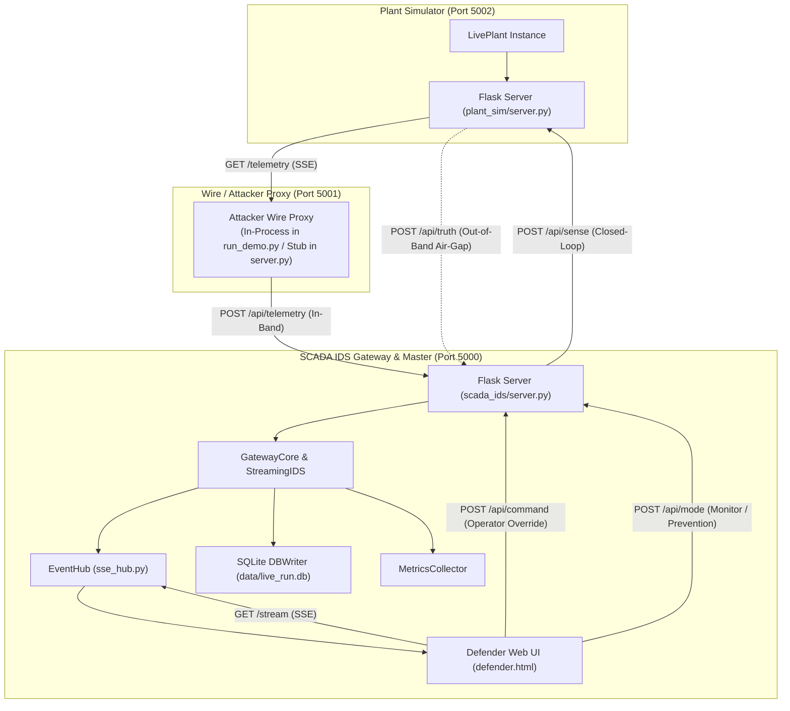
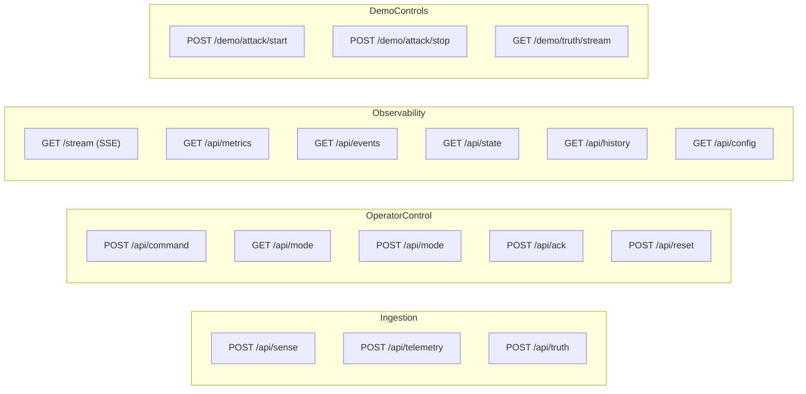
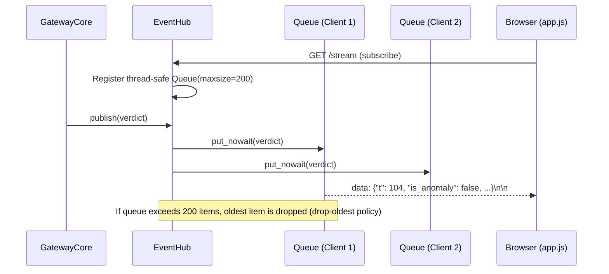

# 05 - API and Packet Reference

**Title:** API and Packet Reference  
**Purpose:** Comprehensive specification for all HTTP endpoints, Server-Sent Events (SSE) streams, network packet schemas, event hub semantics, and truth-channel isolation mechanisms across the live SCADA IDS system.  
**Audience:** Security auditors, backend engineers, systems integrators, and plant operators.  
**Generated From Commit:** `3152c35`  
**Date:** 2026-10-13  
**Status:** Active & 100% Code-Verified  

---

## 1. Network Topology and Service Architecture

The SCADA Hybrid IDS live system operates across three logical tiers connected via HTTP REST and Server-Sent Events (SSE) [CODE [scada_live/config.yaml:70-76](file:///c:/projects/p1/New%20folder/scada_live/config.yaml#L70-L76)]:



### Port and Binding Allocations

| Component | Default Host | Default Port | Config Key | Implementation File | Status |
| :--- | :--- | :--- | :--- | :--- | :--- |
| **SCADA IDS & Gateway** | `127.0.0.1` | `5000` | `network.scada_host`, `network.scada_port` | [scada_live/scada_ids/server.py:411](file:///c:/projects/p1/New%20folder/scada_live/scada_ids/server.py#L411) | **Active** (21 Flask routes + UI) |
| **Attacker Wire Proxy** | `127.0.0.1` | `5001` | `network.attacker_host`, `network.attacker_port` | [scada_live/attacker_wire/server.py:1](file:///c:/projects/p1/New%20folder/scada_live/attacker_wire/server.py#L1) | **Stub** (Unified in [run_demo.py](file:///c:/projects/p1/New%20folder/run_demo.py)) |
| **Plant Simulator** | `127.0.0.1` | `5002` | `network.plant_host`, `network.plant_port` | [scada_live/plant_sim/server.py:80](file:///c:/projects/p1/New%20folder/scada_live/plant_sim/server.py#L80) | **Active** (3 Flask routes + background ODE thread) |
| **Legacy Replay Dashboard** | `127.0.0.1` | `5000` | N/A (Standalone Flask app) | [dashboard/app.py:19-78](file:///c:/projects/p1/New%20folder/dashboard/app.py#L19-L78) | **Active** (3 Flask routes for offline data exploration) |

[CODE [scada_live/config.yaml:70-76](file:///c:/projects/p1/New%20folder/scada_live/config.yaml#L70-L76), [scada_live/scada_ids/server.py:410-412](file:///c:/projects/p1/New%20folder/scada_live/scada_ids/server.py#L410-L412), [scada_live/plant_sim/server.py:75-81](file:///c:/projects/p1/New%20folder/scada_live/plant_sim/server.py#L75-L81)].

---

## 2. Packet Schemas and Data Models

Network packet structures are defined in [scada_live/common/packets.py](file:///c:/projects/p1/New%20folder/scada_live/common/packets.py) using Python `@dataclass`.

### 2.1 `TelemetryPacket`

Represents a single discrete time-step observation transmitted from the physical plant sensors across the network to the SCADA gateway [CODE [scada_live/common/packets.py:3-42](file:///c:/projects/p1/New%20folder/scada_live/common/packets.py#L3-L42)].

```python
@dataclass
class TelemetryPacket:
    seq: int
    run_id: str
    ts: float
    src_t: float
    received: bool
    level_m: float
    q_in: float
    q_out: float
    pump_on: bool
    pump_cmd: int
    valve_pct: float
    valve_cmd: float
    _true_level: float = 0.0
    _attack_active: bool = False
    _attack_type: str = "None"
```

#### Field Specifications

| Field Name | Wire / Truth | Type | Range / Units | Description |
| :--- | :--- | :--- | :--- | :--- |
| `seq` | **Wire** | `int` | $\ge 0$ | Monotonically increasing simulation sequence tick index. |
| `run_id` | **Wire** | `str` | Alphanumeric | Unique scenario or session run identifier (e.g., `"live_run"` or `"demo_run_reset"`). |
| `ts` | **Wire** | `float` | $\ge 0.0\text{ s}$ | Master wall/simulation clock timestamp assigned by the plant simulator. |
| `src_t` | **Wire** | `float` | $\ge 0.0\text{ s}$ | Sensor source timestamp (freezes under DoS replay or packet drop). |
| `received` | **Wire** | `bool` | `True` / `False` | Network arrival flag (`False` indicates network packet drop / DoS). |
| `level_m` | **Wire** | `float` | $[0.0, 2.5]\text{ m}$ | Observed water level at the sensor tap (includes sensor Gaussian noise and FDI offsets). |
| `q_in` | **Wire** | `float` | $\ge 0.0\text{ m}^3/\text{s}$ | Inflow rate measured by flow sensor (nominal $0.003\text{ m}^3/\text{s}$ when pump is ON). |
| `q_out` | **Wire** | `float` | $\ge 0.0\text{ m}^3/\text{s}$ | Outflow rate measured by discharge sensor ($C_v \cdot (u_v/100) \cdot \sqrt{2gH}$). |
| `pump_on` | **Wire** | `bool` | `True` / `False` | Physical pump state reported by telemetry. |
| `pump_cmd` | **Wire** | `int` | `0` or `1` | Actuator control register state for pump (`0` = OFF, `1` = ON). |
| `valve_pct` | **Wire** | `float` | $[0.0, 100.0]\%$ | Physical valve opening percentage reported by telemetry. |
| `valve_cmd` | **Wire** | `float` | $[0.0, 100.0]\%$ | Actuator control register state for outflow valve. |
| `_true_level` | **Truth** | `float` | $\ge 0.0\text{ m}$ | Physical uncorrupted tank height from continuous ODE integrator (never seen by IDS). |
| `_attack_active` | **Truth** | `bool` | `True` / `False` | Out-of-band indicator whether an attack is actively corrupting signals. |
| `_attack_type` | **Truth** | `str` | Category | True attack label (`"None"`, `"FDI"`, `"Replay"`, `"DoS"`, `"Auth misuse"`). |

#### Truth Channel Air-Gap Methods

To ensure evaluation integrity, `TelemetryPacket` provides methods to strip ground-truth labels before wire transmission:
- `strip_truth() -> dict`: Returns a dictionary containing wire fields only (all keys starting with `_` are deleted) [CODE [scada_live/common/packets.py:33-36](file:///c:/projects/p1/New%20folder/scada_live/common/packets.py#L33-L36)].
- `truth_only() -> dict`: Returns a dictionary containing only the out-of-band truth fields (`_true_level`, `_attack_active`, `_attack_type`) [CODE [scada_live/common/packets.py:38-41](file:///c:/projects/p1/New%20folder/scada_live/common/packets.py#L38-L41)].

---

### 2.2 `CommandPacket`

Represents an actuator directive transmitted from the SCADA gateway or an external operator to the plant simulator [CODE [scada_live/common/packets.py:43-57](file:///c:/projects/p1/New%20folder/scada_live/common/packets.py#L43-L57)].

```python
@dataclass
class CommandPacket:
    seq: int
    ts: float
    src: str
    cmd: str
    value: str
```

#### Field Specifications

| Field Name | Type | Allowed Values | Description |
| :--- | :--- | :--- | :--- |
| `seq` | `int` | $\ge 0$ | Command sequence counter. |
| `ts` | `float` | $\ge 0.0\text{ s}$ | Issuance timestamp. |
| `src` | `str` | `"scada_master"`, `"operator"`, `"attacker"` | Originating entity. |
| `cmd` | `str` | `"PUMP"` | Target actuator sub-system (`"PUMP"` supported in `plant_sim`). |
| `value` | `str` | `"ON"`, `"OFF"` | Target command state string. |

---

## 3. SCADA IDS Server API Reference (`scada_ids/server.py`)

The SCADA IDS server exposes 21 endpoints handling telemetry ingestion, closed-loop sensing, operator controls, dynamic configuration, metrics aggregation, SSE broadcasting, and attack simulation [CODE [scada_live/scada_ids/server.py:37-409](file:///c:/projects/p1/New%20folder/scada_live/scada_ids/server.py#L37-L409)].



---

### Route Catalog

#### 1. Closed-Loop Sensor Ingress (`POST /api/sense`)
- **Path:** `/api/sense`
- **Method:** `POST`
- **Purpose:** Ingests the current water level from the plant simulator, determines autonomous control actions, evaluates external holds against physical safety constraints, applies digital twin level substitution under active takeover, and returns actuator directives [CODE [scada_live/scada_ids/server.py:37-44](file:///c:/projects/p1/New%20folder/scada_live/scada_ids/server.py#L37-L44), [scada_live/scada_ids/gateway_core.py:249-335](file:///c:/projects/p1/New%20folder/scada_live/scada_ids/gateway_core.py#L249-L335)].
- **Request Body (JSON):**
  ```json
  {
    "level_m": 1.152
  }
  ```
- **Response (200 OK):**
  ```json
  {
    "pump_cmd": 1,
    "valve_cmd": 50.0,
    "level_source": "sensor",
    "active_level": 1.152,
    "action_taken": "none"
  }
  ```
  *(Under Twin Takeover in Prevention mode, `level_source` becomes `"twin"`, `active_level` contains the Digital Twin estimate, and `action_taken` reports `"twin_takeover"`).*
- **Error Responses:**
  - `400 Bad Request`: `{"error": "Missing level_m"}` if body is missing or lacks `level_m`.

---

#### 2. Telemetry Ingestion (`POST /api/telemetry`)
- **Path:** `/api/telemetry`
- **Method:** `POST`
- **Purpose:** Receives full sensor telemetry packet across the network wire, verifies packet schema, updates detection engines, checks actuator consistency (wire tamper), evaluates alert state machine, logs to SQLite (`live_ticks`), and publishes the verdict to `/stream` [CODE [scada_live/scada_ids/server.py:46-58](file:///c:/projects/p1/New%20folder/scada_live/scada_ids/server.py#L46-L58)].
- **Request Body (JSON):**
  ```json
  {
    "seq": 104,
    "run_id": "live_run",
    "ts": 104.0,
    "src_t": 104.0,
    "received": true,
    "level_m": 1.148,
    "q_in": 0.003,
    "q_out": 0.0019,
    "pump_on": true,
    "pump_cmd": 1,
    "valve_pct": 50.0,
    "valve_cmd": 50.0
  }
  ```
- **Response (200 OK):**
  ```json
  {
    "ok": true,
    "seq": 104
  }
  ```
- **Error Responses:**
  - `400 Bad Request`: `{"error": "Empty body"}` or `{"error": "Invalid packet format: <details>"}`.

---

#### 3. Ground Truth Ingress (`POST /api/truth`)
- **Path:** `/api/truth`
- **Method:** `POST`
- **Purpose:** Ingests uncorrupted physical state and attack labels out-of-band directly from the simulation harness into `MetricsCollector`. Truth data is completely segregated from detection decisions and is NOT forwarded to `/stream` [CODE [scada_live/scada_ids/server.py:60-82](file:///c:/projects/p1/New%20folder/scada_live/scada_ids/server.py#L60-L82)].
- **Request Body (JSON):**
  ```json
  {
    "run_id": "live_run",
    "seq": 104,
    "ts": 104.0,
    "true_level": 1.150,
    "attack_active": false,
    "attack_type": "None",
    "overflow": false,
    "dry_run": false
  }
  ```
- **Response (200 OK):**
  ```json
  {
    "ok": true
  }
  ```
- **Error Responses:**
  - `400 Bad Request`: `{"error": "Missing field <key>"}` if mandatory fields (`run_id`, `seq`, `true_level`) are absent.

---

#### 4. Live Telemetry & Verdict Event Stream (`GET /stream`)
- **Path:** `/stream`
- **Method:** `GET`
- **Purpose:** Provides a persistent Server-Sent Events (SSE) feed (`text/event-stream`) for the web dashboard and remote observers. Transmits per-tick enriched verdicts, wire tamper alerts, and command filter actions [CODE [scada_live/scada_ids/server.py:84-103](file:///c:/projects/p1/New%20folder/scada_live/scada_ids/server.py#L84-L103)].
- **Security Constraint:** Air-gapped: Truth events (`msg.get('event') == 'truth'`) are explicitly filtered out [CODE [scada_live/scada_ids/server.py:93-94](file:///c:/projects/p1/New%20folder/scada_live/scada_ids/server.py#L93-L94)].
- **Protocol:**
  - Standard event format: `data: <JSON_VERDICT_OBJECT>\n\n`
  - Keepalive ping: `: keepalive\n\n` emitted every 15 seconds on subscriber queue timeout [CODE [scada_live/scada_ids/server.py:96-97](file:///c:/projects/p1/New%20folder/scada_live/scada_ids/server.py#L96-L97)].

---

#### 5. Operator Command Injection (`POST /api/command`)
- **Path:** `/api/command`
- **Method:** `POST`
- **Purpose:** Ingests external operator or automated control overrides. Implements strict field type validation, cryptographic constant-time authentication, unauthenticated hold-duration capping, and gateway ingress safety filtering [CODE [scada_live/scada_ids/server.py:158-281](file:///c:/projects/p1/New%20folder/scada_live/scada_ids/server.py#L158-L281)].
- **Headers:**
  - `Content-Type: application/json` (Mandatory; non-JSON returns 400 [CODE [scada_live/scada_ids/server.py:160-161](file:///c:/projects/p1/New%20folder/scada_live/scada_ids/server.py#L160-L161)]).
  - `Authorization: Bearer <shared_secret>` (Optional; grants uncapped holds [CODE [scada_live/scada_ids/server.py:205-211](file:///c:/projects/p1/New%20folder/scada_live/scada_ids/server.py#L205-L211)]).
  - `X-API-Key: <shared_secret>` (Optional alternative auth header).
  - `X-Actor-Role: <role>` (Audit metadata ONLY; strictly prohibited from bypassing safety rules or caps [CODE [scada_live/scada_ids/server.py:220-221](file:///c:/projects/p1/New%20folder/scada_live/scada_ids/server.py#L220-L221)]).
- **Request Body (JSON):**
  ```json
  {
    "pump_cmd": 1,
    "valve_cmd": 50.0,
    "hold_ticks": 45
  }
  ```
- **Validation Rules:**
  - `pump_cmd`: Must be integer `0` or `1` (booleans and strings rejected) [CODE [scada_live/scada_ids/server.py:175-177](file:///c:/projects/p1/New%20folder/scada_live/scada_ids/server.py#L175-L177)].
  - `valve_cmd`: Must be numeric in range $[0.0, 100.0]$ (booleans rejected) [CODE [scada_live/scada_ids/server.py:180-184](file:///c:/projects/p1/New%20folder/scada_live/scada_ids/server.py#L180-L184)].
  - `hold_ticks`: Must be a positive integer $\ge 1$ (defaults to 1 if omitted) [CODE [scada_live/scada_ids/server.py:186-189](file:///c:/projects/p1/New%20folder/scada_live/scada_ids/server.py#L186-L189)].
  - **Hold Cap:** If unauthenticated, `hold_ticks` is capped to $\min(\text{requested}, 60)$ ticks with `capped=True` [CODE [scada_live/scada_ids/server.py:213-215](file:///c:/projects/p1/New%20folder/scada_live/scada_ids/server.py#L213-L215)].
- **Ingress Filtering Outcomes:**
  - **Valid Command (200 OK):**
    ```json
    {
      "status": "accepted",
      "hold_ticks": 45,
      "pump_cmd": 1,
      "valve_cmd": 50.0,
      "capped": false,
      "authenticated": false,
      "role": "unauthenticated"
    }
    ```
  - **Invalid Command in Monitor Mode (200 OK):**
    ```json
    {
      "status": "accepted_monitor",
      "would_block": true,
      "reason": "Dangerous pump command: pump=1 while tank level h=1.350m is above deadband top 1.250m",
      "hold_ticks": 45,
      "pump_cmd": 1,
      "valve_cmd": 50.0,
      "capped": false,
      "authenticated": false,
      "role": "unauthenticated"
    }
    ```
  - **Invalid Command in Prevention Mode (403 Forbidden):**
    ```json
    {
      "status": "blocked",
      "reason": "Dangerous pump command: pump=1 while tank level h=1.350m is above deadband top 1.250m"
    }
    ```
- **Error Responses:**
  - `400 Bad Request`: `{"error": "Bad Request", "details": "<message>"}` on schema/type violations.

---

#### 6. Operating Mode Inspection & Toggle (`GET`, `POST /api/mode`)
- **Path:** `/api/mode`
- **Methods:** `GET`, `POST`
- **Purpose:** Queries or modifies the operational mode (`"monitor"` vs `"prevention"`) [CODE [scada_live/scada_ids/server.py:148-156](file:///c:/projects/p1/New%20folder/scada_live/scada_ids/server.py#L148-L156)].
- **GET Request:** Returns current mode.
  - **Response (200 OK):** `{"status": "ok", "mode": "monitor"}`
- **POST Request Body (JSON):**
  ```json
  {
    "mode": "prevention"
  }
  ```
- **POST Response (200 OK):** `{"status": "ok", "mode": "prevention"}`
- **Error Responses:**
  - `400 Bad Request`: `{"error": "mode must be 'monitor' or 'prevention'"}` if invalid mode string provided.

---

#### 7. Alert Acknowledgment & Recalibration (`POST /api/ack`)
- **Path:** `/api/ack`
- **Method:** `POST`
- **Purpose:** Operator clears a latched `CRITICAL` alert state in `AlertManager`. Can optionally trigger digital twin recalibration against recent clean observations [CODE [scada_live/scada_ids/server.py:113-127](file:///c:/projects/p1/New%20folder/scada_live/scada_ids/server.py#L113-L127)].
- **Request Body (JSON):**
  ```json
  {
    "recalibrate": true
  }
  ```
- **Response (200 OK):**
  ```json
  {
    "status": "ack"
  }
  ```
- **Error Responses:**
  - `409 Conflict`: `{"error": "<recalibration_failure_reason>"}` if recalibration fails due to insufficient stable history or standard deviation exceeding `max_std_m` ($0.015\text{ m}$) [CODE [scada_live/scada_ids/server.py:124-125](file:///c:/projects/p1/New%20folder/scada_live/scada_ids/server.py#L124-L125)].

---

#### 8. System Reset (`POST /api/reset`)
- **Path:** `/api/reset`
- **Method:** `POST`
- **Purpose:** Resets gateway digital twin estimate, telemetry sliding windows, alert states, and active holds to default values [CODE [scada_live/scada_ids/server.py:105-111](file:///c:/projects/p1/New%20folder/scada_live/scada_ids/server.py#L105-L111)].
- **Request Body (JSON):**
  ```json
  {
    "run_id": "test_run_01",
    "initial_level_m": 1.0
  }
  ```
- **Response (200 OK):**
  ```json
  {
    "status": "reset"
  }
  ```

---

#### 9. Live Metrics & Performance Counter Query (`GET /api/metrics`)
- **Path:** `/api/metrics`
- **Method:** `GET`
- **Purpose:** Returns comprehensive evaluation metrics calculated by joining in-band verdicts with out-of-band truth data [CODE [scada_live/scada_ids/server.py:134-145](file:///c:/projects/p1/New%20folder/scada_live/scada_ids/server.py#L134-L145), [scada_live/scada_ids/metrics.py:165-182](file:///c:/projects/p1/New%20folder/scada_live/scada_ids/metrics.py#L165-L182)].
- **Response (200 OK):**
  ```json
  {
    "episodes": [
      {
        "attack_type": "FDI",
        "start_ts": 300.0,
        "end_ts": 360.0,
        "detected": true,
        "first_flag_ts": 302.0,
        "detected_ts": 305.0,
        "ttd": 5.0
      }
    ],
    "missed_attacks": 0,
    "spurious_alerts": 0,
    "lingering_alerts": 1,
    "ticks_tp": 55,
    "ticks_fp": 2,
    "ticks_tn": 883,
    "ticks_fn": 5,
    "safety": {
      "overflow_events": 0,
      "dry_run_events": 0,
      "max_true_level": 1.482,
      "min_true_level": 0.651,
      "operator_errors": 0
    },
    "commands": {
      "received": 12,
      "blocked": 4,
      "would_block": 0,
      "holds_dropped": 1,
      "holds_would_drop": 0,
      "wire_tamper_alerts": 0
    }
  }
  ```

---

#### 10. Historical Event Log Query (`GET /api/events`)
- **Path:** `/api/events`
- **Method:** `GET`
- **Purpose:** Returns the in-memory array of `CRITICAL` alert events recorded during the current run [CODE [scada_live/scada_ids/server.py:129-132](file:///c:/projects/p1/New%20folder/scada_live/scada_ids/server.py#L129-L132)].
- **Response (200 OK):**
  ```json
  [
    {
      "event_id": 0,
      "run_id": "live_run",
      "seq": 305,
      "ts": 305.0,
      "attack_type": "Sensor/process inconsistency"
    }
  ]
  ```

---

#### 11. Gateway & IDS Operational State (`GET /api/state`)
- **Path:** `/api/state`
- **Method:** `GET`
- **Purpose:** Provides operational status for dashboard UI state badges, indicating alert state, warmup calibration progress, and plant execution speed [CODE [scada_live/scada_ids/server.py:303-315](file:///c:/projects/p1/New%20folder/scada_live/scada_ids/server.py#L303-L315)].
- **Response (200 OK):**
  ```json
  {
    "alert_state": "SAFE",
    "active_event_id": null,
    "calibrating": false,
    "recalibrating_ticks_left": 0,
    "paused": false,
    "speed": 1.0
  }
  ```

---

#### 12. Recent Verdict History (`GET /api/history`)
- **Path:** `/api/history`
- **Method:** `GET`
- **Query Parameters:** `n` (Optional integer, default 300)
- **Purpose:** Returns the last $N$ verdict objects stored in `AlertManager.history` buffer to populate dashboard charts upon page load [CODE [scada_live/scada_ids/server.py:317-322](file:///c:/projects/p1/New%20folder/scada_live/scada_ids/server.py#L317-L322)].
- **Response (200 OK):**
  ```json
  {
    "history": [ ... ]
  }
  ```

---

#### 13. System Configuration Export (`GET /api/config`)
- **Path:** `/api/config`
- **Method:** `GET`
- **Purpose:** Returns client-safe physical parameters and operating thresholds for rendering dashboard SVG overlays and chart boundaries [CODE [scada_live/scada_ids/server.py:284-301](file:///c:/projects/p1/New%20folder/scada_live/scada_ids/server.py#L284-L301)].
- **Response (200 OK):**
  ```json
  {
    "tank": {
      "critical_low_m": 0.2,
      "critical_high_m": 2.2,
      "overflow_m": 2.5
    },
    "controller": {
      "pump_on_threshold_m": 0.8,
      "pump_off_threshold_m": 1.2,
      "default_valve_pct": 50.0
    },
    "simulation": {
      "time_scale": 1.0
    },
    "demo_mode": false
  }
  ```

---

#### 14. Plant Simulation Execution Controls
These endpoints interact directly with `app.config['PLANT_CONTROL']` when running under demo harnesses (`run_demo.py`) [CODE [scada_live/scada_ids/server.py:324-357](file:///c:/projects/p1/New%20folder/scada_live/scada_ids/server.py#L324-L357)]:

| Method & Path | Purpose | Request Body | Response (200 OK) | Watchdog Side-Effect |
| :--- | :--- | :--- | :--- | :--- |
| `POST /api/control/pause` | Halts simulation stepping. | Empty `{}` | `{"status": "paused"}` | Suspends gateway watchdog [CODE :329](file:///c:/projects/p1/New%20folder/scada_live/scada_ids/server.py#L329). |
| `POST /api/control/resume` | Resumes simulation stepping. | Empty `{}` | `{"status": "resumed"}` | Resets watchdog timer [CODE :337](file:///c:/projects/p1/New%20folder/scada_live/scada_ids/server.py#L337). |
| `POST /api/control/speed` | Sets simulation multiplier. | `{"speed": 5.0}` | `{"status": "ok", "speed": 5.0}` | Updates `cfg.simulation.time_scale` dynamically [CODE :348](file:///c:/projects/p1/New%20folder/scada_live/scada_ids/server.py#L348). |
| `POST /api/control/reset` | Resets plant and gateway state. | Empty `{}` | `{"status": "reset"}` | Resets plant and gateway to $H = 1.0\text{ m}$ [CODE :355](file:///c:/projects/p1/New%20folder/scada_live/scada_ids/server.py#L355). |

---

#### 15. Demo Attack Injection Endpoints
These endpoints are gated by `app.config['demo_mode']`. If `demo_mode` is `False`, all three return `404 Not Found` [CODE [scada_live/scada_ids/server.py:359-404](file:///c:/projects/p1/New%20folder/scada_live/scada_ids/server.py#L359-L404), [scada_live/tests/test_phase4_api.py:60-70](file:///c:/projects/p1/New%20folder/scada_live/tests/test_phase4_api.py#L60-L70)]:

- **`POST /demo/attack/start`**:
  - Request Body (JSON):
    ```json
    {
      "type": "FDI",
      "duration": 60.0,
      "magnitude": 0.4,
      "stealth": false,
      "target_command": 1,
      "target_valve": 100.0,
      "drop_prob": 1.0
    }
    ```
  - Response (200 OK): `{"status": "attack started"}`
  - Conflict (409 Conflict): `{"error": "Attack already in progress"}` if an attack is already running [CODE :367](file:///c:/projects/p1/New%20folder/scada_live/scada_ids/server.py#L367).
- **`POST /demo/attack/stop`**:
  - Request Body: Empty `{}`
  - Response (200 OK): `{"status": "attack stopped"}`
- **`GET /demo/truth/stream`**:
  - Dedicated SSE stream (`text/event-stream`) streaming out-of-band truth packets when `app.config['demo_truth_enabled']` is `True` [CODE :389-404](file:///c:/projects/p1/New%20folder/scada_live/scada_ids/server.py#L389-L404).

---

#### 16. Web UI Root (`GET /`)
- **Path:** `/`
- **Method:** `GET`
- **Purpose:** Serves static single-page application [scada_live/scada_ids/static/defender.html](file:///c:/projects/p1/New%20folder/scada_live/scada_ids/static/defender.html) [CODE [scada_live/scada_ids/server.py:406-408](file:///c:/projects/p1/New%20folder/scada_live/scada_ids/server.py#L406-L408)].

---

## 4. Plant Simulator Server API Reference (`plant_sim/server.py`)

The plant simulator operates on port 5002, simulating physical continuous ODE dynamics in a background thread while exposing three HTTP endpoints [CODE [scada_live/plant_sim/server.py:20-60](file:///c:/projects/p1/New%20folder/scada_live/plant_sim/server.py#L20-L60)].

### Route Catalog

#### 1. Telemetry SSE Feed (`GET /telemetry`)
- **Path:** `/telemetry`
- **Method:** `GET`
- **Purpose:** Emits raw telemetry packets over Server-Sent Events (`text/event-stream`) as the simulation steps forward [CODE [scada_live/plant_sim/server.py:20-31](file:///c:/projects/p1/New%20folder/scada_live/plant_sim/server.py#L20-L31)].
- **Format:** `data: <JSON_TELEMETRY_PACKET>\n\n` whenever `pkt["seq"] > last_seq`.

#### 2. Actuator Command Receiver (`POST /command`)
- **Path:** `/command`
- **Method:** `POST`
- **Purpose:** Ingests `CommandPacket` directives sent by SCADA master or attacker proxy [CODE [scada_live/plant_sim/server.py:33-49](file:///c:/projects/p1/New%20folder/scada_live/plant_sim/server.py#L33-L49)].
- **Request Body (JSON):**
  ```json
  {
    "seq": 10,
    "ts": 10.0,
    "src": "scada_master",
    "cmd": "PUMP",
    "value": "ON"
  }
  ```
- **Response (200 OK):** `{"status": "accepted"}`
- **Error Responses:**
  - `400 Bad Request`: `{"status": "rejected", "message": "Unknown command"}` or `{"status": "error", "message": "No data"}`.

#### 3. Plant Health Check (`GET /status`)
- **Path:** `/status`
- **Method:** `GET`
- **Purpose:** Health check reporting tick count and physical safety violations [CODE [scada_live/plant_sim/server.py:51-59](file:///c:/projects/p1/New%20folder/scada_live/plant_sim/server.py#L51-L59)].
- **Response (200 OK):**
  ```json
  {
    "running": true,
    "tick": 450,
    "overflow_count": 0,
    "dry_run_count": 0
  }
  ```

---

## 5. Legacy Replay Dashboard API Reference (`dashboard/app.py`)

The offline evaluation dashboard in [dashboard/app.py](file:///c:/projects/p1/New%20folder/dashboard/app.py) provides 3 endpoints to explore stored scenarios from SQLite [CODE [dashboard/app.py:19-78](file:///c:/projects/p1/New%20folder/dashboard/app.py#L19-L78)]:

- **`GET /`**: Renders `dashboard/templates/index.html`.
- **`GET /api/scenarios`**: Queries `SELECT DISTINCT scenario_id FROM scada_telemetry` from `data/scada_ids.db` and returns an array of 150 scenario strings.
- **`GET /api/telemetry/<scenario_id>`**: Reads scenario telemetry from SQLite and merges anomaly detection scores from `data/evaluation_results.csv` on `sequence_id`.

---

## 6. Server-Sent Events (SSE) Architecture & Fanout Hub

SSE broadcasting is powered by `EventHub` in [scada_live/scada_ids/sse_hub.py](file:///c:/projects/p1/New%20folder/scada_live/scada_ids/sse_hub.py) [CODE [scada_live/scada_ids/sse_hub.py:5-34](file:///c:/projects/p1/New%20folder/scada_live/scada_ids/sse_hub.py#L5-L34)].



### EventHub Specifications

1. **Subscriber Management:** Each HTTP client calling `GET /stream` receives a dedicated `queue.Queue(maxsize=200)`.
2. **Drop-Oldest Overflow Policy:** If a slow web client falls behind and its queue fills up, `publish()` calls `get_nowait()` to drop the oldest unconsumed packet before inserting the new one [CODE [scada_live/scada_ids/sse_hub.py:24-29](file:///c:/projects/p1/New%20folder/scada_live/scada_ids/sse_hub.py#L24-L29)]. This prevents memory leaks and ensures active clients always receive current real-time data.
3. **Keepalive Heartbeat:** If no telemetry arrives within 15 seconds, the server yields `: keepalive\n\n` to prevent browser connection termination [CODE [scada_live/scada_ids/server.py:96-97](file:///c:/projects/p1/New%20folder/scada_live/scada_ids/server.py#L96-L97)].

---

## 7. Stream Event Payload Schemas

Clients subscribed to `GET /stream` receive four distinct JSON event schemas:

### 7.1 Standard Tick Verdict (Emitted Every Tick)

Generated by `StreamingIDS.update` and enriched by `GatewayCore._enrich_and_publish` [CODE [scada_live/scada_ids/streaming_ids.py:290-305](file:///c:/projects/p1/New%20folder/scada_live/scada_ids/streaming_ids.py#L290-L305), [scada_live/scada_ids/gateway_core.py:435-446](file:///c:/projects/p1/New%20folder/scada_live/scada_ids/gateway_core.py#L435-L446)]:

```json
{
  "t": 104,
  "run_id": "live_run",
  "received": true,
  "level_obs": 1.148,
  "level_twin": 1.152,
  "pump": true,
  "scores": {
    "physics": 0.004,
    "lstm": 0.0012,
    "policy": 0.0,
    "availability": 0.0
  },
  "physics_residual": 0.004,
  "hybrid": 0.0035,
  "is_anomaly": false,
  "calibrating": false,
  "source_engine": null,
  "engines_firing": [],
  "suppress_physics_takeover": false,
  "alert_state": "SAFE",
  "attack_type": "None",
  "latched": false,
  "first_flag_seq": null,
  "detected_seq": null,
  "peak_hybrid": 0.004,
  "mode": "monitor",
  "twin_takeover_active": false,
  "action_taken": "none",
  "wire_tamper": false
}
```

#### Field Dictionary

| Field | Type | Description |
| :--- | :--- | :--- |
| `t` | `int` | Current sequence tick (`seq`). |
| `run_id` | `str` | Scenario/run identifier. |
| `received` | `bool` | Network packet arrival flag. |
| `level_obs` | `float` | Sensor observed level ($H_{\text{obs}}$). |
| `level_twin` | `float` | Physics Digital Twin estimate ($H_{\text{twin}}$). |
| `pump` | `bool` | Pump operating state (`pump_on`). |
| `scores` | `dict` | Normalized engine scores $\{S_p, S_l, S_c, S_a\} \in [0, 1]$. |
| `physics_residual` | `float` | Raw physical deviation $|H_{\text{obs}} - H_{\text{twin}}|$ in meters. |
| `hybrid` | `float` | Maximum engine score $\max(S_p, S_l, S_c, S_a)$. |
| `is_anomaly` | `bool` | True if $S_{\text{hybrid}} > \tau_{\text{fusion}}$ ($0.5$). |
| `calibrating` | `bool` | True during initial 50-tick LSTM window warmup. |
| `source_engine` | `str` \| `null` | Engine producing maximum score when an anomaly is declared. |
| `engines_firing` | `list[str]` | List of all engines whose score exceeds $\tau_{\text{fusion}}$. |
| `suppress_physics_takeover` | `bool` | Flag set by DoS-Gap reseed rule to inhibit twin takeover while verifying level. |
| `alert_state` | `str` | `"SAFE"`, `"SUSPICIOUS"`, or `"CRITICAL"`. |
| `attack_type` | `str` | Root-cause classification attributed by `AlertManager`. |
| `latched` | `bool` | True if in `CRITICAL` state awaiting operator ack. |
| `mode` | `str` | Gateway mode (`"monitor"` or `"prevention"`). |
| `twin_takeover_active` | `bool` | True if gateway is overriding sensor feedback with Digital Twin estimates. |
| `action_taken` | `str` | Prevention action (`"none"`, `"twin_takeover"`, `"handback"`, `"external_hold"`). |
| `wire_tamper` | `bool` | True if actuator consistency check detected illegal plant actuation. |

---

### 7.2 Wire Tamper Alert Event

Emitted when `gateway_pump_history` has recorded 3 consecutive pump OFF commands (`[0, 0, 0]`) but returning telemetry reports pump ON, pump command 1, or active inflow $Q_{\text{in}} > 0.001\text{ m}^3/\text{s}$ [CODE [scada_live/scada_ids/gateway_core.py:361-392](file:///c:/projects/p1/New%20folder/scada_live/scada_ids/gateway_core.py#L361-L392)]:

```json
{
  "event_type": "Wire tamper",
  "source": "actuator_consistency",
  "seq": 215,
  "ts": 215.0,
  "gateway_history": [0, 0, 0],
  "echoed_pump_cmd": 1,
  "echoed_pump_on": true,
  "q_in": 0.003,
  "action": "wire_tamper_detected"
}
```

---

### 7.3 Command Filter Ingress Event

Emitted when `/api/command` receives a dangerous actuator override [CODE [scada_live/scada_ids/server.py:233-265](file:///c:/projects/p1/New%20folder/scada_live/scada_ids/server.py#L233-L265)]:

```json
{
  "event_type": "Auth misuse",
  "source": "command_filter",
  "action": "would_block",
  "pump_cmd": 1,
  "valve_cmd": 50.0,
  "reason": "Dangerous pump command: pump=1 while tank level h=1.350m is above deadband top 1.250m",
  "role": "unauthenticated"
}
```
*(In Prevention mode, `"action"` is `"command_blocked"`).*

---

### 7.4 Continuous Enforcement Event

Emitted when an active multi-tick hold becomes unsafe because water height transitioned past a safety boundary during subsequent ticks [CODE [scada_live/scada_ids/gateway_core.py:279-297](file:///c:/projects/p1/New%20folder/scada_live/scada_ids/gateway_core.py#L279-L297)]:

```json
{
  "event_type": "Auth misuse",
  "source": "continuous_enforcement",
  "action": "hold_dropped",
  "reason": "Dangerous pump command: pump=1 while tank level h=1.261m is above deadband top 1.250m",
  "h_est": 1.261
}
```
*(In Monitor mode, `"action"` is `"would_drop"`).*

---

## 8. Security Design & Defense-in-Depth Mechanisms

The SCADA IDS API implements four core software security principles:

1. **Air-Gapped Ground Truth:**
   - Ground truth fields (`_true_level`, `_attack_active`, `_attack_type`) are stripped from network packets using `strip_truth()` before entering the IDS network wire [CODE [scada_live/common/packets.py:33-36](file:///c:/projects/p1/New%20folder/scada_live/common/packets.py#L33-L36)].
   - The `/stream` SSE hub explicitly suppresses truth packets [CODE [scada_live/scada_ids/server.py:93-94](file:///c:/projects/p1/New%20folder/scada_live/scada_ids/server.py#L93-L94)]. Truth data is only consumable by `MetricsCollector` or via `/demo/truth/stream` under explicit demo authorization.
2. **Fail-Closed Authentication & Constant-Time Verification:**
   - Secrets are compared using `hmac.compare_digest` to prevent side-channel timing attacks [CODE [scada_live/scada_ids/server.py:209-210](file:///c:/projects/p1/New%20folder/scada_live/scada_ids/server.py#L209-L210)].
   - If no secret is configured, the system **fails closed**: all requests are treated as unauthenticated [CODE [scada_live/scada_ids/server.py:213-215](file:///c:/projects/p1/New%20folder/scada_live/scada_ids/server.py#L213-L215)].
3. **Hold-Duration Rate Limiting (60-Tick Cap):**
   - Unauthenticated operators requesting multi-minute holds are automatically capped to 60 ticks ($60\text{ s}$ at nominal time scale) with `capped=True` [CODE [scada_live/scada_ids/server.py:214-215](file:///c:/projects/p1/New%20folder/scada_live/scada_ids/server.py#L214-L215)].
   - The `X-Actor-Role` header is strictly logged as audit metadata and cannot bypass the 60-tick cap [CODE [scada_live/scada_ids/server.py:220-221](file:///c:/projects/p1/New%20folder/scada_live/scada_ids/server.py#L220-L221), [scada_live/tests/test_api_command_validation.py:200-210](file:///c:/projects/p1/New%20folder/scada_live/tests/test_api_command_validation.py#L200-L210)].
4. **Ingress and Continuous Enforcement:**
   - Actuator commands are validated twice: once at the HTTP ingress point (`evaluate_ingress_command`), and on every subsequent simulation tick while an override is active (`evaluate_command_with_live_setpoint`) [CODE [scada_live/scada_ids/gateway_core.py:225-228, 271-285](file:///c:/projects/p1/New%20folder/scada_live/scada_ids/gateway_core.py#L225-L228)].

---

## 9. Verification & Test Evidence

All API endpoints, schemas, error codes, and security caps documented here are validated by automated test suites [MEASURED [docs_v2/_audit/outputs/pytest_live_output.txt](file:///c:/projects/p1/New%20folder/docs_v2/_audit/outputs/pytest_live_output.txt)]:

| Test Suite File | Tested Behaviors & Endpoints | Test Count | Status |
| :--- | :--- | :--- | :--- |
| [scada_live/tests/test_phase4_api.py](file:///c:/projects/p1/New%20folder/scada_live/tests/test_phase4_api.py) | `/api/config`, `/api/state`, `/api/history`, `/demo/*` gating, `/` UI serving, `/api/mode` GET/POST. | 7 tests | **Passed** |
| [scada_live/tests/test_api_command_validation.py](file:///c:/projects/p1/New%20folder/scada_live/tests/test_api_command_validation.py) | `/api/command` schema types, ranges, non-JSON rejections, 60-tick hold cap, HMAC auth, fail-closed auth, metadata-only role. | 9 tests | **Passed** |
| [scada_live/tests/test_phase3a_gateway.py](file:///c:/projects/p1/New%20folder/scada_live/tests/test_phase3a_gateway.py) | `/api/sense`, `/api/telemetry`, watchdog synthetic packet injection. | 6 tests | **Passed** |
| [scada_live/tests/test_phase3b_alert_metrics.py](file:///c:/projects/p1/New%20folder/scada_live/tests/test_phase3b_alert_metrics.py) | `/api/ack`, `/api/events`, `AlertManager` latching, N-of-W sliding window. | 6 tests | **Passed** |
| [scada_live/tests/test_phase6b_command_filtering.py](file:///c:/projects/p1/New%20folder/scada_live/tests/test_phase6b_command_filtering.py) | Ingress filtering, `would_block` vs 403 `blocked`, continuous enforcement drops. | 8 tests | **Passed** |
| [scada_live/tests/test_tamper_consistency_check.py](file:///c:/projects/p1/New%20folder/scada_live/tests/test_tamper_consistency_check.py) | Actuator consistency check, wire tamper SSE alert generation. | 4 tests | **Passed** |

**Total Suite Result:** 116 passed in 314.58s [MEASURED [docs_v2/_audit/outputs/pytest_live_output.txt](file:///c:/projects/p1/New%20folder/docs_v2/_audit/outputs/pytest_live_output.txt)].
