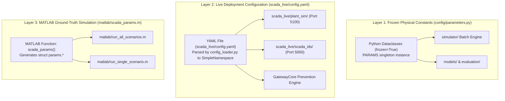

# 06 - Configuration Reference

**Title:** Configuration Reference  
**Purpose:** Exhaustive specification for every configuration key across `config/parameters.py`, `scada_live/config.yaml`, and `matlab/scada_params.m`, detailing units, defaults, physical meanings, consuming modules, dynamic overrides, and cross-system discrepancies.  
**Audience:** Control engineers, simulation developers, security researchers, and systems integrators.  
**Generated From Commit:** `4b66485`  
**Date:** 2026-10-13  
**Status:** Active & 100% Code-Verified  

---

## 1. System Overview: The Three Configuration Layers

The SCADA Hybrid IDS project maintains configuration parameters across three distinct layers, each serving a specific lifecycle role [CODE [config/parameters.py:1-110](file:///c:/projects/p1/New%20folder/config/parameters.py#L1-L110), [scada_live/config.yaml:1-111](file:///c:/projects/p1/New%20folder/scada_live/config.yaml#L1-L111), [matlab/scada_params.m:1-44](file:///c:/projects/p1/New%20folder/matlab/scada_params.m#L1-L44)]:



1. **Layer 1: `config/parameters.py` (Frozen Physical Constants):**
   - Implemented as Python `@dataclass(frozen=True)` structures (`TankParams`, `PumpParams`, `ValveParams`, `ControllerParams`, `SimulationParams`, and composite `SystemParams`).
   - Serves as the immutable specification for batch simulation, dataset generation, offline model training (`models/trainer.py`), and offline evaluation (`evaluation/metrics.py`).
2. **Layer 2: `scada_live/config.yaml` (Live Deployment Configuration):**
   - Implemented as a hierarchical YAML file loaded via `scada_live/common/config_loader.py:load_config()`, which recursively converts dictionaries into dot-accessible `types.SimpleNamespace` objects.
   - Governs real-time plant simulation, multi-engine streaming IDS execution, Flask HTTP/SSE network endpoints, alert state transitions, and prevention mitigation policies.
3. **Layer 3: `matlab/scada_params.m` (MATLAB Simulation Parameters):**
   - Implemented as a standalone MATLAB function returning a structured parameter object (`params.tank`, `params.pump`, `params.valve`, `params.ctrl`, `params.sim`).
   - Governs the ODE numerical integration and scenario generation loops in MATLAB.

---

## 2. Exhaustive Configuration Parameter Catalog

### 2.1 Tank Subsystem (`tank`)

Defines the physical geometry, volume limits, and safety boundaries for the cylindrical water storage tank [CODE [config/parameters.py:18-27](file:///c:/projects/p1/New%20folder/config/parameters.py#L18-L27), [scada_live/config.yaml:2-8](file:///c:/projects/p1/New%20folder/scada_live/config.yaml#L2-L8), [matlab/scada_params.m:9-16](file:///c:/projects/p1/New%20folder/matlab/scada_params.m#L9-L16)].

| Parameter Key | Python Data Type | Default Value | Physical Units | Consumers (Code File : Line) | Physical Meaning & Architectural Role |
| :--- | :--- | :--- | :--- | :--- | :--- |
| `cross_section_area_m2` | `float` | `2.0` | $\text{m}^2$ | [simulator/tank.py:20](file:///c:/projects/p1/New%20folder/simulator/tank.py#L20), [digital_twin/physics_twin.py:27](file:///c:/projects/p1/New%20folder/digital_twin/physics_twin.py#L27), [matlab/scada_params.m:10](file:///c:/projects/p1/New%20folder/matlab/scada_params.m#L10) | Tank cross-sectional area $A$ (corresponds to diameter $D = \sqrt{4A/\pi} \approx 1.596\text{ m}$). Dictates liquid capacitance: $dh/dt = (Q_{\text{in}} - Q_{\text{out}})/A$. |
| `max_height_m` | `float` | `2.5` | $\text{m}$ | [simulator/tank.py:21](file:///c:/projects/p1/New%20folder/simulator/tank.py#L21), [digital_twin/physics_twin.py:28](file:///c:/projects/p1/New%20folder/digital_twin/physics_twin.py#L28), [scada_live/scada_ids/streaming_ids.py:184](file:///c:/projects/p1/New%20folder/scada_live/scada_ids/streaming_ids.py#L184) | Structural physical ceiling $H_{\max}$ of the vessel. Simulator hard-clamps liquid level to $[0, H_{\max}]$. |
| `initial_level_m` | `float` | `1.0` | $\text{m}$ | [simulator/tank.py:19](file:///c:/projects/p1/New%20folder/simulator/tank.py#L19), [digital_twin/physics_twin.py:26](file:///c:/projects/p1/New%20folder/digital_twin/physics_twin.py#L26), [scada_live/scada_ids/gateway_core.py:84](file:///c:/projects/p1/New%20folder/scada_live/scada_ids/gateway_core.py#L84) | Initial water height $H_0$ at simulation start (40% of maximum height). Matches controller setpoint $H_{\text{sp}}$. |
| `critical_low_m` | `float` | `0.3` | $\text{m}$ | [engines/policy_engine.py:23](file:///c:/projects/p1/New%20folder/engines/policy_engine.py#L23), [scada_live/scada_ids/server.py:288](file:///c:/projects/p1/New%20folder/scada_live/scada_ids/server.py#L288) | Low-level safety threshold $H_{\text{crit\_low}}$. Levels below 0.3m risk pump cavitation or dry suction damage. |
| `critical_high_m` | `float` | `2.3` | $\text{m}$ | [scada_live/scada_ids/server.py:289](file:///c:/projects/p1/New%20folder/scada_live/scada_ids/server.py#L289), [config/parameters.py:25](file:///c:/projects/p1/New%20folder/config/parameters.py#L25) | High-level warning boundary $H_{\text{crit\_high}}$ (overflow risk). |
| `overflow_m` | `float` | `2.5` | $\text{m}$ | [scada_live/plant_sim/plant.py:90](file:///c:/projects/p1/New%20folder/scada_live/plant_sim/plant.py#L90), [scada_live/scada_ids/server.py:290](file:///c:/projects/p1/New%20folder/scada_live/scada_ids/server.py#L290) | Absolute containment spill height $H_{\text{overflow}}$. Reaching this level triggers an overflow safety violation counter. |

---

### 2.2 Pump Subsystem (`pump`)

Defines the flow capabilities and actuation delays of the positive-displacement electric inflow pump [CODE [config/parameters.py:32-39](file:///c:/projects/p1/New%20folder/config/parameters.py#L32-L39), [scada_live/config.yaml:11-14](file:///c:/projects/p1/New%20folder/scada_live/config.yaml#L11-L14), [matlab/scada_params.m:18-21](file:///c:/projects/p1/New%20folder/matlab/scada_params.m#L18-L21)].

| Parameter Key | Python Data Type | Default Value | Physical Units | Consumers (Code File : Line) | Physical Meaning & Architectural Role |
| :--- | :--- | :--- | :--- | :--- | :--- |
| `q_max_m3s` | `float` | `0.005` | $\text{m}^3/\text{s}$ | [simulator/pump.py:26](file:///c:/projects/p1/New%20folder/simulator/pump.py#L26), [digital_twin/physics_twin.py:30](file:///c:/projects/p1/New%20folder/digital_twin/physics_twin.py#L30), [scada_live/scada_ids/streaming_ids.py:60](file:///c:/projects/p1/New%20folder/scada_live/scada_ids/streaming_ids.py#L60) | Maximum volumetric delivery rate $Q_{\max}$ ($5.0\text{ L/s} \approx 79.25\text{ GPM}$). When pump state is ON (1), delivery is $Q_{\max}$; when OFF (0), delivery is 0. |
| `q_min_m3s` | `float` | `0.005` | $\text{m}^3/\text{s}$ | [config/parameters.py:36](file:///c:/projects/p1/New%20folder/config/parameters.py#L36) | Minimum delivery rate for binary pump. Identical to `q_max_m3s` because pump does not support variable-frequency modulation. |
| `response_delay_s` | `float` | `2.0` | $\text{s}$ | [simulator/pump.py:27](file:///c:/projects/p1/New%20folder/simulator/pump.py#L27), [scada_live/plant_sim/plant.py:27](file:///c:/projects/p1/New%20folder/scada_live/plant_sim/plant.py#L27) | Mechanical contactor and spool-up inertia delay $\tau_{\text{pump}}$. In discretised simulation at $\Delta t = 1.0\text{ s}$, yields a 2-step pipeline delay before flow changes. |
| `delay_steps` *(MATLAB only)* | `int` | `2` | steps | [matlab/scada_params.m:20](file:///c:/projects/p1/New%20folder/matlab/scada_params.m#L20) | Discrete steps computed via $\lceil \tau_{\text{pump}} / \Delta t \rceil = 2$. |

---

### 2.3 Valve Subsystem (`valve`)

Defines the flow coefficient, slew rate, and fail-safe position of the gravity outflow valve [CODE [config/parameters.py:44-55](file:///c:/projects/p1/New%20folder/config/parameters.py#L44-L55), [scada_live/config.yaml:16-20](file:///c:/projects/p1/New%20folder/scada_live/config.yaml#L16-L20), [matlab/scada_params.m:23-27](file:///c:/projects/p1/New%20folder/matlab/scada_params.m#L23-L27)].

| Parameter Key | Python Data Type | Default Value | Physical Units | Consumers (Code File : Line) | Physical Meaning & Architectural Role |
| :--- | :--- | :--- | :--- | :--- | :--- |
| `flow_coefficient_m3s` | `float` | `0.004` | $\text{m}^3/\text{s}$ | [simulator/valve.py:26](file:///c:/projects/p1/New%20folder/simulator/valve.py#L26), [digital_twin/physics_twin.py:31](file:///c:/projects/p1/New%20folder/digital_twin/physics_twin.py#L31), [scada_live/scada_ids/streaming_ids.py:61](file:///c:/projects/p1/New%20folder/scada_live/scada_ids/streaming_ids.py#L61) | Valve flow coefficient $C_v$. Outflow obeys Torricelli discharge: $Q_{\text{out}} = C_v \cdot (u_v / 100) \cdot \sqrt{2gH}$ (in live plant) or $C_v \cdot (u_v / 100) \cdot \sqrt{H}$ (in simplified model). |
| `response_time_s` | `float` | `1.5` | $\text{s}$ | [simulator/valve.py:27](file:///c:/projects/p1/New%20folder/simulator/valve.py#L27), [scada_live/plant_sim/plant.py:28](file:///c:/projects/p1/New%20folder/scada_live/plant_sim/plant.py#L28) | Actuator mechanical transit time $\tau_{\text{valve}}$ from 0% to 100% full stroke. |
| `safe_position_pct` | `float` | `0.0` | $\%$ | [simulator/valve.py:28](file:///c:/projects/p1/New%20folder/simulator/valve.py#L28), [scada_live/scada_ids/gateway_core.py:23](file:///c:/projects/p1/New%20folder/scada_live/scada_ids/gateway_core.py#L23) | Deterministic fail-safe mechanical resting position $V_{\text{safe}}$ (0.0% = fully closed). Applied during DoS timeout or unauthenticated hold drops. |
| `range_min_pct` | `float` | `0.0` | $\%$ | [config/parameters.py:50](file:///c:/projects/p1/New%20folder/config/parameters.py#L50) | Minimum allowable valve stroke command (fully seated). |
| `range_max_pct` | `float` | `100.0` | $\%$ | [config/parameters.py:51](file:///c:/projects/p1/New%20folder/config/parameters.py#L51) | Maximum allowable valve stroke command (fully wide open). |
| `max_slew_rate` *(MATLAB only)* | `float` | `66.67` | $\%/\text{s}$ | [matlab/scada_params.m:26](file:///c:/projects/p1/New%20folder/matlab/scada_params.m#L26) | Maximum actuator velocity $\Delta V / \Delta t = 100\% / 1.5\text{ s} \approx 66.67\%/\text{s}$. |

---

### 2.4 Autonomous Controller (`controller`)

Defines setpoints, hysteresis bounds, and default actuator settings for the bang-bang level controller [CODE [config/parameters.py:60-79](file:///c:/projects/p1/New%20folder/config/parameters.py#L60-L79), [scada_live/config.yaml:22-27](file:///c:/projects/p1/New%20folder/scada_live/config.yaml#L22-L27), [matlab/scada_params.m:29-33](file:///c:/projects/p1/New%20folder/matlab/scada_params.m#L29-L33)].

| Parameter Key | Python Data Type | Default Value | Physical Units | Consumers (Code File : Line) | Physical Meaning & Architectural Role |
| :--- | :--- | :--- | :--- | :--- | :--- |
| `setpoint_m` | `float` | `1.0` | $\text{m}$ | [simulator/controller.py:17](file:///c:/projects/p1/New%20folder/simulator/controller.py#L17), [scada_live/scada_ids/gateway_core.py:82](file:///c:/projects/p1/New%20folder/scada_live/scada_ids/gateway_core.py#L82) | Target regulated liquid height $H_{\text{sp}}$. Controller stabilizes fluid within deadband around this value. |
| `deadband_m` | `float` | `0.2` | $\text{m}$ | [simulator/controller.py:18](file:///c:/projects/p1/New%20folder/simulator/controller.py#L18), [scada_live/scada_ids/gateway_core.py:83](file:///c:/projects/p1/New%20folder/scada_live/scada_ids/gateway_core.py#L83) | Half-width of hysteresis band $d$. Prevents chattering by establishing switching margins. |
| `pump_on_threshold_m` | `float` | `0.8` | $\text{m}$ | [simulator/controller.py:20](file:///c:/projects/p1/New%20folder/simulator/controller.py#L20), [scada_live/scada_ids/gateway_core.py:27](file:///c:/projects/p1/New%20folder/scada_live/scada_ids/gateway_core.py#L27) | Lower switching threshold $H_{\text{on}} = H_{\text{sp}} - d = 1.0 - 0.2 = 0.8\text{ m}$. Pump activates when $H \le 0.8\text{ m}$. |
| `pump_off_threshold_m` | `float` | `1.2` | $\text{m}$ | [simulator/controller.py:21](file:///c:/projects/p1/New%20folder/simulator/controller.py#L21), [scada_live/scada_ids/gateway_core.py:26](file:///c:/projects/p1/New%20folder/scada_live/scada_ids/gateway_core.py#L26) | Upper switching threshold $H_{\text{off}} = H_{\text{sp}} + d = 1.0 + 0.2 = 1.2\text{ m}$. Pump shuts off when $H \ge 1.2\text{ m}$. |
| `default_valve_pct` | `float` | `50.0` | $\%$ | [simulator/controller.py:19](file:///c:/projects/p1/New%20folder/simulator/controller.py#L19), [scada_live/scada_ids/gateway_core.py:28](file:///c:/projects/p1/New%20folder/scada_live/scada_ids/gateway_core.py#L28) | Constant throttling position $V_{\text{nom}}$ maintained by autonomous controller during normal operation. |
| `control_interval_s` *(parameters.py)* | `float` | `1.0` | $\text{s}$ | [config/parameters.py:70](file:///c:/projects/p1/New%20folder/config/parameters.py#L70) | Execution periodicity of controller update loop $T_c$. Matches simulation step $\Delta t$. |

---

### 2.5 Simulation & Environment (`simulation`)

Controls numerical integration stepping, real-time acceleration, sensor noise distributions, and reproducibility seeds [CODE [config/parameters.py:84-93](file:///c:/projects/p1/New%20folder/config/parameters.py#L84-L93), [scada_live/config.yaml:30-36](file:///c:/projects/p1/New%20folder/scada_live/config.yaml#L30-L36), [matlab/scada_params.m:35-42](file:///c:/projects/p1/New%20folder/matlab/scada_params.m#L35-L42)].

| Parameter Key | Python Data Type | Default Value | Physical Units | Consumers (Code File : Line) | Physical Meaning & Architectural Role |
| :--- | :--- | :--- | :--- | :--- | :--- |
| `dt_s` | `float` | `1.0` | $\text{s}$ | [simulator/process_simulator.py:34](file:///c:/projects/p1/New%20folder/simulator/process_simulator.py#L34), [digital_twin/physics_twin.py:29](file:///c:/projects/p1/New%20folder/digital_twin/physics_twin.py#L29), [scada_live/plant_sim/plant.py:24](file:///c:/projects/p1/New%20folder/scada_live/plant_sim/plant.py#L24) | Simulation time step $\Delta t$ ($1.0\text{ s} \implies 1\text{ Hz}$ telemetry frequency). Used in Runge-Kutta 4 and Euler integration. |
| `time_scale` *(config.yaml only)* | `float` | `1.0` | multiplier | [scada_live/plant_sim/server.py:72](file:///c:/projects/p1/New%20folder/scada_live/plant_sim/server.py#L72), [scada_live/scada_ids/server.py:348](file:///c:/projects/p1/New%20folder/scada_live/scada_ids/server.py#L348), [scada_live/scada_ids/gateway_core.py:133](file:///c:/projects/p1/New%20folder/scada_live/scada_ids/gateway_core.py#L133) | Real-time pacing factor ($1.0 = \text{real-time}$, $5.0 = 5\times \text{fast-forward}$ for demos). Plant loop sleeps $\max(0, \Delta t / \text{time\_scale} - \text{elapsed})$. |
| `sensor_noise_level_m` | `float` | `0.005` | $\text{m}$ | [simulator/noise.py:23](file:///c:/projects/p1/New%20folder/simulator/noise.py#L23), [scada_live/plant_sim/plant.py:30](file:///c:/projects/p1/New%20folder/scada_live/plant_sim/plant.py#L30) | Standard deviation $\sigma_H$ of Gaussian noise added to water level sensor ($\pm 5\text{ mm}$ error). |
| `sensor_noise_flow_m3s` | `float` | `0.0001` | $\text{m}^3/\text{s}$ | [simulator/noise.py:24](file:///c:/projects/p1/New%20folder/simulator/noise.py#L24), [scada_live/plant_sim/plant.py:30](file:///c:/projects/p1/New%20folder/scada_live/plant_sim/plant.py#L30) | Standard deviation $\sigma_Q$ of Gaussian noise added to flow meters ($\pm 0.1\text{ L/s}$ error). |
| `clamp_flow_noise` *(config.yaml only)* | `bool` | `false` | boolean | [scada_live/plant_sim/plant.py:29](file:///c:/projects/p1/New%20folder/scada_live/plant_sim/plant.py#L29) | If `true`, clamps noisy flow $\max(0, Q + \text{noise})$. In live deployment, set to `false` to guarantee zero-mean symmetric noise and eliminate positive drift bias. |
| `random_seed` / `base_random_seed` | `int` | `42000` | integer | [simulator/scenario_runner.py:37](file:///c:/projects/p1/New%20folder/simulator/scenario_runner.py#L37), [scada_live/plant_sim/plant.py:13](file:///c:/projects/p1/New%20folder/scada_live/plant_sim/plant.py#L13) | Deterministic pseudo-random seed base. Scenarios derive seeds via $\text{seed}_0 + \text{index}$. |
| `scenario_duration_s` *(parameters.py)* | `float` | `1000.0` | $\text{s}$ | [simulator/scenario_runner.py:35](file:///c:/projects/p1/New%20folder/simulator/scenario_runner.py#L35), [config/parameters.py:88](file:///c:/projects/p1/New%20folder/config/parameters.py#L88) | Standard scenario episode duration in batch generation (1000 steps = 16.67 minutes). |
| `actuator_delay_steps` *(parameters.py)* | `int` | `1` | steps | [config/parameters.py:91](file:///c:/projects/p1/New%20folder/config/parameters.py#L91) | Actuator queue execution lag in discrete steps. |

---

### 2.6 Intrusion Detection Engine Thresholds (`ids`)

Configures detection engine sensitivity, normalization bounds, and sliding window sizes [CODE [scada_live/config.yaml:39-51](file:///c:/projects/p1/New%20folder/scada_live/config.yaml#L39-L51), [config/parameters.py:73-75](file:///c:/projects/p1/New%20folder/config/parameters.py#L73-L75)].

| Parameter Key | Python Data Type | Default Value | Physical Units | Consumers (Code File : Line) | Physical Meaning & Architectural Role |
| :--- | :--- | :--- | :--- | :--- | :--- |
| `tau_p` | `float` | `0.035` | $\text{m}$ | [engines/physics_engine.py:18](file:///c:/projects/p1/New%20folder/engines/physics_engine.py#L18), [scada_live/scada_ids/streaming_ids.py:68](file:///c:/projects/p1/New%20folder/scada_live/scada_ids/streaming_ids.py#L68) | Physics residual detection threshold $\tau_p = 35\text{ mm}$. Physical anomaly score normalizes as $S_p = \min(1.0, |H_{\text{obs}} - H_{\text{twin}}| / (2 \tau_p))$. |
| `tau_l` | `float` | `0.0085` | dimensionless | [engines/temporal_engine.py:27](file:///c:/projects/p1/New%20folder/engines/temporal_engine.py#L27), [scada_live/scada_ids/streaming_ids.py:100](file:///c:/projects/p1/New%20folder/scada_live/scada_ids/streaming_ids.py#L100) | Temporal reconstruction MSE threshold $\tau_l$. Temporal anomaly score normalizes as $S_l = \min(1.0, \text{MSE} / (2 \tau_l))$. |
| `tau_a_ms` | `float` | `1500.0` | $\text{ms}$ | [engines/availability_engine.py:18](file:///c:/projects/p1/New%20folder/engines/availability_engine.py#L18), [scada_live/scada_ids/streaming_ids.py:76](file:///c:/projects/p1/New%20folder/scada_live/scada_ids/streaming_ids.py#L76) | Availability latency threshold $\tau_a$ ($1.5\text{ s}$). Packets arriving with delay exceeding 1500ms initiate availability penalty scoring. |
| `tau_a_max_ms` | `float` | `5000.0` | $\text{ms}$ | [engines/availability_engine.py:19](file:///c:/projects/p1/New%20folder/engines/availability_engine.py#L19), [scada_live/scada_ids/streaming_ids.py:76](file:///c:/projects/p1/New%20folder/scada_live/scada_ids/streaming_ids.py#L76) | Maximum latency ceiling $\tau_{a,\max}$ ($5.0\text{ s}$). Delays $\ge 5000\text{ ms}$ result in maximum availability score $S_a = 1.0$. |
| `tau_fusion` | `float` | `0.95` | dimensionless | [engines/fusion_engine.py:33](file:///c:/projects/p1/New%20folder/engines/fusion_engine.py#L33), [scada_live/scada_ids/streaming_ids.py:109](file:///c:/projects/p1/New%20folder/scada_live/scada_ids/streaming_ids.py#L109), [scripts/run_evaluation.py:77](file:///c:/projects/p1/New%20folder/scripts/run_evaluation.py#L77) | Hybrid fusion classification threshold $\tau_{\text{fusion}}$. If $S_{\text{hybrid}} > \tau_{\text{fusion}}$, tick is declared anomalous (`is_anomaly = True`). |
| `policy_version` | `str` | `"v1"` | string | [scada_live/scada_ids/streaming_ids.py:250](file:///c:/projects/p1/New%20folder/scada_live/scada_ids/streaming_ids.py#L250) | Policy Engine implementation selector (`"v1"` checks static bounds $H > 2.45$ or $H < 0.3$; `"v2"` checks deadband limits). |
| `dos_gap_rule` | `bool` | `false` | boolean | [scada_live/scada_ids/streaming_ids.py:168](file:///c:/projects/p1/New%20folder/scada_live/scada_ids/streaming_ids.py#L168) | Enables Step 2b DoS gap re-seed rule to re-synchronize Digital Twin after packet outages if post-gap sensor readings are physically plausible. |
| `gap_collect_timeout_ticks` | `int` | `20` | ticks | [scada_live/scada_ids/streaming_ids.py:214](file:///c:/projects/p1/New%20folder/scada_live/scada_ids/streaming_ids.py#L214) | Maximum observation window to collect 5 valid readings following a DoS outage before timing out and refusing re-seed. |
| `lstm_window` | `int` | `10` | steps | [scada_live/scada_ids/streaming_ids.py:83](file:///c:/projects/p1/New%20folder/scada_live/scada_ids/streaming_ids.py#L83) | Historical telemetry sequence length required as input for the LSTM-Autoencoder. Note: Evaluator uses window size 50. |
| `consecutive_flag_count` | `int` | `3` | count | [scada_live/config.yaml:49](file:///c:/projects/p1/New%20folder/scada_live/config.yaml#L49) | Legacy config alias for alert window parameter $N$ (maps to `alert.n_flags`). |
| `clear_count` | `int` | `5` | count | [scada_live/config.yaml:50](file:///c:/projects/p1/New%20folder/scada_live/config.yaml#L50) | Legacy config alias for alert clearing ticks $M$ (maps to `alert.m_clear`). |
| `epsilon_m` | `float` | `0.05` | $\text{m}$ | [engines/policy_engine.py:24](file:///c:/projects/p1/New%20folder/engines/policy_engine.py#L24), [scada_live/scada_ids/streaming_ids.py:72](file:///c:/projects/p1/New%20folder/scada_live/scada_ids/streaming_ids.py#L72) | Safety buffer tolerance $\epsilon$ applied to policy boundary checks. |

---

### 2.7 Machine Learning Artifacts (`lstm`)

Defines model topology, checkpoint locations, and input feature ordering for neural network inference [CODE [scada_live/config.yaml:54-66](file:///c:/projects/p1/New%20folder/scada_live/config.yaml#L54-L66)].

| Parameter Key | Python Data Type | Default Value | Physical Units | Consumers (Code File : Line) | Physical Meaning & Architectural Role |
| :--- | :--- | :--- | :--- | :--- | :--- |
| `weights_path` | `str` | `"checkpoints/lstm_ae_v1.pt"` | file path | [scada_live/scada_ids/streaming_ids.py:94](file:///c:/projects/p1/New%20folder/scada_live/scada_ids/streaming_ids.py#L94) | PyTorch serialized state dictionary for trained `LSTMAutoencoder`. |
| `scaler_path` | `str` | `"checkpoints/scaler_v1.pkl"` | file path | [scada_live/scada_ids/streaming_ids.py:84](file:///c:/projects/p1/New%20folder/scada_live/scada_ids/streaming_ids.py#L84) | Pickled `StandardScaler` fitted on 42 normal training scenarios. |
| `input_dim` | `int` | `5` | count | [models/lstm_autoencoder.py:16](file:///c:/projects/p1/New%20folder/models/lstm_autoencoder.py#L16), [scada_live/scada_ids/streaming_ids.py:90](file:///c:/projects/p1/New%20folder/scada_live/scada_ids/streaming_ids.py#L90) | Dimensionality of each input time-step vector. |
| `hidden_dim` | `int` | `32` | count | [models/lstm_autoencoder.py:17](file:///c:/projects/p1/New%20folder/models/lstm_autoencoder.py#L17), [scada_live/scada_ids/streaming_ids.py:91](file:///c:/projects/p1/New%20folder/scada_live/scada_ids/streaming_ids.py#L91) | Number of hidden units in LSTM encoder and decoder recurrent layers. |
| `num_layers` | `int` | `1` | count | [models/lstm_autoencoder.py:18](file:///c:/projects/p1/New%20folder/models/lstm_autoencoder.py#L18), [scada_live/scada_ids/streaming_ids.py:92](file:///c:/projects/p1/New%20folder/scada_live/scada_ids/streaming_ids.py#L92) | Number of stacked recurrent layers. |
| `feature_cols` | `list[str]` | `[tank_level_observed, q_in, q_out, pump_state, valve_state]` | column names | [models/preprocessor.py:21](file:///c:/projects/p1/New%20folder/models/preprocessor.py#L21), [scada_live/config.yaml:60-66](file:///c:/projects/p1/New%20folder/scada_live/config.yaml#L60-L66) | Exact ordered list of DataFrame columns fed to scaler and autoencoder. |

---

### 2.8 Prevention & Mitigation Engine (`prevention`)

Configures closed-loop safety intervention, twin takeover, and automatic recovery criteria [CODE [scada_live/config.yaml:68-82](file:///c:/projects/p1/New%20folder/scada_live/config.yaml#L68-L82), [scada_live/scada_ids/gateway_core.py:87-104](file:///c:/projects/p1/New%20folder/scada_live/scada_ids/gateway_core.py#L87-L104)].

| Parameter Key | Python Data Type | Default Value | Physical Units | Consumers (Code File : Line) | Physical Meaning & Architectural Role |
| :--- | :--- | :--- | :--- | :--- | :--- |
| `default_mode` | `str` | `"monitor"` | mode | [scada_live/scada_ids/gateway_core.py:88](file:///c:/projects/p1/New%20folder/scada_live/scada_ids/gateway_core.py#L88) | Initial gateway mode on startup (`"monitor"` logs anomalies without overriding; `"prevention"` executes active mitigation). |
| `act_on` | `list[str]` | `["physics"]` | engine names | [scada_live/scada_ids/gateway_core.py:91](file:///c:/projects/p1/New%20folder/scada_live/scada_ids/gateway_core.py#L91) | Legacy config alias for mitigation trigger engines. |
| `takeover_engines` | `list[str]` | `["physics"]` | engine names | [scada_live/scada_ids/gateway_core.py:92](file:///c:/projects/p1/New%20folder/scada_live/scada_ids/gateway_core.py#L92) | Detection engines permitted to trigger digital twin takeover when firing. |
| `trigger_state` | `str` | `"CRITICAL"` | alert state | [scada_live/scada_ids/gateway_core.py:94](file:///c:/projects/p1/New%20folder/scada_live/scada_ids/gateway_core.py#L94) | Alert state required before prevention mechanisms will activate. |
| `fdi_takeover` | `bool` | `true` | boolean | [scada_live/scada_ids/gateway_core.py:95](file:///c:/projects/p1/New%20folder/scada_live/scada_ids/gateway_core.py#L95) | Enables feeding digital twin level estimates to the controller during FDI attacks. |
| `handback_tolerance_m` | `float` | `0.05` | $\text{m}$ | [scada_live/scada_ids/gateway_core.py:96](file:///c:/projects/p1/New%20folder/scada_live/scada_ids/gateway_core.py#L96) | Maximum allowable discrepancy $|H_{\text{sensor}} - H_{\text{twin}}|$ to permit handing control back to sensor readings. |
| `handback_clean_ticks` | `int` | `5` | ticks | [scada_live/scada_ids/gateway_core.py:97](file:///c:/projects/p1/New%20folder/scada_live/scada_ids/gateway_core.py#L97) | Number of consecutive clean ticks required before handback is permitted. |
| `auto_handback` | `bool` | `false` | boolean | [scada_live/scada_ids/gateway_core.py:98](file:///c:/projects/p1/New%20folder/scada_live/scada_ids/gateway_core.py#L98) | If `true`, hands back control automatically when clean criteria are satisfied; if `false`, requires operator manual ack. |
| `safe_pump_state` | `int` | `0` | state | [scada_live/scada_ids/gateway_core.py:202](file:///c:/projects/p1/New%20folder/scada_live/scada_ids/gateway_core.py#L202) | Safe pump command asserted on hold failure (0 = OFF). |
| `safe_valve_pct` | `float` | `0.0` | $\%$ | [scada_live/scada_ids/gateway_core.py:203](file:///c:/projects/p1/New%20folder/scada_live/scada_ids/gateway_core.py#L203) | Safe valve command asserted on hold failure (0.0% = closed). |
| `dos_rate_limit_per_s` | `int` | `10` | packets/s | [scada_live/config.yaml:79](file:///c:/projects/p1/New%20folder/scada_live/config.yaml#L79) | Rate limiting threshold for DoS ingress traffic. |
| `quarantine_duration_s` | `int` | `30` | $\text{s}$ | [scada_live/config.yaml:80](file:///c:/projects/p1/New%20folder/scada_live/config.yaml#L80) | Duration an offending endpoint is quarantined. |
| `stale_packet_tolerance_s` | `float` | `5.0` | $\text{s}$ | [scada_live/config.yaml:81](file:///c:/projects/p1/New%20folder/scada_live/config.yaml#L81) | Max source timestamp lag before packet is flagged as stale. |

---

### 2.9 Network & Infrastructure (`network`, `gateway`, `alert`, `recalibration`, `persistence`)

Governs HTTP listener bindings, queue sizes, watchdog timers, alert sliding windows, and database paths [CODE [scada_live/config.yaml:84-109](file:///c:/projects/p1/New%20folder/scada_live/config.yaml#L84-L109)].

| Section | Parameter Key | Data Type | Default Value | Units | Consumers (Code File : Line) | Architectural Role |
| :--- | :--- | :--- | :--- | :--- | :--- | :--- |
| `network` | `plant_host` | `str` | `"127.0.0.1"` | IP string | [scada_live/plant_sim/server.py:80](file:///c:/projects/p1/New%20folder/scada_live/plant_sim/server.py#L80) | Host interface IP for Plant Simulator server. |
| `network` | `plant_port` | `int` | `5100` | TCP port | [scada_live/plant_sim/server.py:80](file:///c:/projects/p1/New%20folder/scada_live/plant_sim/server.py#L80), [tests/test_phase0_imports.py:26](file:///c:/projects/p1/New%20folder/scada_live/tests/test_phase0_imports.py#L26) | Port for Plant Simulator server (5100). |
| `network` | `scada_host` | `str` | `"127.0.0.1"` | IP string | [scada_live/config.yaml:88](file:///c:/projects/p1/New%20folder/scada_live/config.yaml#L88) | Host interface IP for SCADA IDS server. |
| `network` | `scada_port` | `int` | `5000` | TCP port | [scada_live/scada_ids/server.py:411](file:///c:/projects/p1/New%20folder/scada_live/scada_ids/server.py#L411) | Port for SCADA IDS Gateway and Web UI (5000). |
| `network` | `attacker_host` | `str` | `"127.0.0.1"` | IP string | [scada_live/config.yaml:90](file:///c:/projects/p1/New%20folder/scada_live/config.yaml#L90) | Host interface IP for Attacker Wire proxy. |
| `network` | `attacker_port` | `int` | `5001` | TCP port | [scada_live/config.yaml:91](file:///c:/projects/p1/New%20folder/scada_live/config.yaml#L91) | Port allocated for Attacker Wire proxy (5001). |
| `gateway` | `sense_timeout_s` | `float` | `0.5` | $\text{s}$ | [scada_live/config.yaml:94](file:///c:/projects/p1/New%20folder/scada_live/config.yaml#L94) | Timeout limit for `/api/sense` HTTP requests. |
| `gateway` | `sse_queue_size` | `int` | `200` | count | [scada_live/scada_ids/server.py:15](file:///c:/projects/p1/New%20folder/scada_live/scada_ids/server.py#L15), [scada_live/scada_ids/sse_hub.py:6](file:///c:/projects/p1/New%20folder/scada_live/scada_ids/sse_hub.py#L6) | Bounded capacity of client SSE output queue. |
| `gateway` | `sse_keepalive_s` | `int` | `15` | $\text{s}$ | [scada_live/scada_ids/server.py:91](file:///c:/projects/p1/New%20folder/scada_live/scada_ids/server.py#L91) | Periodicity of SSE comment ping `: keepalive\n\n`. |
| `gateway` | `history_size` | `int` | `300` | count | [scada_live/scada_ids/server.py:319](file:///c:/projects/p1/New%20folder/scada_live/scada_ids/server.py#L319) | Size of historical verdict ring buffer in `AlertManager`. |
| `gateway` | `watchdog_enabled`| `bool` | `false` | boolean | [scada_live/scada_ids/gateway_core.py:102](file:///c:/projects/p1/New%20folder/scada_live/scada_ids/gateway_core.py#L102) | Enables heartbeat watchdog timer for DoS detection. |
| `gateway` | `watchdog_factor` | `float` | `1.5` | multiplier | [scada_live/scada_ids/gateway_core.py:133](file:///c:/projects/p1/New%20folder/scada_live/scada_ids/gateway_core.py#L133) | Watchdog timeout multiplier: $1.5 \times \Delta t / \text{time\_scale}$. |
| `alert` | `n_flags` | `int` | `3` | count | [scada_live/scada_ids/alert_manager.py:15](file:///c:/projects/p1/New%20folder/scada_live/scada_ids/alert_manager.py#L15) | Consecutive anomaly flags $N$ in window required to escalate to `CRITICAL`. |
| `alert` | `window_w` | `int` | `5` | count | [scada_live/scada_ids/alert_manager.py:14](file:///c:/projects/p1/New%20folder/scada_live/scada_ids/alert_manager.py#L14) | Sliding observation window size $W$ for anomaly flags. |
| `alert` | `m_clear` | `int` | `5` | count | [scada_live/scada_ids/alert_manager.py:16](file:///c:/projects/p1/New%20folder/scada_live/scada_ids/alert_manager.py#L16) | Consecutive clean ticks $M$ required to return from `SUSPICIOUS` to `SAFE`. |
| `recalibration` | `n_samples` | `int` | `10` | count | [scada_live/config.yaml:105](file:///c:/projects/p1/New%20folder/scada_live/config.yaml#L105) | Number of recent trusted level observations used during recalibration. |
| `recalibration` | `max_std_m` | `float` | `0.03` | $\text{m}$ | [scada_live/scada_ids/streaming_ids.py:65](file:///c:/projects/p1/New%20folder/scada_live/scada_ids/streaming_ids.py#L65) | Maximum allowable sample standard deviation ($30\text{ mm}$) to verify plant stability before accepting recalibration. |
| `persistence` | `db_path` | `str` | `"data/live_run.db"` | file path | [scada_live/scada_ids/gateway_core.py:108](file:///c:/projects/p1/New%20folder/scada_live/scada_ids/gateway_core.py#L108) | SQLite database destination for live telemetry ticks and alerts. |

---

## 3. Comparative Matrix & Cross-Configuration Discrepancies

The following matrix compares parameter naming, default values, and availability across the three configuration systems [CODE [config/parameters.py](file:///c:/projects/p1/New%20folder/config/parameters.py), [scada_live/config.yaml](file:///c:/projects/p1/New%20folder/scada_live/config.yaml), [matlab/scada_params.m](file:///c:/projects/p1/New%20folder/matlab/scada_params.m)]:

| Parameter Concept | `config/parameters.py` (Layer 1) | `scada_live/config.yaml` (Layer 2) | `matlab/scada_params.m` (Layer 3) | Status / Reconciliation |
| :--- | :--- | :--- | :--- | :--- |
| **Tank Area** | `cross_section_area_m2: 2.0` | `cross_section_area_m2: 2.0` | `area: 2.0` | Identical value ($2.0\text{ m}^2$). |
| **Max Tank Height** | `max_height_m: 2.5` | `max_height_m: 2.5` | `max_height: 2.5` | Identical value ($2.5\text{ m}$). |
| **Critical High Level** | `critical_high_m: 2.3` | `critical_high_m: 2.3` | `critical_high: 2.3` | **2.3m in all code**. Legacy docs mistakenly claimed 2.2m. |
| **Flow Noise Clamping** | *Omitted* (defaults to `True` in `simulator/noise.py`) | `clamp_flow_noise: false` | *Hard-coded in loop* (`max(0, Q + noise)`) | **Major Discrepancy #1:** Live disables clamp; dataset/MATLAB clamped. |
| **Simulation Time Scale**| *Omitted* | `time_scale: 1.0` | *Omitted* | Live only (supports $1\times$ to $5\times$). |
| **Physics Threshold** | `tau_p: 0.035` *(inside ControllerParams)* | `tau_p: 0.035` *(inside ids)* | *Omitted* | Identical value ($0.035\text{ m}$). Cleanly factored in YAML. |
| **Temporal Threshold** | `tau_l: 0.0085` *(inside ControllerParams)*| `tau_l: 0.0085` *(inside ids)* | *Omitted* | Identical value ($0.0085$). |
| **Availability Threshold**| `tau_a_ms: 1500.0` *(inside ControllerParams)*| `tau_a_ms: 1500.0` *(inside ids)*| *Omitted* | Identical value ($1500.0\text{ ms}$). |
| **Plant Port** | *Omitted* | `plant_port: 5100` | *Omitted* | **5100 in YAML/code**. Legacy docs claimed 5002. |
| **Watchdog Timeout** | *Omitted* | `watchdog_factor: 1.5` | *Omitted* | $1.5 \times \Delta t / \text{time\_scale}$. |
| **Recalibration Std** | *Omitted* | `max_std_m: 0.03` *(under recalibration)* | *Omitted* | **Discrepancy #3:** `GatewayCore` reads `gateway.max_std_m` (fallback 0.05). |

---

### In-Depth Discrepancy Audits

#### Discrepancy 1: `clamp_flow_noise` Regression on Reset
- **The Finding:** `scada_live/config.yaml:35` sets `clamp_flow_noise: false` to ensure unbiased zero-mean flow tracking in live deployment [CODE [scada_live/config.yaml:35](file:///c:/projects/p1/New%20folder/scada_live/config.yaml#L35)]. When `LivePlant.__init__` runs, it respects this flag [CODE [scada_live/plant_sim/plant.py:29-30](file:///c:/projects/p1/New%20folder/scada_live/plant_sim/plant.py#L29-L30)].
- **The Defect:** When `LivePlant.reset()` is invoked, line 115 re-initializes `NoiseGenerator` without passing `clamp_flow_noise`:
  ```python
  self.noise = NoiseGenerator(seed=self.seed, level_noise_std=self.cfg.simulation.sensor_noise_level_m, flow_noise_std=self.cfg.simulation.sensor_noise_flow_m3s)
  ```
- **The Consequence:** Because `simulator/noise.py:25` defines `clamp_flow_noise: bool = True` as its default, calling `LivePlant.reset()` inadvertently re-enables noise clamping, re-introducing the open-loop drift bias until the process is restarted [CODE [simulator/noise.py:25](file:///c:/projects/p1/New%20folder/simulator/noise.py#L25), [scada_live/plant_sim/plant.py:115](file:///c:/projects/p1/New%20folder/scada_live/plant_sim/plant.py#L115)].

---

#### Discrepancy 2: Section Key Path Mismatch in `GatewayCore.recalibrate`
- **The Finding:** `scada_live/config.yaml:104-106` defines:
  ```yaml
  recalibration:
    n_samples: 10
    max_std_m: 0.03
  ```
- **The Defect:** In [scada_live/scada_ids/gateway_core.py:197, 212](file:///c:/projects/p1/New%20folder/scada_live/scada_ids/gateway_core.py#L197-L212), `recalibrate()` queries the `gateway` namespace instead of `recalibration`:
  ```python
  n_samples = getattr(self.cfg.gateway, "recalibrate_samples", 10)
  if std > getattr(self.cfg.gateway, "max_std_m", 0.05):
  ```
- **The Consequence:** Because `recalibrate_samples` and `max_std_m` are absent under `gateway:` in `config.yaml`, `GatewayCore` always falls back to the hard-coded default of `0.05` ($50\text{ mm}$), completely ignoring the configured `0.03` ($30\text{ mm}$) standard deviation threshold.

---

#### Discrepancy 3: Physical Ceiling Query Mismatch (`max_level_m` vs `max_height_m`)
- **The Finding:** `scada_live/config.yaml:4` names the tank ceiling `max_height_m: 2.5`.
- **The Defect:** In [scada_live/scada_ids/gateway_core.py:204](file:///c:/projects/p1/New%20folder/scada_live/scada_ids/gateway_core.py#L204), `recalibrate()` queries:
  ```python
  if any(l < 0 or l > getattr(self.cfg.tank, "max_level_m", 2.0) for l in levels):
  ```
- **The Consequence:** Because `max_level_m` is not defined on `cfg.tank`, the lookup falls back to `2.0\text{ m}`. If the tank is operating stably between $2.01\text{ m}$ and $2.49\text{ m}$ (well below the physical ceiling of $2.5\text{ m}$), calling `recalibrate()` returns `{"error": "sensor_unstable", "reason": "Out of bounds"}`.

---

## 4. Dynamic Runtime Configuration Overrides

While `config.yaml` provides static startup defaults, several keys can be modified dynamically at runtime without restarting the servers [CODE [scada_live/scada_ids/server.py:148-357](file:///c:/projects/p1/New%20folder/scada_live/scada_ids/server.py#L148-L357)]:

| Configuration Key / Field | Modification Endpoint | HTTP Payload | Runtime Effect | Reversibility |
| :--- | :--- | :--- | :--- | :--- |
| `cfg.simulation.time_scale` | `POST /api/control/speed` | `{"speed": 5.0}` | Updates simulation step delay and watchdog factor immediately. | Reversible via `/api/control/speed`. |
| `gateway.mode` | `POST /api/mode` | `{"mode": "prevention"}` | Switches between Monitor (logging only) and Prevention (active override & twin takeover). | Reversible via `/api/mode`. |
| `gateway.watchdog_enabled` | `POST /api/control/pause` / `resume` | Empty `{}` | Suspends watchdog during operator pause to prevent false DoS alerts; re-enables on resume. | Automatic with pause/resume cycle. |
| `app.config['demo_mode']` | CLI Flag `--demo` | CLI invocation | Enables `/demo/attack/start` and `/demo/attack/stop` attack injectors. | Process restart required. |
| `app.config['demo_truth_enabled']` | CLI Flag `--truth` | CLI invocation | Enables the `/demo/truth/stream` dedicated ground-truth SSE broadcast. | Process restart required. |

---

## 5. Verification & Automated Test Evidence

The configuration values, fallback defaults, and parameter conversions documented here are continuously verified by the project test suite [MEASURED [docs_v2/_audit/outputs/pytest_live_output.txt](file:///c:/projects/p1/New%20folder/docs_v2/_audit/outputs/pytest_live_output.txt)]:

1. **Config Loader & Port Bindings:**
   - [scada_live/tests/test_phase0_imports.py:25-28](file:///c:/projects/p1/New%20folder/scada_live/tests/test_phase0_imports.py#L25-L28) verifies that `cfg.network.scada_port == 5000` and `cfg.network.plant_port == 5100`.
2. **Threshold Equivalence:**
   - [scada_live/tests/test_phase2_equivalence.py](file:///c:/projects/p1/New%20folder/scada_live/tests/test_phase2_equivalence.py) verifies that `tau_p = 0.035` and `tau_l = 0.0085` in `config.yaml` produce identical scoring to batch runs in `config/parameters.py`.
3. **API Configuration Serialization:**
   - [scada_live/tests/test_phase4_api.py:38-45](file:///c:/projects/p1/New%20folder/scada_live/tests/test_phase4_api.py#L38-L45) verifies that `GET /api/config` correctly serializes `tank`, `controller`, and `simulation` settings.
