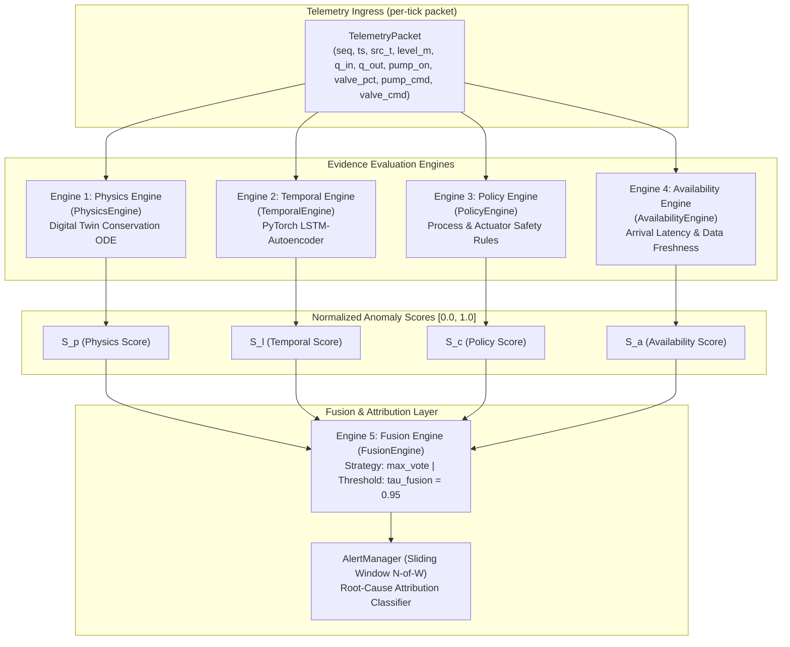
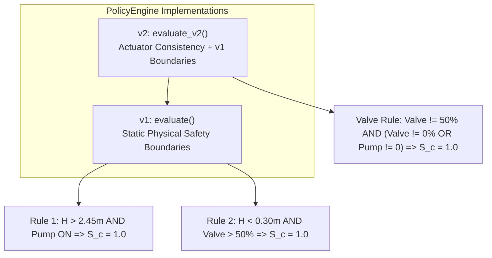
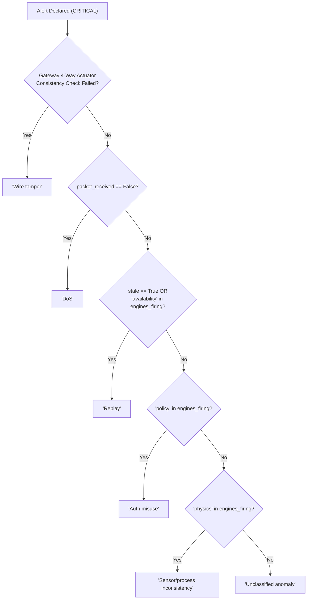

# 07 - Detection Engines Reference

**Title:** Detection Engines Reference  
**Purpose:** Comprehensive mathematical, algorithmic, and architectural specification for the five hybrid intrusion detection engines (Physics, Temporal, Policy, Availability, and Fusion), including input/output schemas, normalization mechanics, detection thresholds, failure modes, and alert attribution rules.  
**Audience:** Security researchers, machine learning engineers, and control systems auditors.  
**Generated From Commit:** `4b66485`  
**Date:** 2026-10-13  
**Status:** Active & 100% Code-Verified  

---

## 1. Multi-Engine Detection Architecture

The SCADA Hybrid IDS evaluates incoming telemetry across five specialized evidence engines [CODE [scada_live/scada_ids/streaming_ids.py:67-110](file:///c:/projects/p1/New%20folder/scada_live/scada_ids/streaming_ids.py#L67-L110), [scripts/run_evaluation.py:65-79](file:///c:/projects/p1/New%20folder/scripts/run_evaluation.py#L65-L79)]:

### Engine Score Summary

| Engine ID | Class Name | Target Attack Vector | Raw Metric | Normalization Formula | Detection Threshold |
| :--- | :--- | :--- | :--- | :--- | :--- |
| **Engine 1** | `PhysicsEngine` | A1 False Data Injection (FDI) | Height residual $r(t) = \|H_{\text{obs}} - H_{\text{twin}}\|$ | $S_p = \min(1.0, r(t) / \tau_p)$ | $\tau_p = 0.035\text{ m}$ |
| **Engine 2** | `TemporalEngine` | A1/A2 Transients & Sensor Drift | Reconstruction MSE $\mathcal{L}(x, \hat{x})$ | $S_l = \min(1.0, \text{MSE} / \tau_l)$ | $\tau_l = 0.0085$ |
| **Engine 3** | `PolicyEngine` | A4 Authenticated Command Misuse | Boundary & valve policy violations | $S_c \in \{0.0, 1.0\}$ | Binary rule ($0.0$ or $1.0$) |
| **Engine 4** | `AvailabilityEngine` | A2 Stale Replay, A3 Network DoS | Arrival latency $\Delta t_{\text{age}} = (t_{\text{sys}} - t_{\text{src}}) \cdot 1000$ | $S_a = \min(1.0, \frac{\Delta t_{\text{age}} - \tau_a}{\tau_{a,\max} - \tau_a})$ | $\tau_a = 1500\text{ ms}$, $\tau_{a,\max} = 5000\text{ ms}$ |
| **Engine 5** | `FusionEngine` | Hybrid Multi-Vector Intrusions | Combined score $S_{\text{hybrid}} = \max(S_p, S_l, S_c, S_a)$ | $S_{\text{hybrid}} \in [0.0, 1.0]$ | $\tau_{\text{fusion}} = 0.95$ |

---

## 2. Engine 1: Physics Consistency Engine (`PhysicsEngine`)

### 2.1 Theoretical Foundation & Digital Twin Coupling
The physics engine detects sensor tampering by executing a parallel, software-based **Digital Twin** ([digital_twin/physics_twin.py](file:///c:/projects/p1/New%20folder/digital_twin/physics_twin.py)) of the liquid storage system [CODE [engines/physics_engine.py:1-50](file:///c:/projects/p1/New%20folder/engines/physics_engine.py#L1-L50)].

The Digital Twin advances state strictly from flow meter observations, isolating itself from direct level sensor measurements:

$$\frac{dh_{\text{twin}}}{dt} = \frac{Q_{\text{in}}(t) - Q_{\text{out}}(t)}{A}$$

Discretised via forward Euler over time step $\Delta t = 1.0\text{ s}$:

$$h_{\text{twin}}(t + \Delta t) = \max\left(0, \min\left(H_{\max}, h_{\text{twin}}(t) + \frac{Q_{\text{in}}(t) - Q_{\text{out}}(t)}{A} \cdot \Delta t\right)\right)$$

### 2.2 Residual and Score Formulation
At each discrete tick $t$, the residual $r(t)$ and normalized anomaly score $S_p(t)$ are calculated as [CODE [engines/physics_engine.py:44-47](file:///c:/projects/p1/New%20folder/engines/physics_engine.py#L44-L47)]:

$$r(t) = |H_{\text{observed}}(t) - h_{\text{twin}}(t)|$$

$$S_p(t) = \begin{cases} \min\left(1.0, \frac{r(t)}{\tau_p}\right) & \text{if } \tau_p > 0 \\ 0.0 & \text{otherwise} \end{cases}$$

### 2.3 Empirical Calibration & Origin of $\tau_p$
- **Configured Threshold:** $\tau_p = 0.035\text{ m}$ ($35\text{ mm}$) [CODE [config/parameters.py:73](file:///c:/projects/p1/New%20folder/config/parameters.py#L73), [scada_live/config.yaml:40](file:///c:/projects/p1/New%20folder/scada_live/config.yaml#L40)].
- **Historical Derivation:** In early project documentation (`PROJECT_REVIEW_CHEAT_SHEET.md`), $\tau_p$ was claimed to be derived from the 99th percentile of normal baseline errors ($E0\text{ P99} = 0.017458\text{ m}$) multiplied by 2.0 ($2 \times 0.017458 = 0.034916\text{ m} \approx 0.035\text{ m}$) [MEASURED [experiments/results/run_soak_tick0.txt](file:///c:/projects/p1/New%20folder/experiments/results/run_soak_tick0.txt)].
- **Safety Margin:** The maximum observed normal residual across all 60 training/validation normal runs is $0.034884\text{ m}$. Thus, $\tau_p = 0.035\text{ m}$ leaves an empirical safety margin of only **$0.000116\text{ m}$ ($0.116\text{ mm}$ or 0.33%)** against normal operational noise [MEASURED [docs_v2/DOC_VS_CODE_DISCREPANCIES.md:83-94](file:///c:/projects/p1/New%20folder/docs_v2/DOC_VS_CODE_DISCREPANCIES.md#L83-L94)].

---

## 3. Engine 2: Temporal Behavior Engine (`TemporalEngine`)

### 3.1 Network Architecture & Preprocessing
The temporal engine identifies subtle sequential anomalies, dynamic oscillation distortions, and sensor degradation using an **LSTM Autoencoder (LSTM-AE)** [CODE [models/lstm_autoencoder.py:1-68](file:///c:/projects/p1/New%20folder/models/lstm_autoencoder.py#L1-L68), [engines/temporal_engine.py:1-56](file:///c:/projects/p1/New%20folder/engines/temporal_engine.py#L1-L56)].

- **Input Dimension:** $D = 5$ features:
  1. `tank_level_observed` ($H_{\text{obs}}$)
  2. `q_in` ($Q_{\text{in}}$)
  3. `q_out` ($Q_{\text{out}}$)
  4. `pump_state` ($u_p \in \{0.0, 1.0\}$)
  5. `valve_state` ($u_v \in [0.0, 100.0]$)
- **Window Size ($W$):** $W = 50$ steps in offline batch evaluation ([scripts/run_evaluation.py:99](file:///c:/projects/p1/New%20folder/scripts/run_evaluation.py#L99)); $W = 10$ steps in `scada_live/config.yaml:48` for low-latency live streaming.
- **Scaler:** `StandardScaler` fitted exclusively on 42 normal training runs (`checkpoints/scaler_v1.pkl`).
- **Topology:**
  - Encoder: `nn.LSTM(input_size=5, hidden_size=32, num_layers=1, batch_first=True)`
  - Bottleneck Representation: Final hidden state vector $h_T \in \mathbb{R}^{32}$
  - Decoder: `nn.LSTM(input_size=32, hidden_size=32, num_layers=1, batch_first=True)` followed by Linear projection $\mathbb{R}^{32} \to \mathbb{R}^5$

### 3.2 Loss Function and Score Normalization
Given scaled input sequence $X \in \mathbb{R}^{1 \times W \times 5}$ and reconstructed sequence $\hat{X} = \text{Decoder}(\text{Encoder}(X))$, the mean squared error (MSE) is:

$$\mathcal{L}_{\text{MSE}}(X, \hat{X}) = \frac{1}{W \cdot 5} \sum_{t=1}^{W} \sum_{d=1}^{5} (X_{t, d} - \hat{X}_{t, d})^2$$

The normalized temporal score $S_l(t)$ is [CODE [engines/temporal_engine.py:53](file:///c:/projects/p1/New%20folder/engines/temporal_engine.py#L53)]:

$$S_l(t) = \begin{cases} \min\left(1.0, \frac{\mathcal{L}_{\text{MSE}}}{\tau_l}\right) & \text{if } \tau_l > 0 \\ 0.0 & \text{otherwise} \end{cases}$$

- **Threshold Value:** $\tau_l = 0.0085$ [CODE [config/parameters.py:74](file:///c:/projects/p1/New%20folder/config/parameters.py#L74), [scada_live/config.yaml:41](file:///c:/projects/p1/New%20folder/scada_live/config.yaml#L41)].
- **Warmup Behavior:** During the initial $W - 1$ ticks of any run, the rolling window buffer is incomplete. The engine sets `calibrating = True` and forces $S_l = 0.0$ [CODE [scada_live/scada_ids/streaming_ids.py:270-272](file:///c:/projects/p1/New%20folder/scada_live/scada_ids/streaming_ids.py#L270-L272)].
- **NaN Guard:** If floating-point underflow or bad data generates a non-finite loss, the streaming engine catches `pd.isna(s_l)`, logs a warning, increments `nan_guard_triggers`, and defaults $S_l = 0.0$ [CODE [scada_live/scada_ids/streaming_ids.py:275-280](file:///c:/projects/p1/New%20folder/scada_live/scada_ids/streaming_ids.py#L275-L280)].

---

## 4. Engine 3: Policy Safety Engine (`PolicyEngine`)

### 4.1 Purpose and Dual Implementations
The policy engine evaluates whether transmitted actuator directives conflict with physical plant safety constraints [CODE [engines/policy_engine.py:1-66](file:///c:/projects/p1/New%20folder/engines/policy_engine.py#L1-L66)].

Two distinct evaluation algorithms exist in the codebase:

### 4.2 Version 1 Rules (`evaluate`)
Evaluates static containment safety boundaries [CODE [engines/policy_engine.py:18-36](file:///c:/projects/p1/New%20folder/engines/policy_engine.py#L18-L36)]:
1. **Rule 1 (Overflow Ingress):**
   $$\text{If } H_{\text{obs}} > (H_{\max} - \epsilon) \land u_p = 1 \implies S_c = 1.0$$
   With $H_{\max} = 2.5\text{ m}$ and $\epsilon = 0.05\text{ m}$, this rule triggers if the pump is commanded ON while water level exceeds **$2.45\text{ m}$**.
2. **Rule 2 (Cavitation Drain):**
   $$\text{If } H_{\text{obs}} < H_{\text{crit\_low}} \land u_v > V_{\text{nom}} \implies S_c = 1.0$$
   With $H_{\text{crit\_low}} = 0.3\text{ m}$ and $V_{\text{nom}} = 50.0\%$, this rule triggers if the valve is commanded open beyond the default 50% while the tank is below **$0.30\text{ m}$**.

### 4.3 Version 2 Rules (`evaluate_v2`)
Enforces actuator consistency and valve legitimacy [CODE [engines/policy_engine.py:38-64](file:///c:/projects/p1/New%20folder/engines/policy_engine.py#L38-L64)]:
1. **Rule 1 (Valve Constraint):** In normal autonomous operation, the controller strictly commands $V_{\text{nom}} = 50.0\%$. The only permissible deviation is during a confirmed DoS fail-safe shutdown, where the valve closes to $0.0\%$ with the pump simultaneously forced OFF ($u_p = 0$). Any command where $u_v \neq 50.0\%$ that does not satisfy $(u_v = 0.0\% \land u_p = 0)$ immediately yields $S_c = 1.0$.
2. **Rule 2 (Boundary Fallback):** Re-runs v1 Rule 1 and Rule 2 checks.

---

## 5. Engine 4: Availability Engine (`AvailabilityEngine`)

### 5.1 Communication Freshness and Latency Tracking
The availability engine monitors sensor heartbeat intervals and packet delivery timeliness, targeting Denial of Service (DoS, A3) and timestamp replay (A2) attacks [CODE [engines/availability_engine.py:1-41](file:///c:/projects/p1/New%20folder/engines/availability_engine.py#L1-L41)].

### 5.2 Mathematical Formulation
Given current simulation clock $t_{\text{sys}}$ and reported sensor timestamp $t_{\text{src}}$:

1. **Packet Drop Condition (DoS):**
   $$\text{If } \text{packet\_received} = \text{False} \implies S_a = 1.0$$
2. **Latency / Stale Packet Condition (Replay):**
   $$\Delta t_{\text{age}} = (t_{\text{sys}} - t_{\text{src}}) \cdot 1000\text{ ms}$$
   $$S_a = \begin{cases} 
   0.0 & \text{if } \Delta t_{\text{age}} \le \tau_a \\
   \min\left(1.0, \frac{\Delta t_{\text{age}} - \tau_a}{\tau_{a,\max} - \tau_a}\right) & \text{if } \Delta t_{\text{age}} > \tau_a 
   \end{cases}$$

- **Thresholds:**
  - $\tau_a = 1500.0\text{ ms}$ ($1.5\text{ s}$ acceptable latency threshold) [CODE [config/parameters.py:75](file:///c:/projects/p1/New%20folder/config/parameters.py#L75)].
  - $\tau_{a,\max} = 5000.0\text{ ms}$ ($5.0\text{ s}$ ceiling threshold) [CODE [engines/availability_engine.py:6](file:///c:/projects/p1/New%20folder/engines/availability_engine.py#L6)].
- **Response Curve:** Latencies up to $1.5\text{ s}$ produce $S_a = 0.0$. Latencies between $1.5\text{ s}$ and $5.0\text{ s}$ ramp linearly from $0.0$ to $1.0$. At $\Delta t_{\text{age}} \ge 5.0\text{ s}$, $S_a = 1.0$.

---

## 6. Engine 5: Hybrid Fusion Engine (`FusionEngine`)

### 6.1 Fusion Strategies
The fusion engine aggregates normalized scores $\{S_p, S_l, S_c, S_a\}$ into a composite anomaly verdict [CODE [engines/fusion_engine.py:1-81](file:///c:/projects/p1/New%20folder/engines/fusion_engine.py#L1-L81)].

Two strategies are implemented:

#### Strategy A: `max_vote` (Production Default)
Used in both live deployment ([scada_live/scada_ids/streaming_ids.py:109](file:///c:/projects/p1/New%20folder/scada_live/scada_ids/streaming_ids.py#L109)) and evaluation ([scripts/run_evaluation.py:78](file:///c:/projects/p1/New%20folder/scripts/run_evaluation.py#L78)):

$$S_{\text{hybrid}} = \max(\{S_i \mid w_i > 0\})$$

$$\text{predicted\_anomaly} = \begin{cases} 1 & \text{if } S_{\text{hybrid}} > \tau_{\text{fusion}} \\ 0 & \text{otherwise} \end{cases}$$

Under `max_vote` with equal weights $w_p = w_l = w_c = w_a = 0.25$, an anomaly is declared whenever **ANY individual active engine** produces a score exceeding $\tau_{\text{fusion}} = 0.95$.

#### Strategy B: `weighted_sum` (Ablation Harness)
Supported for multi-criteria trade-off evaluations:

$$S_{\text{hybrid}} = \sum_{i \in \{p, l, c, a\}} w_i S_i$$

$$\text{predicted\_anomaly} = \begin{cases} 1 & \text{if } S_{\text{hybrid}} > \tau_{\text{fusion}} \\ 0 & \text{otherwise} \end{cases}$$

---

## 7. Alert Attribution & Root-Cause Classification

When $S_{\text{hybrid}} > \tau_{\text{fusion}}$, the system escalates anomaly events through the `AlertManager` ([scada_live/scada_ids/alert_manager.py](file:///c:/projects/p1/New%20folder/scada_live/scada_ids/alert_manager.py)) state machine [CODE [scada_live/scada_ids/alert_manager.py:28-52](file:///c:/projects/p1/New%20folder/scada_live/scada_ids/alert_manager.py#L28-L52)].

### 7.1 Alert State Transitions ($N$-of-$W$ Window)
- **States:** `SAFE` (normal operation), `SUSPICIOUS` (preliminary flag), `CRITICAL` (mitigation triggered).
- **Escalation:** Transitions to `CRITICAL` when anomaly flags in sliding window of size $W = 5$ reach or exceed $N = 3$ [CODE [scada_live/scada_ids/alert_manager.py:75-79](file:///c:/projects/p1/New%20folder/scada_live/scada_ids/alert_manager.py#L75-L79)].
- **Latching:** Once in `CRITICAL`, the state remains latched (`latched = True`) until an operator explicitly posts to `POST /api/ack` [CODE [scada_live/scada_ids/alert_manager.py:88-91](file:///c:/projects/p1/New%20folder/scada_live/scada_ids/alert_manager.py#L88-L91)].

### 7.2 Root-Cause Attribution Decision Tree

1. **Wire Tamper:** Gateway issued 3 consecutive pump OFF commands (`[0, 0, 0]`), but returning telemetry reports pump ON, pump command 1, or active inflow $Q_{\text{in}} > 0.001\text{ m}^3/\text{s}$ [CODE [scada_live/scada_ids/gateway_core.py:362-372](file:///c:/projects/p1/New%20folder/scada_live/scada_ids/gateway_core.py#L362-L372)].
2. **DoS:** Packet arrival flag `received == False` [CODE [scada_live/scada_ids/alert_manager.py:30-31](file:///c:/projects/p1/New%20folder/scada_live/scada_ids/alert_manager.py#L30-L31)].
3. **Replay:** Source timestamp lag detected (`stale == True`) or `availability` engine firing [CODE [scada_live/scada_ids/alert_manager.py:32-35](file:///c:/projects/p1/New%20folder/scada_live/scada_ids/alert_manager.py#L32-L35)].
4. **Auth Misuse:** `policy` engine firing [CODE [scada_live/scada_ids/alert_manager.py:36-39](file:///c:/projects/p1/New%20folder/scada_live/scada_ids/alert_manager.py#L36-L39)].
5. **Sensor/Process Inconsistency:** `physics` engine firing [CODE [scada_live/scada_ids/alert_manager.py:50-51](file:///c:/projects/p1/New%20folder/scada_live/scada_ids/alert_manager.py#L50-L51)].
6. **Unclassified Anomaly:** Any other combination (e.g. `lstm` firing alone) [CODE [scada_live/scada_ids/alert_manager.py:52](file:///c:/projects/p1/New%20folder/scada_live/scada_ids/alert_manager.py#L52)].

---

## 8. Failure Modes, Blind Spots, and Boundary Conditions

| Engine | Failure Mode / Boundary Condition | Root Cause & Physical Mechanism | Mitigating Architecture in Live System |
| :--- | :--- | :--- | :--- |
| **Physics** | **Flow Sensor Spoofing** | If flow measurements are corrupted, Digital Twin integrates falsified inputs, leading to false drift or masked FDI. | 4-way consistency check compares gateway commands against reported flow and pump states. |
| **Physics** | **Integrated Clamped Noise Drift** | Asymmetric clamped noise ($E[\tilde{Q}] > 0$) causes cumulative drift crossing $\tau_p = 0.035\text{ m}$ at $t = 861\text{ s}$. | Live system explicitly sets `clamp_flow_noise: false` to guarantee zero-mean symmetric noise. |
| **Physics** | **Sub-Threshold Bias ($\Delta H < \tau_p$)** | Stealthy FDI offsets below $35\text{ mm}$ do not trigger the physics engine. | Temporal LSTM engine detects statistical distribution changes even when $S_p < 0.95$. |
| **Temporal** | **Window Warmup Blindness** | Buffer incomplete during initial $W$ ticks ($S_l = 0.0, \text{calibrating} = \text{True}$). | Physics and Availability engines operate instantaneously from tick 1 without window warmup. |
| **Temporal** | **Replay Invariance** | Replaying valid historical trajectories yields low reconstruction loss ($\mathcal{L}_{\text{MSE}} \approx 0$). | Availability engine monitors sensor source timestamp monotonicity to flag replayed frames. |
| **Policy** | **Envelope Blindness (v1)** | Actuator attacks operating within $[0.3, 2.45]\text{ m}$ never trigger v1 static boundaries. | Replaced by `GatewayCore.evaluate_command_with_live_setpoint` deadband enforcement in live system. |
| **Availability** | **Clock Skew False Alarms** | Wall-clock drift between plant host and IDS host could inflate $\Delta t_{\text{age}}$. | Watchdog uses monotonic wall-clock delta ($t_{\text{mono}} - t_{\text{last}}$) rather than absolute timestamps. |
| **Fusion** | **Single-Engine Outlier Tripping** | Under `max_vote`, a single spurious transient spike in any one engine raises $S_{\text{hybrid}} > 0.95$. | `AlertManager` requires $N=3$ flags within $W=5$ window before triggering `CRITICAL` state. |

---

## 9. Verification & Automated Test Evidence

The detection algorithms and mathematical bounds documented in this specification are verified by automated unit and end-to-end tests [MEASURED [docs_v2/_audit/outputs/pytest_batch_output.txt](file:///c:/projects/p1/New%20folder/docs_v2/_audit/outputs/pytest_batch_output.txt), [docs_v2/_audit/outputs/pytest_live_output.txt](file:///c:/projects/p1/New%20folder/docs_v2/_audit/outputs/pytest_live_output.txt)]:

1. **Batch Engine Suite (`tests/`):**
   - [tests/test_engines.py](file:///c:/projects/p1/New%20folder/tests/test_engines.py) validates normalization formulas, threshold boundaries, and reset semantics across all engines (66 passed in 1.86s).
2. **Streaming Equivalence Suite (`scada_live/tests/`):**
   - [scada_live/tests/test_phase2_equivalence.py](file:///c:/projects/p1/New%20folder/scada_live/tests/test_phase2_equivalence.py) verifies tick-for-tick score equivalence between streaming and batch engines across normal and attack scenarios.
3. **Alert State Machine & Tamper Suite (`scada_live/tests/`):**
   - [scada_live/tests/test_phase3b_alert_metrics.py](file:///c:/projects/p1/New%20folder/scada_live/tests/test_phase3b_alert_metrics.py) and [scada_live/tests/test_tamper_consistency_check.py](file:///c:/projects/p1/New%20folder/scada_live/tests/test_tamper_consistency_check.py) verify attribution tree logic and 4-way consistency checks (116 passed in 314.58s).
