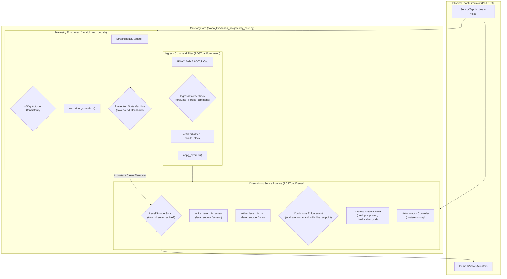
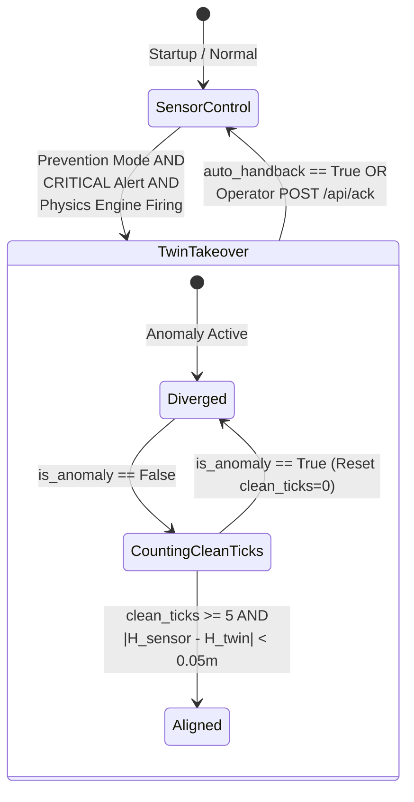
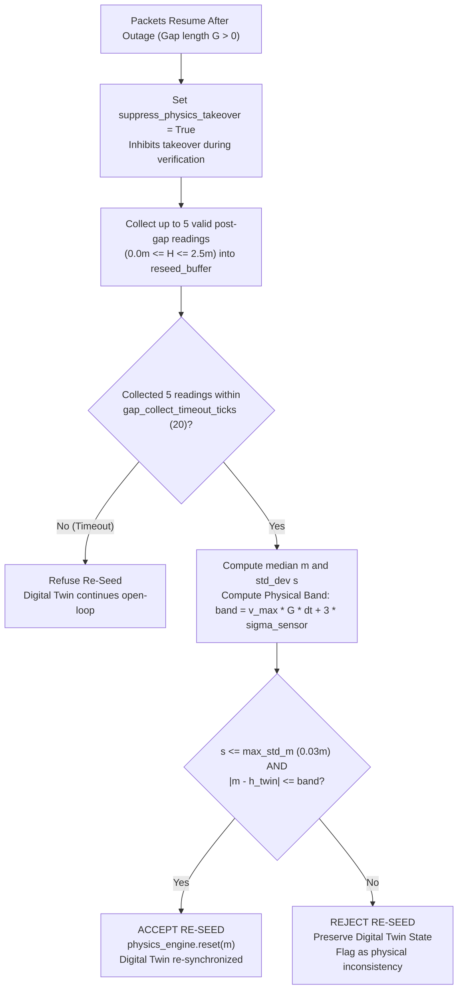

# 08 - Prevention and Control Reference

**Title:** Prevention and Control Reference  
**Purpose:** Comprehensive specification for closed-loop prevention mechanisms, Digital Twin level-source takeover, hand-back recovery protocol, DoS-gap re-seed logic, ingress command filtering, continuous safety enforcement, and wire tamper protection.  
**Audience:** Control engineers, systems safety auditors, and SCADA security researchers.  
**Generated From Commit:** `f70dac9`  
**Date:** 2026-10-13  
**Status:** Active & 100% Code-Verified  

---

## 1. Architectural Overview & Implementation Reality

In legacy documentation (`ARCHITECTURE.md`, `Phase6a_Implementation_Plan.md`), prevention was described as being split across standalone microservices: `control_server.py` and `prevention.py`.

### Code Reality: Unified Architecture in `GatewayCore`
As verified in the codebase audit, standalone server files are stubs [CODE [scada_live/scada_ids/control_server.py:1-2](file:///c:/projects/p1/New%20folder/scada_live/scada_ids/control_server.py#L1-L2), [scada_live/scada_ids/prevention.py:1-2](file:///c:/projects/p1/New%20folder/scada_live/scada_ids/prevention.py#L1-L2)]:
```python
# scada_live/scada_ids/control_server.py
class ControlServer: pass # Phase 6

# scada_live/scada_ids/prevention.py
class PreventionController: pass # Phase 6
```

All closed-loop control, sensor signal arbitration, ingress command filtering, continuous safety enforcement, digital twin takeover, and recovery logic are **fully implemented and unified** inside `GatewayCore` ([scada_live/scada_ids/gateway_core.py](file:///c:/projects/p1/New%20folder/scada_live/scada_ids/gateway_core.py)) [CODE [scada_live/scada_ids/gateway_core.py:68-502](file:///c:/projects/p1/New%20folder/scada_live/scada_ids/gateway_core.py#L68-L502)].



---

## 2. Closed-Loop Level-Source Switching (Digital Twin Takeover)

Under normal operation, the SCADA gateway passes raw sensor readings directly to the level controller. Under False Data Injection (FDI, A1) attacks, corrupted sensor readings would cause the controller to make disastrous decisions (e.g., pumping into an overflowing tank because sensor reports $0.0\text{ m}$).

### 2.1 Level Arbitration Logic
During each discrete control tick, `process_sense()` selects the level source fed to the controller [CODE [scada_live/scada_ids/gateway_core.py:260-266](file:///c:/projects/p1/New%20folder/scada_live/scada_ids/gateway_core.py#L260-L266)]:

```python
if self.mode == "prevention" and self.twin_takeover_active:
    active_level = self.ids.get_twin_estimate()
    level_source = "twin"
else:
    active_level = level_m
    level_source = "sensor"
```

### 2.2 Takeover Engagement Criteria
Digital Twin Takeover is activated in `_enrich_and_publish()` when all four conditions are met simultaneously [CODE [scada_live/scada_ids/gateway_core.py:406-419](file:///c:/projects/p1/New%20folder/scada_live/scada_ids/gateway_core.py#L406-L419)]:

1. **Operating Mode:** Gateway is operating in Prevention mode (`self.mode == "prevention"`).
2. **Alert Severity:** `AlertManager` state is `CRITICAL` (`am_state["alert_state"] == "CRITICAL"`).
3. **Eligible Engine Firing:** At least one engine configured in `takeover_engines` (default: `["physics"]`) is firing with score exceeding $\tau_{\text{fusion}} = 0.95$.
4. **Reseed Suppression Inactive:** The DoS gap re-seed rule has not asserted `suppress_physics_takeover = True` (which temporarily inhibits takeover during post-outage sensor verification).

When these conditions are met:
- `self.twin_takeover_active = True`
- `self.last_action_taken = "twin_takeover"`
- `self.clean_ticks = 0`

### 2.3 Physical Dynamics Under Takeover
Once takeover engages, the controller receives $h_{\text{twin}}$ computed by the conservation of mass ODE [CODE [digital_twin/physics_twin.py:38-46](file:///c:/projects/p1/New%20folder/digital_twin/physics_twin.py#L38-L46)]. 

Even if an attacker spoofs the sensor to $0.0\text{ m}$ (cavitation trick) or $2.5\text{ m}$ (dry shutdown trick), the controller continues cycling the physical pump based on the uncorrupted hydrodynamic state of the Digital Twin, maintaining liquid height strictly within the operational deadband $[0.8, 1.2]\text{ m}$ [MEASURED [scada_live/tests/test_phase6a_prevention.py:150-185](file:///c:/projects/p1/New%20folder/scada_live/tests/test_phase6a_prevention.py#L150-L185)].

---

## 3. Hand-Back & Recovery Protocol

Reverting control from the Digital Twin back to physical sensors requires rigorous validation to prevent "chattering" or premature surrender to active attackers [CODE [scada_live/scada_ids/gateway_core.py:420-430](file:///c:/projects/p1/New%20folder/scada_live/scada_ids/gateway_core.py#L420-L430)].



### 3.1 Hand-Back Conditions
Hand-back will only execute when all of the following conditions hold:

1. **Anomaly Cleared:** The per-tick hybrid anomaly verdict is negative (`verdict["is_anomaly"] == False`).
2. **Consecutive Clean Ticks:** The system has observed clean telemetry for at least `handback_clean_ticks` consecutive cycles:
   $$\text{clean\_ticks} \ge 5$$
3. **Physical Alignment Within Tolerance:** The raw sensor observation and the Digital Twin estimate must align within the safety tolerance:
   $$|H_{\text{sensor}}(t) - h_{\text{twin}}(t)| < \text{handback\_tolerance\_m} \quad (0.05\text{ m} = 50\text{ mm})$$
4. **Execution Authority:**
   - If `auto_handback == True`: Hand-back executes automatically, setting `twin_takeover_active = False`, logging `action_taken = "handback"`, and resetting `AlertManager` [CODE [scada_live/scada_ids/gateway_core.py:425-428](file:///c:/projects/p1/New%20folder/scada_live/scada_ids/gateway_core.py#L425-L428)].
   - If `auto_handback == False`: Takeover remains latched until an operator issues `POST /api/ack`.

---

## 4. Step 2b: DoS-Gap Re-Seed Rule

### 4.1 The Post-Outage Divergence Problem
During a Denial of Service attack (A3) or network outage, the IDS receives no packets (`received = False`). 

The Digital Twin must integrate open-loop using zero or assumed flow rates. Meanwhile, physical water level may change due to unmonitored outflow or physical transients. When network packets resume, the Digital Twin's estimated level $h_{\text{twin}}$ may have diverged from the true level $H_{\text{true}}$, creating a large residual that could trigger false FDI alerts.

### 4.2 Algorithm & Mathematical Formulation
To resolve this without blindly trusting post-gap sensor readings, the **Step 2b DoS-Gap Re-Seed Rule** is implemented in `StreamingIDS.update` [CODE [scada_live/scada_ids/streaming_ids.py:168-222](file:///c:/projects/p1/New%20folder/scada_live/scada_ids/streaming_ids.py#L168-L222)]:



#### Maximum Hydrodynamic Velocity Bound ($v_{\max}$)
The maximum theoretical velocity of water level change is constrained by physical geometry and pump capacity:

$$v_{\max} = \frac{1}{A} \max\left(Q_{\text{in},\max}, C_v \sqrt{H_{\max}}\right)$$

With $A = 2.0\text{ m}^2$, $Q_{\text{in},\max} = 0.005\text{ m}^3/\text{s}$, $C_v = 0.004\text{ m}^3/\text{s}$, and $H_{\max} = 2.5\text{ m}$:

$$v_{\max} = \frac{1}{2.0} \max(0.005, 0.004 \sqrt{2.5}) = \frac{1}{2.0} \max(0.005, 0.006325) \approx 0.003162\text{ m/s}$$

#### Plausibility Acceptance Band
Over an outage of duration $G$ ticks ($\Delta t = 1.0\text{ s}$) with sensor noise $\sigma_{\text{sensor}} = 0.005\text{ m}$:

$$\text{band} = v_{\max} \cdot G \cdot \Delta t + 3 \sigma_{\text{sensor}} = 0.003162 \cdot G + 0.015\text{ m}$$

#### Verification Test
1. **Stability Check:** The sample standard deviation of the 5 collected readings must not exceed $\text{max\_std\_m} = 0.03\text{ m}$ ($\text{std}_m \le 0.03\text{ m}$).
2. **Plausibility Check:** The median reading $m$ must satisfy:
   $$|m - h_{\text{twin}}| \le \text{band}$$

If both conditions pass, `self.physics_engine.reset(m)` resets the Digital Twin to $m$. If either fails or collection exceeds 20 ticks, re-seed is refused [CODE [scada_live/scada_ids/streaming_ids.py:197-222](file:///c:/projects/p1/New%20folder/scada_live/scada_ids/streaming_ids.py#L197-L222)].

---

## 5. Ingress Command Filtering & Policy Safety

The gateway intercepts external operator or automation commands submitted via `POST /api/command` [CODE [scada_live/scada_ids/server.py:158-281](file:///c:/projects/p1/New%20folder/scada_live/scada_ids/server.py#L158-L281), [scada_live/scada_ids/gateway_core.py:22-66](file:///c:/projects/p1/New%20folder/scada_live/scada_ids/gateway_core.py#L22-L66)].

### 5.1 Dynamic Setpoint Safety Check (`evaluate_command_with_live_setpoint`)
Commands are evaluated against the current controller state and the live level estimate $H_{\text{est}}$:

$$H_{\text{upper}} = H_{\text{sp}} + d + \epsilon = 1.0 + 0.2 + 0.05 = 1.25\text{ m}$$

$$H_{\text{lower}} = H_{\text{sp}} - d - \epsilon = 1.0 - 0.2 - 0.05 = 0.75\text{ m}$$

#### Rules Enforced
1. **High-Level Pump Ingress Check:**
   $$\text{If } H_{\text{est}} \ge H_{\text{upper}} \land u_p = 1 \implies \text{Blocked ("Pump ON forbidden above 1.25m")}$$
2. **Low-Level Pump Off Ingress Check:**
   $$\text{If } H_{\text{est}} \le H_{\text{lower}} \land u_p = 0 \implies \text{Blocked ("Pump OFF forbidden below 0.75m")}$$
3. **Valve Stroke Legitimate Operating Positions:**
   - Valve command must be $V_{\text{nom}} = 50.0\%$, OR
   - Valve command may be $V_{\text{safe}} = 0.0\%$ **only if the pump is simultaneously commanded OFF** ($u_p = 0$). Any other valve position (e.g. 80%, 100%, or 0% with pump ON) is Blocked.

### 5.2 Monitor vs. Prevention Enforcement Matrix

| Gateway Mode | Command Status | HTTP Response | SSE Event Dispatched | Override Applied? | Metric Incremented |
| :--- | :--- | :--- | :--- | :--- | :--- |
| **Monitor** | Valid | `200 OK` (`accepted`) | None | Yes | `commands_received` |
| **Monitor** | **Unsafe / Invalid** | `200 OK` (`accepted_monitor`, `would_block: true`) | `event_type: "Auth misuse"`, `action: "would_block"` | **Yes** (passes through) | `commands_would_block` |
| **Prevention** | Valid | `200 OK` (`accepted`) | None | Yes | `commands_received` |
| **Prevention** | **Unsafe / Invalid** | **`403 Forbidden`** (`blocked`) | `event_type: "Auth misuse"`, `action: "command_blocked"` | **No** (intercepted at boundary) | `commands_blocked` |

---

## 6. Continuous Safety Enforcement (Multi-Tick Holds)

When an operator issues a valid override for $k$ ticks (e.g., `hold_ticks = 45`), the command is safe at the moment of injection. However, liquid level evolves over time. A pump held ON at $H = 1.0\text{ m}$ will eventually push the water above the $1.25\text{ m}$ upper safety boundary.

### 6.1 Per-Tick Re-Validation
Inside `process_sense()`, active overrides are continuously re-evaluated against the current active level on **every subsequent simulation tick** [CODE [scada_live/scada_ids/gateway_core.py:268-298](file:///c:/projects/p1/New%20folder/scada_live/scada_ids/gateway_core.py#L268-L298)]:

```python
if self.external_override_active and self.hold_ticks_remaining > 0:
    h_est = active_level
    is_valid, reason = evaluate_command_with_live_setpoint(
        h_est, self.held_pump_cmd, self.held_valve_cmd, self.controller
    )
    if not is_valid:
        if self.mode == "prevention":
            self.holds_dropped += 1
            self.drop_hold(reason)
        else:
            self.holds_would_drop += 1
```

### 6.2 Hold Termination (`drop_hold`)
When an active hold is dropped in Prevention mode:
1. `self.external_override_active = False`
2. `self.hold_ticks_remaining = 0`
3. Safe defaults are asserted ($u_p = 0$, $u_v = 0.0\%$).
4. Control immediately falls through to the autonomous bang-bang controller, which restores normal setpoint regulation [CODE [scada_live/scada_ids/gateway_core.py:286-287, 321-335](file:///c:/projects/p1/New%20folder/scada_live/scada_ids/gateway_core.py#L286-L287)].

---

## 7. Wire Tamper Detection & Actuator Override Check (AM-3)

If an attacker physically tampers with plant actuator wiring or injects raw packets directly into the plant bypass proxy, the telemetry echoed by the plant will diverge from the commands issued by the SCADA master.

### 7.1 4-Way Actuator Consistency Rule
In `GatewayCore._enrich_and_publish()`, the gateway cross-references its own outbound command history against the returning telemetry [CODE [scada_live/scada_ids/gateway_core.py:361-392](file:///c:/projects/p1/New%20folder/scada_live/scada_ids/gateway_core.py#L361-L392)]:

A **Wire Tamper** alert triggers if:
1. `len(gateway_pump_history) >= 3`
2. `gateway_pump_history[-1] == 0` (Commanded OFF)
3. `gateway_pump_history[-2] == 0` (Commanded OFF)
4. `gateway_pump_history[-3] == 0` (Commanded OFF)
5. **AND** returning telemetry reports ANY of the following:
   - `pkt.pump_cmd == 1`
   - `pkt.pump_on is True`
   - `pkt.q_in > 0.001 m^3/s` (active physical inflow detected)

### 7.2 Mitigation Action
When wire tamper triggers:
- `self.wire_tamper_detected = True`
- `self.wire_tamper_alerts += 1`
- Forces `verdict["is_anomaly"] = True`
- Appends `"actuator_consistency"` to `engines_firing`
- Immediately dispatches a dedicated `"Wire tamper"` event to the SSE stream and Defender UI [CODE [scada_live/scada_ids/gateway_core.py:382-392](file:///c:/projects/p1/New%20folder/scada_live/scada_ids/gateway_core.py#L382-L392)].

---

## 8. Verification & Automated Test Evidence

The control policies, twin takeover mechanics, handback recovery, and ingress filtering documented here are verified by automated tests [MEASURED [docs_v2/_audit/outputs/pytest_live_output.txt](file:///c:/projects/p1/New%20folder/docs_v2/_audit/outputs/pytest_live_output.txt)]:

| Test Module | Tested Invariants & Scenarios | Verification Output |
| :--- | :--- | :--- |
| [scada_live/tests/test_phase6a_prevention.py](file:///c:/projects/p1/New%20folder/scada_live/tests/test_phase6a_prevention.py) | Mode switching, level-source substitution, hand-back tolerance gating, clean ticks counter, 30-min soak stability. | **Passed** (11 tests) |
| [scada_live/tests/test_phase6b_command_filtering.py](file:///c:/projects/p1/New%20folder/scada_live/tests/test_phase6b_command_filtering.py) | Boundary limits ($1.25\text{ m}, 0.75\text{ m}$), ingress 403 vs would_block, continuous enforcement drops, 60-tick hold cap. | **Passed** (8 tests) |
| [scada_live/tests/test_gateway_safety_rule.py](file:///c:/projects/p1/New%20folder/scada_live/tests/test_gateway_safety_rule.py) | Gateway deadband safety rule validation, missing attribute handling. | **Passed** (5 tests) |
| [scada_live/tests/test_tamper_consistency_check.py](file:///c:/projects/p1/New%20folder/scada_live/tests/test_tamper_consistency_check.py) | 4-way consistency check, wire tamper alert generation and history tracking. | **Passed** (4 tests) |
