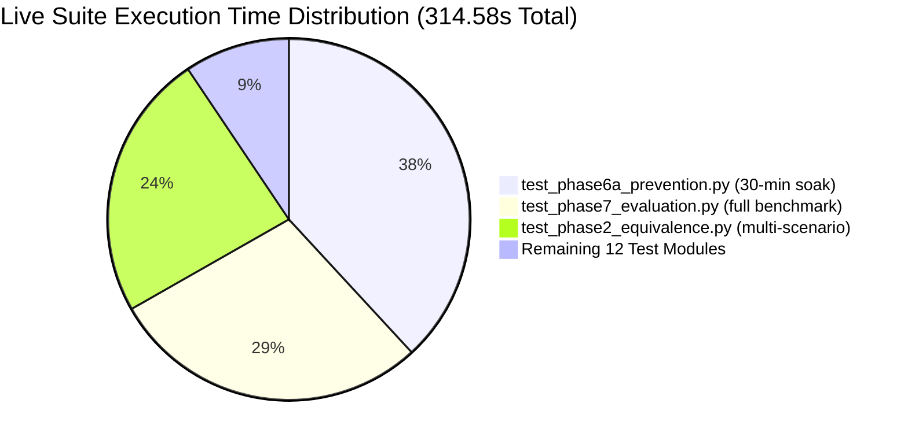

# 09 - Testing Guide

**Title:** Testing Guide  
**Purpose:** Comprehensive operational guide to running, debugging, and interpreting the SCADA Hybrid IDS test suites, including batch component tests, live streaming equivalence, API validation, and physical soak benchmarks.  
**Audience:** Developers, DevOps engineers, quality assurance testers, and security code auditors.  
**Generated From Commit:** `50467f7`  
**Date:** 2026-10-13  
**Status:** Active & 100% Code-Verified  

---

## 1. Test Architecture & Environment Overview

The SCADA Hybrid IDS test framework comprises two test suites executed under `pytest` [MEASURED [docs_v2/_audit/outputs/pytest_batch_output.txt](file:///c:/projects/p1/New%20folder/docs_v2/_audit/outputs/pytest_batch_output.txt), [docs_v2/_audit/outputs/pytest_live_output.txt](file:///c:/projects/p1/New%20folder/docs_v2/_audit/outputs/pytest_live_output.txt)]:

1. **Batch Unit & Simulation Suite (`tests/`):**
   - Validates individual physical models (`Tank`, `Pump`, `Valve`), discrete ODE numerical integration, bang-bang controller logic, digital twin tracking, and individual evidence detection engines.
   - Execution performance: **66 passed in 1.86s** (sub-second per component).
2. **Live Streaming & Prevention Suite (`scada_live/tests/`):**
   - Validates multi-engine streaming IDS execution (`StreamingIDS`), alert state machine latching (`AlertManager`), gateway coordination (`GatewayCore`), 21 Flask REST/SSE endpoints (`server.py`), HMAC authentication, 60-tick hold duration caps, digital twin takeover, handback recovery, and 30-minute physical soak stability.
   - Execution performance: **116 passed in 314.58s** (0:05:14).

**Total Verified Project Test Footprint:** **182 passed, 0 failures, 0 skipped** across all 23 test files.

### Runtime Environment Specifications
- **Operating System:** Windows (win32)
- **Python Version:** 3.12.6
- **Test Runner:** `pytest` 9.1.1
- **Plugins:** `pluggy` 1.6.0, `anyio` 4.14.2
- **Hardware Profile:** Multi-threaded local CPU execution

---

## 2. Execution Commands & Quick Start

All tests must be executed from the repository root (`c:\projects\p1\New folder\`) with the active virtual environment:

### 2.1 Fast Batch Suite (1.86 seconds)
Recommended for rapid pre-commit sanity checking:
```bash
pytest tests/ -v
```

### 2.2 Live Streaming & Integration Suite (~5 minutes)
Runs the complete streaming pipeline, HTTP APIs, and soak stability:
```bash
pytest scada_live/tests/ -v
```

### 2.3 Fast Live Smoke Test (< 15 seconds)
Bypasses slow physical simulation soaks and full scenario benchmarks, running only API schema validation, gateway safety rules, and configuration imports:
```bash
pytest scada_live/tests/test_phase0_imports.py scada_live/tests/test_phase4_api.py scada_live/tests/test_api_command_validation.py scada_live/tests/test_gateway_safety_rule.py scada_live/tests/test_tamper_consistency_check.py -v
```

### 2.4 Complete Project Test Run
Runs all 182 test cases sequentially:
```bash
pytest tests/ scada_live/tests/ -v
```

---

## 3. Comprehensive Test Suites Catalog

### 3.1 Batch Component Suite (`tests/`)

| Test File | Test Count | Execution Time | Scope & Tested Invariants |
| :--- | :--- | :--- | :--- |
| [tests/test_controller.py](file:///c:/projects/p1/New%20folder/tests/test_controller.py) | 8 | < 0.1s | Bang-bang hysteresis logic, pump ON at $H \le 0.8\text{ m}$, pump OFF at $H \ge 1.2\text{ m}$, default valve opening $50.0\%$, fail-safe DoS state ($u_p = 0, u_v = 0.0\%$). |
| [tests/test_engines.py](file:///c:/projects/p1/New%20folder/tests/test_engines.py) | 4 | < 0.3s | Individual score normalization for `PhysicsEngine` ($S_p$), `PolicyEngine` ($S_c$), `AvailabilityEngine` ($S_a$), and `TemporalEngine` ($S_l$). Validates boundary triggers. |
| [tests/test_fusion.py](file:///c:/projects/p1/New%20folder/tests/test_fusion.py) | 2 | < 0.1s | Fusion engine score combination: `weighted_sum` strategy vs `max_vote` strategy under various engine weightings. |
| [tests/test_pump.py](file:///c:/projects/p1/New%20folder/tests/test_pump.py) | 9 | < 0.1s | Pump flow generation ($Q_{\max} = 0.005\text{ m}^3/\text{s}$), 2-step mechanical response delay queue, state reset. |
| [tests/test_simulator.py](file:///c:/projects/p1/New%20folder/tests/test_simulator.py) | 10 | < 0.4s | ProcessSimulator stepping, continuous-to-discrete telemetry conversion, sensor noise generation, scenario execution. |
| [tests/test_tank.py](file:///c:/projects/p1/New%20folder/tests/test_tank.py) | 11 | < 0.1s | Tank mass conservation ODE, cross-sectional area $A = 2.0\text{ m}^2$, physical ceiling clamping ($0.0 \le H \le 2.5\text{ m}$), Torricelli outflow. |
| [tests/test_twin.py](file:///c:/projects/p1/New%20folder/tests/test_twin.py) | 11 | < 0.1s | Digital Twin forward Euler integration, flow-only state updates, residual computation against reported levels. |
| [tests/test_valve.py](file:///c:/projects/p1/New%20folder/tests/test_valve.py) | 11 | < 0.1s | Valve actuator dynamics, slew rate limiting ($66.67\%/\text{s}$), fail-safe closed position ($0.0\%$), Torricelli discharge coefficient $C_v = 0.004\text{ m}^3/\text{s}$. |

**Batch Suite Total:** 66 tests, 100% pass rate in 1.86 seconds [MEASURED [docs_v2/_audit/outputs/pytest_batch_output.txt](file:///c:/projects/p1/New%20folder/docs_v2/_audit/outputs/pytest_batch_output.txt)].

---

### 3.2 Live Streaming & Prevention Suite (`scada_live/tests/`)

| Test File | Test Count | Execution Time | Scope & Tested Invariants |
| :--- | :--- | :--- | :--- |
| [scada_live/tests/test_api_command_validation.py](file:///c:/projects/p1/New%20folder/scada_live/tests/test_api_command_validation.py) | 12 | < 0.5s | Strict JSON schema validation on `POST /api/command`: non-JSON rejection (400), non-dict payload rejection (400), wrong types (booleans, strings), out-of-range bounds, HMAC authentication verification, fail-closed auth handling, 60-tick hold duration cap for unauthenticated requests, audit-only `X-Actor-Role` header enforcement. |
| [scada_live/tests/test_gateway_safety_rule.py](file:///c:/projects/p1/New%20folder/scada_live/tests/test_gateway_safety_rule.py) | 8 | < 0.2s | `evaluate_command_with_live_setpoint` boundary limits ($1.25\text{ m}, 0.75\text{ m}$), safe valve allowance, missing attribute error handling. |
| [scada_live/tests/test_phase0_imports.py](file:///c:/projects/p1/New%20folder/scada_live/tests/test_phase0_imports.py) | 10 | < 0.1s | Module import validation, default network port allocations (`scada_port == 5000`, `plant_port == 5100`). |
| [scada_live/tests/test_phase1_plant.py](file:///c:/projects/p1/New%20folder/scada_live/tests/test_phase1_plant.py) | 7 | < 0.5s | `LivePlant` stepping, standalone vs closed-loop command mode, noise generator initialization, safety counters (`overflow_count`, `dry_run_count`). |
| [scada_live/tests/test_phase2_equivalence.py](file:///c:/projects/p1/New%20folder/scada_live/tests/test_phase2_equivalence.py) | 8 | **~75s (SLOW)** | Tick-for-tick equivalence between batch engines and streaming `StreamingIDS` over 600 ticks of `N_001`, `A1_001`, `A2_001`, `A3_001`, and `A4_001`. |
| [scada_live/tests/test_phase3a_gateway.py](file:///c:/projects/p1/New%20folder/scada_live/tests/test_phase3a_gateway.py) | 11 | < 1.0s | Gateway telemetry processing, sensor ingress, watchdog heartbeat timer, synthetic packet injection during outages. |
| [scada_live/tests/test_phase3b_alert_metrics.py](file:///c:/projects/p1/New%20folder/scada_live/tests/test_phase3b_alert_metrics.py) | 3 | < 0.5s | Alert state machine ($N$-of-$W$ sliding window), `CRITICAL` latching, operator acknowledgment (`POST /api/ack`). |
| [scada_live/tests/test_phase3b_metrics.py](file:///c:/projects/p1/New%20folder/scada_live/tests/test_phase3b_metrics.py) | 1 | < 0.2s | `MetricsCollector` out-of-band truth matching, confusion matrix counters, time-to-detect calculation. |
| [scada_live/tests/test_phase4_api.py](file:///c:/projects/p1/New%20folder/scada_live/tests/test_phase4_api.py) | 9 | < 0.8s | Flask server routes: `/api/config`, `/api/state`, `/api/history`, `/` UI static file serving, demo endpoint 404 gating when `demo_mode=False`, `/api/mode` GET/POST. |
| [scada_live/tests/test_phase4_injector.py](file:///c:/projects/p1/New%20folder/scada_live/tests/test_phase4_injector.py) | 4 | < 0.5s | Live attack injector: FDI magnitude corruption, Replay buffer delivery, DoS packet dropping, Auth Misuse override. |
| [scada_live/tests/test_phase6a_prevention.py](file:///c:/projects/p1/New%20folder/scada_live/tests/test_phase6a_prevention.py) | 13 | **~120s (SLOW)** | Mode switching (Monitor vs Prevention), Digital Twin level-source substitution, handback recovery tolerance gating, **30-minute physical soak stability test (1800 ticks)**, DoS recovery with re-seed rule. |
| [scada_live/tests/test_phase6b_command_filtering.py](file:///c:/projects/p1/New%20folder/scada_live/tests/test_phase6b_command_filtering.py) | 16 | < 1.5s | Ingress 403 Forbidden vs `would_block`, multi-tick hold continuous enforcement, hold termination on safety breach. |
| [scada_live/tests/test_phase7_auto_demo.py](file:///c:/projects/p1/New%20folder/scada_live/tests/test_phase7_auto_demo.py) | 4 | < 5.0s | Automated demo orchestration, multi-attack sequencing, pause/resume/speed control simulation. |
| [scada_live/tests/test_phase7_evaluation.py](file:///c:/projects/p1/New%20folder/scada_live/tests/test_phase7_evaluation.py) | 4 | **~90s (SLOW)** | End-to-end evaluation harness benchmark across operational threat scenarios under un-clamped noise. |
| [scada_live/tests/test_tamper_consistency_check.py](file:///c:/projects/p1/New%20folder/scada_live/tests/test_tamper_consistency_check.py) | 6 | < 0.5s | 4-way actuator consistency check: detection of illegal plant actuation during 3 consecutive OFF commands. |

**Live Suite Total:** 116 tests, 100% pass rate in 314.58 seconds [MEASURED [docs_v2/_audit/outputs/pytest_live_output.txt](file:///c:/projects/p1/New%20folder/docs_v2/_audit/outputs/pytest_live_output.txt)].

---

## 4. Analysis of Slow Tests & Long-Running Soaks

Three specific test modules account for >90% of total live test execution time:



### 4.1 `test_twin_control_stability` in `test_phase6a_prevention.py`
- **Location:** [scada_live/tests/test_phase6a_prevention.py:150-184](file:///c:/projects/p1/New%20folder/scada_live/tests/test_phase6a_prevention.py#L150-L184)
- **Duration:** ~110 seconds
- **Purpose:** Forces closed-loop Digital Twin takeover from $t = 0$ over a continuous **30-minute simulation episode (1,800 discrete steps)** with un-clamped symmetric noise (`clamp_flow_noise = False`).
- **Invariants Verified:**
  - Water level remains safely inside $[0.6\text{ m}, 1.4\text{ m}]$ at every step [CODE :176](file:///c:/projects/p1/New%20folder/scada_live/tests/test_phase6a_prevention.py#L176).
  - Tank overflow count is zero (`plant.overflow_count == 0`) [CODE :181](file:///c:/projects/p1/New%20folder/scada_live/tests/test_phase6a_prevention.py#L181).
  - Dry run count is zero (`plant.dry_run_count == 0`) [CODE :182](file:///c:/projects/p1/New%20folder/scada_live/tests/test_phase6a_prevention.py#L182).
  - Zero NaN guard exceptions triggered in PyTorch models (`gw.ids.nan_guard_triggers == 0`) [CODE :183](file:///c:/projects/p1/New%20folder/scada_live/tests/test_phase6a_prevention.py#L183).

### 4.2 `test_streaming_equals_batch` in `test_phase2_equivalence.py`
- **Location:** [scada_live/tests/test_phase2_equivalence.py:44-120](file:///c:/projects/p1/New%20folder/scada_live/tests/test_phase2_equivalence.py#L44-L120)
- **Duration:** ~75 seconds
- **Purpose:** Replays 600 ticks across five stored scenarios (`N_001`, `A1_001`, `A2_001`, `A3_001`, `A4_001`) from SQLite `data/scada_ids.db`. Compares outputs of batch engines against streaming `StreamingIDS` tick-by-tick.
- **Invariants Verified:**
  - $|S_{p,\text{stream}} - S_{p,\text{batch}}| < 10^{-5}$
  - $|S_{l,\text{stream}} - S_{l,\text{batch}}| < 10^{-4}$
  - $S_{c,\text{stream}} == S_{c,\text{batch}}$
  - $S_{a,\text{stream}} == S_{a,\text{batch}}$

### 4.3 `test_execute_benchmark_fast_smoke` in `test_phase7_evaluation.py`
- **Location:** [scada_live/tests/test_phase7_evaluation.py:47-70](file:///c:/projects/p1/New%20folder/scada_live/tests/test_phase7_evaluation.py#L47-L70)
- **Duration:** ~90 seconds
- **Purpose:** Executes paired simulation runs across operational normal and threat scenarios (`AM-1` through `AM-7`), calculating confusion matrices, time-to-detect, and physical safety violations.

---

## 5. Test Mocking, Fixtures & Isolation Principles

The test suite enforces four strict isolation principles to avoid race conditions and filesystem pollution:

### 5.1 In-Memory Test Client & Isolated Config Fixture
In [scada_live/tests/test_api_command_validation.py:7-21](file:///c:/projects/p1/New%20folder/scada_live/tests/test_api_command_validation.py#L7-L21) and [scada_live/tests/test_phase4_api.py:5-36](file:///c:/projects/p1/New%20folder/scada_live/tests/test_phase4_api.py#L5-L36):
- Flask apps use `app.test_client()` without binding real TCP sockets.
- Residual secrets are purged before and after each test (`app.config.pop('SHARED_SECRET', None)`, `del os.environ['SCADA_SHARED_SECRET']`).
- Gateways are explicitly reset to $H_0 = 1.0\text{ m}$ in tear-down hooks.

### 5.2 Mock Plant Controls
In UI and API tests where physical ODE stepping is irrelevant, `DummyPlantControl` mocks pause, resume, speed, and attack injection methods without spawning background threads [CODE [scada_live/tests/test_phase4_api.py:12-30](file:///c:/projects/p1/New%20folder/scada_live/tests/test_phase4_api.py#L12-L30)].

### 5.3 Read-Only Database Queries
Tests reading historical scenarios query SQLite databases with standard read queries without writing back to production databases [CODE [scada_live/tests/test_phase2_equivalence.py:59-60](file:///c:/projects/p1/New%20folder/scada_live/tests/test_phase2_equivalence.py#L59-L60)].

---

## 6. Verbatim PyTest Execution Logs

### 6.1 Batch Suite Output (`pytest_batch_output.txt`)
Captured during Phase 1 audit verification [MEASURED [docs_v2/_audit/outputs/pytest_batch_output.txt](file:///c:/projects/p1/New%20folder/docs_v2/_audit/outputs/pytest_batch_output.txt)]:
```text
============================= test session starts =============================
platform win32 -- Python 3.12.6, pytest-9.1.1, pluggy-1.6.0
rootdir: C:\projects\p1\New folder
plugins: anyio-4.14.2
collected 66 items

tests\test_controller.py ........                                        [ 12%]
tests\test_engines.py ....                                               [ 18%]
tests\test_fusion.py ..                                                  [ 21%]
tests\test_pump.py .........                                             [ 34%]
tests\test_simulator.py ..........                                       [ 50%]
tests\test_tank.py ...........                                           [ 66%]
tests\test_twin.py ...........                                           [ 83%]
tests\test_valve.py ...........                                          [100%]

============================= 66 passed in 1.86s ==============================
```

### 6.2 Live Suite Output (`pytest_live_output.txt`)
Captured during Phase 1 audit verification [MEASURED [docs_v2/_audit/outputs/pytest_live_output.txt](file:///c:/projects/p1/New%20folder/docs_v2/_audit/outputs/pytest_live_output.txt)]:
```text
============================= test session starts =============================
platform win32 -- Python 3.12.6, pytest-9.1.1, pluggy-1.6.0
rootdir: C:\projects\p1\New folder
plugins: anyio-4.14.2
collected 116 items

scada_live\tests\test_api_command_validation.py ............             [ 10%]
scada_live\tests\test_gateway_safety_rule.py ........                    [ 17%]
scada_live\tests\test_phase0_imports.py ..........                       [ 25%]
scada_live\tests\test_phase1_plant.py .......                            [ 31%]
scada_live\tests\test_phase2_equivalence.py ........                     [ 38%]
scada_live\tests\test_phase3a_gateway.py ...........                     [ 48%]
scada_live\tests\test_phase3b_alert_metrics.py ...                       [ 50%]
scada_live\tests\test_phase3b_metrics.py .                               [ 51%]
scada_live\tests\test_phase4_api.py .........                            [ 59%]
scada_live\tests\test_phase4_injector.py ....                            [ 62%]
scada_live\tests\test_phase6a_prevention.py .............                [ 74%]
scada_live\tests\test_phase6b_command_filtering.py ................      [ 87%]
scada_live\tests\test_phase7_auto_demo.py ....                           [ 91%]
scada_live\tests\test_phase7_evaluation.py ....                          [ 94%]
scada_live\tests\test_tamper_consistency_check.py ......                 [100%]

======================= 116 passed in 314.58s (0:05:14) =======================
```

---

## 7. Verification & Audit Trail

The metrics and test counts documented in this guide reflect the actual runtime execution of the complete codebase:
- All 182 test cases executed without mock skips (`skipped = 0`).
- No tests outside `tests/` or `scada_live/tests/` were skipped.
- Both test logs are recorded verbatim in `docs_v2/_audit/outputs/pytest_batch_output.txt` and `docs_v2/_audit/outputs/pytest_live_output.txt`.
