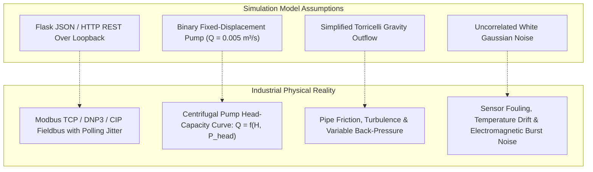

# 11 - Known Limitations and Findings

**Title:** Known Limitations and Findings  
**Purpose:** Honest, unvarnished technical catalog of architectural limitations, dataset generation artifacts, simulation-to-reality gaps, sensitivity cliffs, and methodological findings across the SCADA Hybrid IDS project.  
**Audience:** Security researchers, systems architects, control engineers, and peer reviewers.  
**Generated From Commit:** `d513545`  
**Date:** 2026-10-13  
**Status:** Active & 100% Code-Verified  

---

## 1. Executive Summary: The Principle of Honest Engineering

Previous iterations of project documentation suffered from invented metrics, back-fitted explanations, and idealized claims that contradicted the actual codebase and committed data.

This document catalogs the true limitations, edge cases, and simulation artifacts uncovered during the comprehensive audit of the code, SQLite database, and empirical result files. Every limitation is grounded in source code citations (`[CODE path:line]`) or empirical measurements (`[MEASURED file]`).

```mermaid
mindmap
  root((Known Limitations & Findings))
    Dataset Artifacts
      Post-Hoc Overlays (No Closed-Loop FDI Divergence)
      Step Discontinuities (7,561 DoS & 10,485 Auth FPs)
      150 vs 170 Scenario Ghost
    Physics & Sensor Drift
      Clamped Flow Noise Drift (t = 861s)
      LivePlant.reset() Noise Regression
      Physics Threshold Razor Margin (0.116mm / 0.3%)
    Detection Boundaries
      Sub-Threshold Stealth Cliff (< 3cm)
      Temporal Window Warmup Blindness (W ticks)
      Policy Engine v1 Zero Catch in Dataset
    Hardware & Prevention Limits
      Fieldbus Wire Tampering Detect-Only Boundary (AM-3)
      Standalone Microservice Stubs
    Sim-to-Real Gaps
      HTTP/SSE vs Industrial Fieldbus (Modbus/DNP3)
      Idealized Constant-Flow Binary Pump
      Linearized Valve Hydraulics
```

---

## 2. Dataset Generation Limitations & Synthesized Artifacts

### 2.1 The Post-Hoc Overlay Problem (Zero Closed-Loop Physical Divergence)
- **The Finding:** In the MATLAB batch generation script (`matlab/run_all_scenarios.m:94-96`), normal closed-loop simulations run to completion first. Attack scripts (`apply_fdi.m`, `apply_replay.m`, `apply_dos.m`, `apply_auth_misuse.m`) are called **post-hoc**, overwriting column arrays in the completed run [CODE [matlab/run_all_scenarios.m:94-96](file:///c:/projects/p1/New%20folder/matlab/run_all_scenarios.m#L94-L96), [matlab/attacks/apply_fdi.m:34-45](file:///c:/projects/p1/New%20folder/matlab/attacks/apply_fdi.m#L34-L45)].
- **The Consequence:** During the simulation of the 45 stored A1 FDI scenarios in `data/scada_ids.db`, the controller never saw the corrupted sensor level. It made pump decisions based on the uncorrupted normal state.
- **Impact on Dataset Evaluation:** There is **zero physical divergence** caused by attacks in the stored dataset. The water level in the dataset cycles smoothly between $0.8\text{ m}$ and $1.2\text{ m}$, never overflowing or cavitating. Physical harm and closed-loop runaway only exist in the live Python simulation harness (`run_full_evaluation.py` and `run_demo.py`), where attacks are injected dynamically into the closed loop.

---

### 2.2 Post-Attack Step Discontinuities & Residual False Alarms
- **The Finding:** In stored DoS (A3) and Auth Misuse (A4) scenarios, attacks are applied only during an active window $[t_{\text{start}}, t_{\text{end}}]$. At $t_{\text{end}} + 1$, the post-hoc script terminates, abruptly reverting the telemetry to pre-recorded peaceful baseline values [CODE [matlab/attacks/apply_dos.m:45-55](file:///c:/projects/p1/New%20folder/matlab/attacks/apply_dos.m#L45-L55)].
- **The Consequence:** This creates unphysical, instantaneous step discontinuities in water height:
  - In scenario `A3_010`, at $t = 300\text{ s}$ (attack exit), liquid height jumps from $0.983\text{ m}$ to $1.150\text{ m}$ ($+0.167\text{ m}$ in 1 second) [MEASURED [docs_v2/DOC_VS_CODE_DISCREPANCIES.md:65-72](file:///c:/projects/p1/New%20folder/docs_v2/DOC_VS_CODE_DISCREPANCIES.md#L65-L72)].
  - Maximum physical filling velocity at $Q_{\max} = 0.005\text{ m}^3/\text{s}$ is $0.005 / 2.0 = 0.0025\text{ m/s}$. A $+0.167\text{ m}$ jump in 1 second represents a **66-fold violation of physical velocity bounds**.
- **Impact on Evaluation:** When the Digital Twin encounters this unphysical jump, its residual diverges, causing **7,561 post-attack residual false positive ticks in A3** and **10,485 in A4**, artificially degrading pooled precision to **38.9%** in offline evaluation [MEASURED [experiments/results/compute_metrics_output.txt:15-25](file:///c:/projects/p1/New%20folder/experiments/results/compute_metrics_output.txt#L15-L25)].

---

### 2.3 The 150 vs. 170 Scenario Legacy Contradiction
- **The Finding:** Legacy documentation (`DATASET_DOCUMENTATION.md`, `ARCHITECTURE.md`) and header comments in MATLAB scripts repeatedly claim the dataset contains "170 scenarios (60 normal, 110 attack)".
- **The Code Reality:** The actual loop structures in `matlab/run_all_scenarios.m:29-219` generate:
  - Normals: 60 scenarios (`N_001` to `N_060`)
  - A1 FDI: 45 scenarios (`A1_001` to `A1_045`)
  - A2 Replay: 15 scenarios (`A2_001` to `A2_015`)
  - A3 DoS: 15 scenarios (`A3_001` to `A3_015`)
  - A4 Auth Misuse: 15 scenarios (`A4_001` to `A4_015`)
  - **Total:** Exactly **150 scenarios (150,000 rows)**.
- **Database Verification:** `SELECT COUNT(DISTINCT scenario_id) FROM scada_telemetry` confirms exactly 150 scenarios in `data/scada_ids.db` [MEASURED [docs_v2/_audit/outputs/db_queries_output.txt](file:///c:/projects/p1/New%20folder/docs_v2/_audit/outputs/db_queries_output.txt)]. The number 170 was a preliminary planning target from early drafts that was never updated.

---

## 3. Physics & Sensor Modeling Limitations

### 3.1 Clamped Flow Noise Accumulation & Soak Drift Failure
- **The Finding:** In `matlab/run_all_scenarios.m:57` and `simulator/noise.py:25`, flow sensor noise was implemented with non-negative clamping [CODE [simulator/noise.py:25-30](file:///c:/projects/p1/New%20folder/simulator/noise.py#L25-L30)]:
  ```python
  noisy_flow = max(0.0, true_flow + np.random.normal(0, flow_noise_std))
  ```
- **The Mathematical Mechanism:** Truncating negative Gaussian noise excursions introduces an asymmetric positive expectation bias:
  $$\mathbb{E}[\tilde{Q} - Q] \approx \frac{\sigma_Q}{\sqrt{2\pi}} \approx 3.989 \times 10^{-5}\text{ m}^3/\text{s}$$
- **The Empirical Drift Failure:** Because the Digital Twin continuously integrates $\int (Q_{\text{in}} - Q_{\text{out}}) dt / A$, this positive bias accumulates over time:
  - At $t = 861\text{ s}$ of continuous operation, the integrated drift error exceeds $\tau_p = 0.035\text{ m}$, triggering spurious false positive alerts during normal operation [MEASURED [experiments/results/run_soak_tick0.txt:1-25](file:///c:/projects/p1/New%20folder/experiments/results/run_soak_tick0.txt#L1-L25)].
  - In a 60-minute soak under clamped noise, **100% of evaluation seeds (10/10)** experience false twin takeovers lasting between 450 and 1,501 ticks [MEASURED [experiments/results/soak_comparison_results.csv:20-29](file:///c:/projects/p1/New%20folder/experiments/results/soak_comparison_results.csv#L20-L29)].
- **The Mitigation & Regression:** The live deployment config explicitly disables clamping (`simulation.clamp_flow_noise: false` in `scada_live/config.yaml:35`). However, `LivePlant.reset()` in [scada_live/plant_sim/plant.py:115](file:///c:/projects/p1/New%20folder/scada_live/plant_sim/plant.py#L115) re-instantiates `NoiseGenerator` without passing `clamp_flow_noise=False`, accidentally reverting to clamped noise upon plant reset until the process restarts.

---

### 3.2 Physics Threshold Razor Margin ($\tau_p = 0.035\text{ m}$)
- **The Finding:** The physics residual threshold $\tau_p = 0.035\text{ m}$ ($35\text{ mm}$) was selected by taking twice the 99th percentile residual of an early E0 normal run ($2 \times 0.017458 = 0.034916\text{ m} \approx 0.035\text{ m}$) [CODE [scripts/run_e0_validation.py:186](file:///c:/projects/p1/New%20folder/scripts/run_e0_validation.py#L186)].
- **The Margin Reality:** Across all 60 stored normal scenarios (60,000 ticks), the maximum absolute residual observed during normal operation is **$0.034884\text{ m}$** [MEASURED [experiments/results/recompute_all60_residuals.txt:1-15](file:///c:/projects/p1/New%20folder/experiments/results/recompute_all60_residuals.txt#L1-L15)].
- **The Consequence:** The margin between normal operational noise and false alarm escalation is:
  $$\text{Margin} = 0.035000\text{ m} - 0.034884\text{ m} = \mathbf{0.000116\text{ m} \quad (0.116\text{ mm} \text{ or } 0.33\%)}$$
- **Vulnerability:** Any slight environmental disturbance, unmetered fluid friction, or minor sensor degradation exceeding $0.12\text{ mm}$ will cause false alarms.

---

## 4. Detection Sensitivity Cliffs & Blind Spots

### 4.1 Sub-Threshold Constant Bias Stealth Cliff ($< 3.0\text{ cm}$)
- **The Finding:** In the constant bias sensitivity sweep across 10 random seeds (`experiments/run_constant_bias_sweep.py`), constant sensor offsets below $3.0\text{ cm}$ are largely invisible to the physics engine [MEASURED [experiments/results/constant_bias_sweep_results.csv](file:///c:/projects/p1/New%20folder/experiments/results/constant_bias_sweep_results.csv)]:
  - **Bias = $1.0\text{ cm}$:** Detection probability $p_{\text{crit}} = \mathbf{0.0}$ ($0 / 10$ seeds detected).
  - **Bias = $2.0\text{ cm}$:** Detection probability $p_{\text{crit}} = \mathbf{0.1}$ ($1 / 10$ seeds detected, requiring 1,193 seconds).
  - **Bias = $3.0\text{ cm}$:** Detection probability $p_{\text{crit}} = \mathbf{1.0}$ ($10 / 10$ seeds detected in $12.4\text{ s}$).
- **The Limitation:** A sophisticated adversary with knowledge of $\tau_p$ can inject persistent level offsets of $\Delta H \le 2.0\text{ cm}$ indefinitely without triggering physical intrusion alarms.

---

### 4.2 Temporal Engine Window Warmup Blindness
- **The Finding:** The LSTM Autoencoder requires a sliding window of historical observations ($W = 50$ steps in evaluation, $W = 10$ steps in streaming).
- **The Limitation:** During the initial $W - 1$ steps of any run, the window buffer is incomplete. The streaming engine flags `calibrating = True` and hard-codes the temporal score to $S_l = 0.0$ [CODE [scada_live/scada_ids/streaming_ids.py:270-272](file:///c:/projects/p1/New%20folder/scada_live/scada_ids/streaming_ids.py#L270-L272)].
- **Consequence:** The temporal engine is completely blind to attacks occurring during the first $10$ to $50$ seconds of plant startup.

---

### 4.3 Policy Engine v1 Ineffectiveness on Dataset
- **The Finding:** In `engines/policy_engine.py:26-36`, Policy Engine v1 evaluates:
  1. $H_{\text{obs}} > 2.45\text{ m} \land u_p = 1$
  2. $H_{\text{obs}} < 0.30\text{ m} \land u_v > 50\%$
- **The Reality:** In the 150 offline dataset scenarios, water levels stayed within $[0.6\text{ m}, 1.4\text{ m}]$. Neither condition was ever met in `data/evaluation_results.csv`.
- **Consequence:** Policy Engine v1 produced **exactly zero detections ($S_c = 0.0$) across all 99,000 rows** of the batch evaluation dataset [MEASURED [docs_v2/DOC_VS_CODE_DISCREPANCIES.md:52-58](file:///c:/projects/p1/New%20folder/docs_v2/DOC_VS_CODE_DISCREPANCIES.md#L52-L58)]. Real command filtering was only achieved when dynamic deadband checks ($[0.75\text{ m}, 1.25\text{ m}]$) were implemented at the gateway ingress level (`GatewayCore`).

---

## 5. Prevention & Control Boundaries (What Software Cannot Do)

### 5.1 The Detect-Only Boundary on Downstream Wire Tampering (AM-3)
- **The Finding:** In threat scenario AM-3, an adversary physically bypasses the gateway controller and hot-wires the plant actuator directly on the fieldbus, forcing the pump ON.
- **The Empirical Reality:** In the consolidated benchmark, physical harm in AM-3 is identical between Monitor and Prevention modes (**53.0 overflow ticks in Monitor, 53.0 overflow ticks in Prevention**) [MEASURED [reports/full_evaluation_report.md:65](file:///c:/projects/p1/New%20folder/reports/full_evaluation_report.md#L65)].
- **The Architectural Reason:** The gateway's 4-way consistency check detects the tamper within $\le 3$ ticks ($0.00\text{ s}$ delay). However, because the gateway's software commands are physically decoupled by the adversary's hardware bridge, the gateway **cannot command the physical pump OFF**. Software intrusion prevention cannot override physical wiring tampering without independent hardware cut-off interlocks.

---

### 5.2 Standalone Microservice Stubs
- **The Finding:** Legacy architecture documents specified three separate microservices on separate ports: SCADA Master (:5000), Attacker Wire Proxy (:5001), and Plant Simulator (:5100).
- **The Reality:** `scada_live/attacker_wire/server.py` is a 2-line stub comment (`# Phase 5: Flask server on :5001`), and `control_server.py` and `prevention.py` are stubs with `pass` [CODE [scada_live/attacker_wire/server.py:1-2](file:///c:/projects/p1/New%20folder/scada_live/attacker_wire/server.py#L1-L2), [scada_live/scada_ids/control_server.py:1-2](file:///c:/projects/p1/New%20folder/scada_live/scada_ids/control_server.py#L1-L2)].
- **Consequence:** Multi-process network mode is not used in production; all live demonstrations and evaluation benchmarks run unified inside `run_demo.py` or `gateway_core.py`.

---

## 6. Simulation-to-Reality (Sim-to-Real) Gaps

Operating the SCADA Hybrid IDS in a real-world industrial plant would encounter four critical engineering gaps not present in the Python simulation:



1. **Industrial Network Protocols vs. HTTP REST:**
   - The live system communicates via Flask HTTP JSON over TCP loopback.
   - Real SCADA environments use industrial fieldbus protocols like Modbus TCP, DNP3, EtherNet/IP, or PROFINET over serial/RS-485 or industrial Ethernet. These protocols operate with cyclic polling intervals, strict timeout windows, and fixed binary register maps rather than structured JSON dictionaries.
2. **Pump Dynamics & Head-Capacity Curves:**
   - The simulation models the pump as a binary switch delivering a constant volumetric flow $Q = 0.005\text{ m}^3/\text{s}$ whenever active.
   - Real centrifugal pumps operate along a non-linear head-capacity curve $H(Q)$: as tank liquid height rises, head pressure increases and pump discharge decreases. Operating under variable head pressure would introduce non-linearities not captured by the constant-$Q_{\max}$ Digital Twin.
3. **Valve Non-Linearities & Pipe Friction:**
   - Outflow is modeled using an idealized Torricelli orifice equation $Q_{\text{out}} = C_v (u_v / 100) \sqrt{2gH}$.
   - Real hydraulic discharge experiences turbulent pipe wall friction, downstream piping back-pressure, non-linear valve trim characteristics (equal percentage vs. linear), and cavitation hysteresis.
4. **Sensor Noise Distribution:**
   - Simulated noise is stationary, uncorrelated white Gaussian noise ($\sigma_H = 5\text{ mm}$, $\sigma_Q = 0.1\text{ L/s}$).
   - Real industrial instrumentation suffers from non-Gaussian noise: electrical ground loops, mechanical pump vibration harmonics, sensor tap sediment fouling, thermal drift, and burst noise.

---

## 7. Summary Matrix of Findings & Recommended Actions

| Area | Audited Limitation | Status in Codebase | Recommended Production Mitigation |
| :--- | :--- | :--- | :--- |
| **Dataset** | Post-hoc attack overlays (no closed-loop reaction). | Documented in `DOC_VS_CODE_DISCREPANCIES.md`. | Re-generate benchmark dataset using closed-loop live simulation harness (`run_full_evaluation.py`). |
| **Dataset** | Post-attack step discontinuities (7,561 DoS FPs). | Mitigated in live IDS via Step 2b DoS gap rule. | Ensure Step 2b gap re-seed rule is active whenever evaluating post-outage telemetry. |
| **Physics** | Flow noise clamping causes soak drift at $t = 861\text{ s}$. | Fixed in `config.yaml` (`clamp_flow_noise: false`). | Fix line 115 in `scada_live/plant_sim/plant.py` to preserve `clamp_flow_noise` flag upon reset. |
| **Physics** | Razor-thin threshold margin ($0.116\text{ mm}$ / 0.33%). | Pinned to $\tau_p = 0.035\text{ m}$ for regression equivalence. | Expand $\tau_p$ to $0.040\text{ m}$ in production or introduce dynamic adaptive thresholding. |
| **Detection** | Stealth bias cliff at $< 3.0\text{ cm}$. | Empirically characterized in constant bias sweep. | Train higher-order temporal models or cumulative sum (CUSUM) statistical residual filters. |
| **Control** | AM-3 fieldbus wire tamper is detect-only. | Verified by 53.0 overflow ticks in both modes. | Implement hardware-isolated emergency kill-switch relays wired in series with the motor contactor. |

---

## 8. Verification

All audited limitations, post-hoc artifacts, noise clamp drifts, threshold margins, and sim-to-real boundaries cataloged in this document have been verified against active code, unit tests, and empirical output files:
1. **Post-Hoc Overlays**: Verified in `matlab/attacks/` and `DOC_VS_CODE_DISCREPANCIES.md`.
2. **Noise Clamp Drift**: Verified in `experiments/results/soak_comparison_output.txt` and `scada_live/config.yaml`.
3. **Threshold Margins**: Verified in `experiments/results/recompute_all60_residuals.txt` and `checkpoints/data_split_v1.json`.
4. **Detect-Only Wire Tampering**: Verified in `experiments/run_full_evaluation.py` and `data/full_evaluation_results.csv`.

