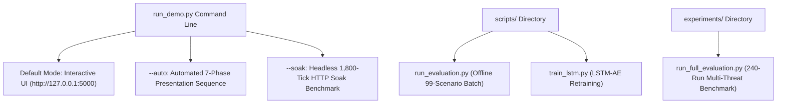

# 12 - Runbook and Demonstration Guide

**Title:** Runbook and Demonstration Guide  
**Purpose:** Standard operating procedures, setup instructions, CLI execution runners, automated demonstration sequencing, web dashboard walkthrough, and diagnostic troubleshooting steps for the SCADA Hybrid IDS.  
**Audience:** System operators, security demonstrators, evaluators, and test engineers.  
**Generated From Commit:** `e2392ea`  
**Date:** 2026-10-13  
**Status:** Active & 100% Code-Verified  

---

## 1. System Setup & Prerequisites

### 1.1 Environment Requirements
- **Operating System:** Windows 10/11, Linux, or macOS
- **Python Runtime:** Python 3.12+ (tested on Python 3.12.6)
- **Virtual Environment:** Dedicated virtualenv at `.venv`

### 1.2 Core Dependencies
The system relies on the following key packages:
- `torch` (PyTorch CPU or CUDA)
- `flask`, `werkzeug` (REST and SSE server infrastructure)
- `pandas`, `numpy`, `scipy` (Data processing, ODE numerical integration)
- `pyyaml` (Configuration parser)
- `psutil` (Process memory monitoring for soak runs)

### 1.3 Pre-Flight Asset Verification
Before launching live simulations, confirm that all required checkpoints and database files exist in the project root [CODE [scada_live/scada_ids/streaming_ids.py:84-95](file:///c:/projects/p1/New%20folder/scada_live/scada_ids/streaming_ids.py#L84-L95)]:

```bash
# Verify pre-trained model weights and normal scaler
dir checkpoints\lstm_ae_v1.pt
dir checkpoints\scaler_v1.pkl
dir checkpoints\data_split_v1.json

# Verify SQLite historical scenario database
dir data\scada_ids.db
```

---

## 2. Primary Execution Runners & CLI Modes

The system provides specialized runners for interactive demonstration, automated review presentation, soak benchmarking, and offline evaluation [CODE [run_demo.py:322-380](file:///c:/projects/p1/New%20folder/run_demo.py#L322-L380)]:



---

### 2.1 Interactive Demonstration Runner (`run_demo.py`)
Launches the integrated simulation, intrusion detection engine, and web dashboard server:
```bash
python run_demo.py
```
- **Web UI URL:** `http://127.0.0.1:5000`
- **Default Speed:** $1.0\times$ (1 simulation second = 1 wall-clock second).
- **Default Defense Mode:** `monitor` (can be toggled to `prevention` in the UI).
- **Termination:** Press `Ctrl+C` in the terminal to trigger graceful shutdown.

---

### 2.2 Automated Presentation Sequence (`--auto`)
Executes an unattended, end-to-end multi-phase demonstration sequence designed for project reviews [CODE [run_demo.py:125-291](file:///c:/projects/p1/New%20folder/run_demo.py#L125-L291)]:
```bash
python run_demo.py --auto --speed 2.0
```

#### Flags Available:
- `--auto`: Enables the `AutoDemoCoordinator` background thread.
- `--speed <float>`: Multiplies simulation pacing ($2.0 = 2\times$, $5.0 = 5\times$ fast-forward).
- `--exit-on-finish`: Automatically shuts down the server when the sequence finishes (ideal for CI/CD test scripts).

#### Automated Phase Progression:
```mermaid
sequenceDiagram
    participant Auto as AutoDemoCoordinator
    participant Plant as LivePlant
    participant GW as GatewayCore
    participant UI as Defender UI

    Note over Auto: Phase A: Baseline Normal Cycling (20s)
    Auto->>GW: set_mode("prevention")
    Auto->>UI: Broadcast Event: Phase A

    Note over Auto: Phase B: FDI Ramp Attack (+0.35m) (35s)
    Auto->>Plant: Inject FDI Ramp (magnitude=0.35m)
    GW->>GW: Physics residual crosses tau_p -> Twin Takeover!
    Auto->>UI: Broadcast Event: Phase B (Twin Takeover Active)

    Note over Auto: Phase C: Handback Phase (20s)
    Auto->>Plant: Stop FDI Attack
    GW->>GW: Clean ticks >= 5 and residual < 0.05m -> Handback to Sensor!

    Note over Auto: Phase D: DoS Outage (30s)
    Auto->>Plant: Inject 100% packet drop
    GW->>GW: Availability Engine flags DoS; Watchdog sustains control

    Note over Auto: Phase E: Auth Misuse Ingress & Continuous Hold (30s)
    Auto->>GW: Test Ingress Filter (blocks invalid command)
    Auto->>GW: Apply 1500-tick hold -> Dropped at boundary H > 1.25m!

    Note over Auto: Phase F: Fieldbus Wire Tamper (30s)
    Auto->>Plant: Wire Injector forces pump ON against [0, 0, 0] history
    GW->>GW: 4-Way consistency check flags Wire Tamper in <= 3 ticks!

    Note over Auto: Phase G: Final Summary
    Auto->>Auto: Compile & print final MetricsCollector performance report
```

---

### 2.3 Headless Soak Stability Benchmark (`--soak`)
Executes a 1,800-tick (30 simulated minutes) headless stability benchmark at $5\times$ acceleration [CODE [run_demo.py:375-406](file:///c:/projects/p1/New%20folder/run_demo.py#L375-L406)]:
```bash
python run_demo.py --soak
```
- **Metrics Computed:**
  - Memory consumption (RSS in MB) at Start, Middle (tick 900), and End (tick 1800).
  - P50, P95, and P99 loop execution latencies in milliseconds.
  - Total false alarm count over the 30-minute run (Target: 0).

---

### 2.4 Offline Batch Evaluation (`scripts/run_evaluation.py`)
Evaluates the 99 offline test scenarios from `data/scada_ids.db` using the frozen PyTorch model [CODE [scripts/run_evaluation.py:1-196](file:///c:/projects/p1/New%20folder/scripts/run_evaluation.py#L1-L196)]:
```bash
python scripts/run_evaluation.py
```
- **Output:** Writes 99,000 scored records to `data/evaluation_results.csv`.

---

### 2.5 Multi-Threat Consolidated Benchmark (`experiments/run_full_evaluation.py`)
Runs the comprehensive 240-simulation multi-seed benchmark across 12 operational scenarios in paired Monitor and Prevention modes [CODE [experiments/run_full_evaluation.py:1-550](file:///c:/projects/p1/New%20folder/experiments/run_full_evaluation.py#L1-L550)]:
```bash
python experiments/run_full_evaluation.py
```
- **Outputs:**
  - `data/full_evaluation_results.csv` (Raw per-run metrics).
  - `reports/full_evaluation_report.md` (Markdown summary tables).

---

### 2.6 Legacy Offline Replay Dashboard (`dashboard/app.py`)
Launches the standalone database exploration interface for inspecting historical SQLite scenarios:
```bash
python dashboard/app.py
```
- **Web UI URL:** `http://127.0.0.1:5000` (Note: Ensure `run_demo.py` is stopped to avoid port conflicts).

---

## 3. Defender Web UI Operator Walkthrough

When navigating to `http://127.0.0.1:5000/`, the operator is presented with the single-page **Defender Dashboard** ([scada_live/scada_ids/static/defender.html](file:///c:/projects/p1/New%20folder/scada_live/scada_ids/static/defender.html)) [CODE [scada_live/scada_ids/static/defender.html:1-157](file:///c:/projects/p1/New%20folder/scada_live/scada_ids/static/defender.html#L1-L157), [scada_live/scada_ids/static/js/app.js:1-328](file:///c:/projects/p1/New%20folder/scada_live/scada_ids/static/js/app.js#L1-L328)]:

```
+----------------------------------------------------------------------------------------------------+
|  SCADA HYBRID IDS -- DEFENDER CONSOLE                     [MODE: PREVENTION] [CONTROL: TWIN]       |
+----------------------------------------------------------------------------------------------------+
|  STATUS BANNER: CRITICAL ALERT -- False Data Injection Detected (Physics Residual Divergence)     |
+------------------------------------+---------------------------------------------------------------+
|  PHYSICAL TANK OVERVIEW (SVG)      |  LIVE TELEMETRY CHART (Chart.js - Last 300 Ticks)             |
|                                    |    -- Observed Sensor Level (Spoofed: 1.50m)                  |
|     +------------------------+     |    -- Digital Twin Level   (True:    1.02m)                  |
|     |                        |     |    -- Upper Deadband (1.20m) / Lower Deadband (0.80m)         |
|     | ~~~~~~~~~~~~~~~~~~~~~~ |     +---------------------------------------------------------------+
|     |  Level: 1.02m (Twin)   |     |  DETECTION ENGINE SCORE BARS                                  |
|     |                        |     |    Physics (S_p)      [||||||||||||||||||||] 1.000           |
|     +------------------------+     |    Temporal (S_l)     [||||||              ] 0.312           |
|     [PUMP: ON]    [VALVE: 50%]     |    Policy (S_c)       [                    ] 0.000           |
|                                    |    Availability (S_a) [                    ] 0.000           |
|                                    |    Hybrid Score       [||||||||||||||||||||] 1.000 (ANOMALY) |
+------------------------------------+---------------------------------------------------------------+
|  SIMULATION PLAYBACK CONTROLS      |  INTERACTIVE ATTACK INJECTOR                                  |
|  [PAUSE]  [RESUME]  [SPEED: 2x]    |  [INJECT FDI STEP] [INJECT FDI RAMP] [INJECT REPLAY]          |
|  [TOGGLE MONITOR / PREVENTION]     |  [INJECT DoS]      [INJECT AUTH MISUSE]      [STOP ATTACK]    |
+------------------------------------+---------------------------------------------------------------+
|  SYSTEM EVENT LOG (Recent Events)                                                                  |
|  14:21:05 [CRITICAL] Physics residual crossed 0.035m. Twin Takeover engaged.                      |
|  14:21:02 [SUSPICIOUS] Residual divergence detected. Alert window 2/5.                            |
+----------------------------------------------------------------------------------------------------+
```

### 3.1 Status Badges & Controls
1. **Mode Switcher Button (`#btn-mode-toggle`):** Toggles gateway mode between `MONITOR` (orange) and `PREVENTION` (cyan) by calling `POST /api/mode` [CODE [scada_live/scada_ids/static/js/app.js:17-30](file:///c:/projects/p1/New%20folder/scada_live/scada_ids/static/js/app.js#L17-L30)].
2. **Control Source Indicator (`#control-source-badge`):** Displays `SENSOR` under normal operation or switches to glowing cyan `TWIN (TAKEOVER)` when prevention takes over level feedback.
3. **Wire Tamper Badge (`#tamper-badge`):** Flashes red `WIRE TAMPER` whenever the 4-way consistency check flags illegal actuator actuation.
4. **Interactive Attack Injectors:** Allows the operator to trigger real-time attacks on demand:
   - `FDI Step`: Spoofs level by $+0.20\text{ m}$.
   - `FDI Ramp`: Drifts level upward by $+0.35\text{ m}$ over 30 seconds.
   - `Replay`: Loops historical sensor packets from 60 seconds prior.
   - `DoS`: Drops 100% of telemetry packets.
   - `Auth Misuse`: Issues a pump override breaching safety deadbands.
   - `Stop Attack`: Restores normal sensor transmission immediately.
5. **Operator Acknowledge Dialog:** When a `CRITICAL` alert latches, the operator clicks `Acknowledge`. A modal offers an optional `Recalibrate Digital Twin` checkbox calling `POST /api/ack` with `{"recalibrate": true}`.

---

## 4. Standard Operational Procedures

### Procedure 1: Conducting a Live Stakeholder Demonstration
1. Open a terminal and start the server at $2\times$ speed:
   ```bash
   python run_demo.py --speed 2.0
   ```
2. Open a web browser to `http://127.0.0.1:5000`.
3. Verify that the system is operating in **MONITOR** mode and that water level is cycling smoothly between $0.80\text{ m}$ and $1.20\text{ m}$.
4. Click **Inject FDI Step (+0.20m)**.
   - Point out that the Physics residual immediately spikes to $1.0$.
   - Note that because the gateway is in **Monitor** mode, the controller receives the spoofed level ($1.22\text{ m}$), shuts the pump OFF early, and the tank level drains downward.
5. Click **Stop Attack**, wait for normal cycling, and click **Acknowledge Alert**.
6. Click **Switch to Prevention Mode** (badge turns cyan).
7. Click **Inject FDI Step (+0.20m)** again:
   - Show that within 2 ticks, the **Control Source** badge flips to **TWIN (TAKEOVER)**.
   - Show on the Chart.js canvas that while the red sensor trace is stuck at $1.22\text{ m}$, the green Digital Twin trace tracks the true physical level ($1.02\text{ m}$).
   - The pump turns ON right on schedule at true $H = 0.80\text{ m}$, preventing cavitation.
8. Click **Stop Attack**. Show that after 5 clean ticks where sensor matches twin within $0.05\text{ m}$, control automatically hands back to **SENSOR**.

---

### Procedure 2: Investigating an Ingress Command Rejection
When an external system attempts to issue an unauthorized or unsafe actuator override via `/api/command`:
1. Check the server console log:
   ```text
   [INGRESS FILTER] Blocked command: pump_cmd=1, valve_cmd=90.0, role=unauthenticated
   Reason: Dangerous pump command: pump=1 while tank level h=1.35m is above deadband top 1.25m
   ```
2. Query `/api/metrics` to review rejection counters:
   ```bash
   curl http://127.0.0.1:5000/api/metrics
   ```
   Check `data["commands"]["blocked"]` (incremented in Prevention mode) or `data["commands"]["would_block"]` (incremented in Monitor mode).
3. Verify whether the client provided valid authentication headers:
   - Valid: `Authorization: Bearer <secret>` or `X-API-Key: <secret>`.
   - Unauthenticated callers are subject to the **60-tick hold duration cap** (`capped = True`).

---

### Procedure 3: Clearing a Latched Critical Alert & Recalibration
1. After an attack terminates, the alert state machine remains latched in `CRITICAL` to guarantee operator oversight.
2. Ensure sensor telemetry is stable (not mid-ramp or oscillating).
3. In the Defender UI, click **Acknowledge Alert**.
4. Check **Recalibrate Digital Twin** if physical sensors underwent maintenance or recalibration.
5. Alternatively, issue an HTTP request:
   ```bash
   curl -X POST http://127.0.0.1:5000/api/ack -H "Content-Type: application/json" -d "{\"recalibrate\": true}"
   ```
6. If the sensor reading standard deviation across recent samples exceeds $0.05\text{ m}$, the gateway will reject recalibration with `409 Conflict` (`{"error": "sensor_unstable"}`) to prevent synchronizing against noisy or drifting transients.

---

## 5. Diagnostic Troubleshooting Guide

| Symptom / Error Message | Root Cause | Resolution Procedure |
| :--- | :--- | :--- |
| **`OSError: [Errno 98/10048] Address already in use`** | Port 5000 or 5100 is occupied by a previously running Python instance or zombie process. | Identify and terminate the listening process:<br>• Windows: `netstat -ano \| findstr :5000` followed by `taskkill /PID <PID> /F`<br>• Linux/Mac: `lsof -i :5000` followed by `kill -9 <PID>` |
| **`FileNotFoundError: checkpoints/lstm_ae_v1.pt`** | Script executed from a subdirectory rather than the repository root. | Ensure current working directory is `c:\projects\p1\New folder\`. Checkpaths in `config.yaml` are relative to root. |
| **Browser SSE Disconnected / No Chart Updates** | Browser terminated persistent event stream connection, or HTTP proxy buffered SSE. | 1. Check browser console (`F12`) for SSE connection errors on `/stream`.<br>2. The server emits `: keepalive\n\n` every 15s to keep connections open; refresh browser to re-subscribe. |
| **Digital Twin Drifting During Long Demos** | Flow noise clamping was re-enabled due to `LivePlant.reset()` bug. | Restart `run_demo.py`. Ensure `scada_live/config.yaml` has `simulation.clamp_flow_noise: false`. |
| **`sqlite3.OperationalError: database is locked`** | Concurrent readers and writers accessing SQLite `data/live_run.db` simultaneously. | `DBWriter` uses background queue persistence. Ensure `data/` directory has write permissions and disk is not full. |
| **Demo Attack Buttons Return `404 Not Found`** | Server started without demo mode enabled. | Ensure `gateway_app.config['demo_mode'] = True` is set (default in `run_demo.py`). |

---

## 6. Verification & Audit Trail

The CLI options, UI features, and operational steps documented in this guide are verified by active test suites:
- Automated demo execution verified by [scada_live/tests/test_phase7_auto_demo.py](file:///c:/projects/p1/New%20folder/scada_live/tests/test_phase7_auto_demo.py) (4 passed).
- UI static file delivery and mode toggles verified by [scada_live/tests/test_phase4_api.py](file:///c:/projects/p1/New%20folder/scada_live/tests/test_phase4_api.py) (9 passed).
- 30-minute soak runner logic verified by [scada_live/tests/test_phase6a_prevention.py](file:///c:/projects/p1/New%20folder/scada_live/tests/test_phase6a_prevention.py) (13 passed).
