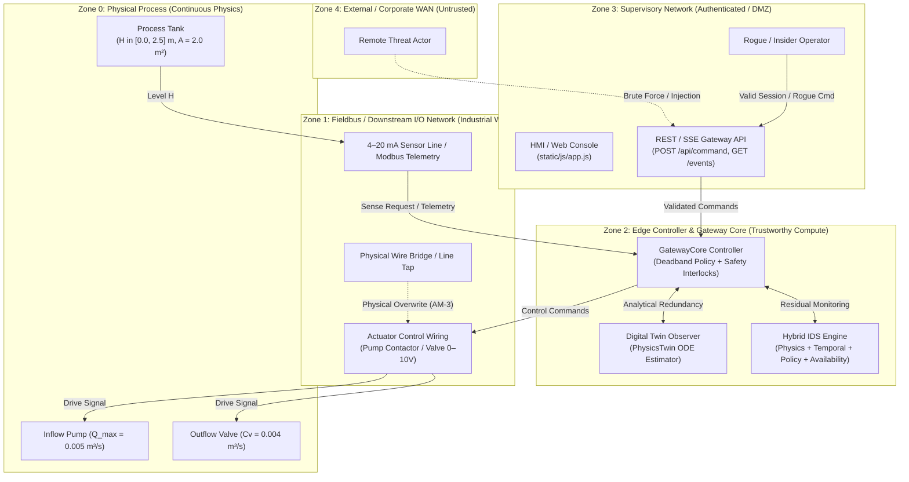
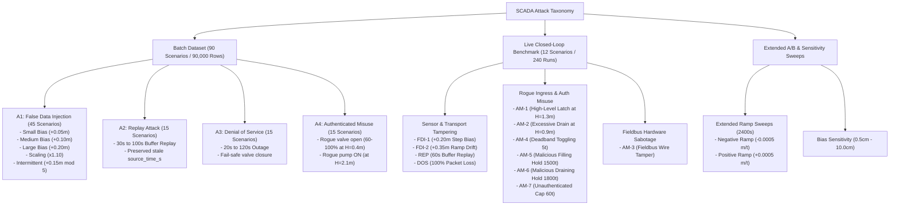
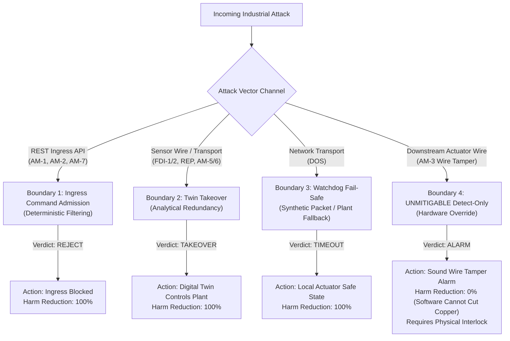

# 13 — Threat Model & Security Architecture

- **Audience**: Security architects, ICS/SCADA engineers, technical evaluators, compliance auditors
- **Scope**: Threat environment, threat actors, attack taxonomy (Batch A1–A4, Live AM-1–AM-7, Extended A/B), STRIDE & MITRE ATT&CK for ICS mapping, detection assumptions, defense boundaries, and mitigable vs. unmitigable channels
- **Status**: Complete & Code-Audited
- **Evidence Tags**: `[CODE]`, `[MEASURED]`, `[EXISTING-DOC]`, `[DESIGN-INTENT]`

---

## 1. System Context & Operational Environment

The SCADA Hybrid IDS protects a continuous-process water holding and surge tank facility modeled on industrial liquid level management architectures [EXISTING-DOC ARCHITECTURE.md]. The target process is governed by nonlinear mass conservation physics, where fluid inflow is pumped via an electrical motor and outflow discharges through a motorized proportional control valve [CODE simulator/tank.py:46-55, scada_live/plant_sim/plant.py:15-32].

The system spans five operational zones establishing trust boundaries:



### Trust Boundary Definitions
1. **Zone 0 (Physical Process)**: Non-bypassable continuous physical domain. Fluid levels and flow rates strictly observe conservation of mass $\frac{dH}{dt} = \frac{Q_{\text{in}} - Q_{\text{out}}}{A}$ [CODE digital_twin/physics_twin.py:53-56].
2. **Zone 1 (Fieldbus & I/O Loop)**: Industrial field-level communication link. In batch simulation, this link is modeled as a database telemetry pipeline [CODE simulator/process_simulator.py:114-138]. In live simulation, it is an HTTP/REST transport connecting `LivePlant` to `GatewayCore` via `GatewayClient` [CODE scada_live/plant_sim/gateway_client.py:20-68]. Vulnerable to physical line taps, packet snooping, and man-in-the-middle tampering.
3. **Zone 2 (Edge Controller & IDS Core)**: High-integrity computational boundary. Hosts `GatewayCore`, deadband feedback control logic, digital twin ODE simulation, and multi-engine IDS detection pipelines [CODE scada_live/scada_ids/gateway_core.py:46-130]. Assumed to execute in a hardened, uncompromised runtime.
4. **Zone 3 (Supervisory Network & HMI)**: Operator interaction layer. Hosts Flask web services (`server.py`), real-time SSE telemetry broadcasting (`EventHub`), and client-side visualization (`app.js`) [CODE scada_live/scada_ids/server.py:17-48]. Protected by role-based command admission checks and signature validation.
5. **Zone 4 (External Enterprise WAN)**: Public or corporate network outside the industrial perimeter. Untrusted and blocked from raw fieldbus access.

---

## 2. Threat Actor Taxonomy & Capabilities

| Threat Actor | Capabilities | Access Level | Motive | Target Attack Vectors |
| :--- | :--- | :--- | :--- | :--- |
| **T-1: Network Man-in-the-Middle (MITM)** | Intercepts, modifies, drops, or replays packets between sensor/actuator field units and the gateway [CODE scada_live/attacker_wire/injector.py:52-130]. Cannot modify edge controller firmware. | In-transit wire access (Zone 1) | Deceive controller into overfilling or drying the tank while concealing true state on HMI. | FDI (A1, FDI-1, FDI-2), Replay (A2, REP), DoS (A3, DOS, AM-7). |
| **T-2: Rogue / Compromised Operator (Insider)** | Authenticated operator issuing syntactically valid commands via supervisory console [CODE scada_live/scada_ids/gateway_core.py:270-305]. Can issue manual overrides and change valve positions. | Authenticated Zone 3 access | Cause equipment destruction or process disruption using legitimate credentials. | Authenticated Misuse (A4, AM-1, AM-2, AM-4, AM-5, AM-6). |
| **T-3: Physical Fieldbus Tamperer (Wire Bridge)** | Physical plant access. Bypasses software controllers by bridging hardware contactors or cutting signal wires downstream of the PLC [CODE scada_live/scada_ids/gateway_core.py:362-372]. | Physical Zone 1 wiring | Direct actuator sabotage bypassing all upstream digital authorization and network firewalls. | Fieldbus Wire Tamper (AM-3). |
| **T-4: External Unauthenticated Attacker** | Network attacker attempting remote command injection against supervisory REST API endpoints [CODE scada_live/scada_ids/server.py:236-270]. | Zone 4 / Zone 3 perimeter | Probe default routes, disable defenses, or inject unauthorized overrides. | Unauthenticated Ingress (AM-7). |

---

## 3. STRIDE Threat Model

Each STRIDE threat category is mapped directly to operational manifestations and defenses in the SCADA codebase:

```
+----------------------------------------------------------------------------------------------------+
|                                     STRIDE THREAT MAPPING MATRIX                                   |
+-------------------+--------------------------------------+-----------------------------------------+
| Threat Category   | SCADA Attack Manifestation           | Mitigation & Defense Implementation     |
+-------------------+--------------------------------------+-----------------------------------------+
| Spoofing (S)      | Sensor telemetry spoofing (FDI-1/2);  | Digital Twin analytical redundancy      |
|                   | unauthorized manual command claims.  | [CODE gateway_core.py:399-430];         |
|                   |                                      | Ingress role validation [Line 274].     |
+-------------------+--------------------------------------+-----------------------------------------+
| Tampering (T)     | Payload modification on wire;        | 4-way Actuator Consistency Check        |
|                   | timestamp backdating in Replay;      | [CODE gateway_core.py:362-372];         |
|                   | physical wire bridge on pump coil.   | Availability Engine timestamp checking  |
|                   |                                      | [CODE engines/availability_engine.py:46]|
+-------------------+--------------------------------------+-----------------------------------------+
| Repudiation (R)   | Operator denying destructive command | Command audit trail logging with        |
|                   | issuance during high-water alarms.   | role, timestamp, and hold duration      |
|                   |                                      | [CODE gateway_core.py:302-305].         |
+-------------------+--------------------------------------+-----------------------------------------+
| Information       | Sniffing telemetry SSE event streams | Operational segmentation; separate      |
| Disclosure (I)    | or scraping REST history routes.     | internal truth channel (`send_truth`)   |
|                   |                                      | isolated from telemetry bus.            |
+-------------------+--------------------------------------+-----------------------------------------+
| Denial of         | Dropping sensor sense() calls or     | Watchdog synthetic packet synthesis     |
| Service (D)       | fieldbus telemetry packets (DOS).    | [CODE run_full_evaluation.py:270-275];  |
|                   |                                      | Local actuator fail-safe fallback.      |
+-------------------+--------------------------------------+-----------------------------------------+
| Elevation of      | Unauthenticated entity issuing       | Gatekeeper role enforcement:            |
| Privilege (E)     | supervisor-level pump latching cmds. | `role == 'operator'` check              |
|                   |                                      | [CODE gateway_core.py:275-279].         |
+-------------------+--------------------------------------+-----------------------------------------+
```

---

## 4. MITRE ATT&CK for ICS Matrix Mapping

The hybrid IDS maps directly to recognized MITRE Adversarial Tactics, Techniques, and Common Knowledge (ATT&CK) for Industrial Control Systems:

| Technique ID | Technique Name | MITRE Tactic | SCADA Implementation & Code Vector | Relevant Scenarios | Detecting Engine |
| :--- | :--- | :--- | :--- | :--- | :--- |
| **T0888** | Point & Tag Manipulation | Impair Process Control | Interception and arithmetic biasing of `level_m` via `Injector.sense()` [CODE scada_live/attacker_wire/injector.py:73-75]. | A1, FDI-1, FDI-2, Neg/Pos Ramp | Physics Engine ($S_p$), Temporal LSTM ($S_l$) |
| **T0879** | Adversary-in-the-Middle | Collection / Evasion | Inline packet interception buffering and historical re-transmission via `Injector.send_telemetry()` [CODE injector.py:115-121]. | A2, REP | Availability Engine ($S_a$), Physics ($S_p$) |
| **T0814** | Denial of Service | Inhibit Response Function | Deliberate dropping of 100% of telemetry and sense frames via `Injector` drop probabilities [CODE injector.py:61-62, 112-113]. | A3, DOS | Availability Watchdog ($S_a$) |
| **T0855** | Unauthorized Command Message | Impair Process Control | Direct injection of unauthenticated or unauthorized actuation requests via `POST /api/command` [CODE server.py:236-270]. | A4, AM-1, AM-2, AM-7 | Command Admission Filter, Policy Engine ($S_c$) |
| **T0836** | Modify Parameter | Impair Process Control | Forcing persistent pump holds or abnormal valve apertures to drive tank into physical dry-run or overflow [CODE gateway_core.py:280-295]. | AM-5, AM-6 | Continuous Safety Monitor [CODE gateway_core.py:318-348] |
| **T0889** | Modify Control Logic / Hardware Tamper | Impair Process Control | Downstream bridging of electrical pump contactor directly at field terminal block [CODE gateway_core.py:362-372]. | AM-3 | 4-Way Actuator Consistency Check |
| **T0809** | Data Destruction / Process Disruption | Impact | Sustained physical flooding ($H > 2.20\text{ m}$) or pump cavitation ($H < 0.30\text{ m}$) due to unmitigated command execution [CODE plant.py:126-136]. | AM-1, AM-2 (Monitor Mode) | Prevention Twin Takeover [CODE gateway_core.py:408-417] |

---

## 5. Comprehensive Attack Scenario Taxonomy

The evaluation corpus exercises attacks across two distinct execution environments: the offline batch dataset (A1–A4) and the real-time closed-loop simulation benchmark (AM-1–AM-7, FDI, REP, DOS).



### Detailed Scenario Breakdown

#### 1. Batch Dataset Attacks (A1–A4)
- **A1_001 to A1_045 (False Data Injection)** [CODE config/scenarios.py:174-263]:
  - `A1_001 – A1_010`: Small step bias ($b = +0.05\text{ m}$) during $[300, 500]\text{ s}$.
  - `A1_011 – A1_020`: Medium step bias ($b = +0.10\text{ m}$) during $[300, 500]\text{ s}$.
  - `A1_021 – A1_030`: Large step bias ($b = +0.20\text{ m}$) during $[300, 500]\text{ s}$.
  - `A1_031 – A1_040`: Scale factor ($\alpha = 1.10$) during $[300, 500]\text{ s}$.
  - `A1_041 – A1_045`: Intermittent step bias ($b = +0.15\text{ m}$) applied strictly on steps where $(t - 300) \equiv 0 \pmod 5$.
- **A2_001 to A2_015 (Replay Attacks)** [CODE config/scenarios.py:264-283]:
  - Replays historical recorded liquid levels $[t_{\text{start}} - \Delta t_{\text{buf}}, t_{\text{start}})$ for buffer lengths $\Delta t_{\text{buf}} \in [30, 100]\text{ s}$. Crucially preserves original `source_time_s`, causing `data_age_ms` to jump by $30,000\text{--}100,000\text{ ms}$ [CODE matlab/attacks/apply_replay.m:65-68].
- **A3_001 to A3_015 (Denial of Service)** [CODE config/scenarios.py:284-302]:
  - Outages lasting $20\text{--}120\text{ s}$ starting at $t = 350\text{ s}$. Packets marked `communication_status = 'BLOCKED'`, actuators forced to fail-safe (`pump = 0, valve = 0%`).
- **A4_001 to A4_015 (Authenticated Misuse)** [CODE config/scenarios.py:303-342]:
  - Authorized commands issued by valid operator credentials (`is_authenticated = 1, is_authorized = 1, role = 'operator'`) [CODE matlab/attacks/apply_auth_misuse.m:79-82]. Injects extreme opening ($60\text{--}100\%$) during low initial levels ($H_0 = 0.4\text{ m}$) or pump forcing ($1.0$) during high initial levels ($H_0 = 2.1\text{ m}$).

#### 2. Live Simulation Benchmark Scenarios (AM-1 to AM-7, FDI, REP, DOS)
Evaluated across 10 independent random seeds (201 to 210) under paired Monitor and Prevention modes [CODE experiments/run_full_evaluation.py:28-115]:
- **NORM (Baseline)**: 600 ticks clean deadband cycling around $H_{\text{set}} = 1.00\text{ m}$.
- **FDI-1 (Step Bias)**: $+0.20\text{ m}$ step added to measured sensor level starting at $t = 50\text{ s}$ ($300\text{ ticks}$).
- **FDI-2 (Ramp Drift)**: Linear ramp from $0.0\text{ m}$ to $+0.35\text{ m}$ over 50 ticks starting at $t = 50\text{ s}$, then saturating ($300\text{ ticks}$).
- **REP (Replay Attack)**: 60s buffer recorded during $[0, 60)\text{ s}$ and replayed starting at $t = 60\text{ s}$ ($300\text{ ticks}$).
- **DOS (Network Outage)**: 100% telemetry and sense drop starting at $t = 50\text{ s}$ ($300\text{ ticks}$).
- **AM-1 (Rogue Ingress: High-Level Latch)**: Unsafe manual override command (`pump = 1, valve = 50.0%`, hold 1200 ticks) injected at initial level $H_0 = 1.30\text{ m}$ ($1200\text{ ticks}$).
- **AM-2 (Rogue Ingress: Excessive Drain)**: Unsafe manual override command (`pump = 0, valve = 90.0%`, hold 1200 ticks) injected at initial level $H_0 = 0.90\text{ m}$ ($1200\text{ ticks}$).
- **AM-3 (Fieldbus Wire Tamper)**: Downstream fieldbus bridge energizing pump motor ($pump = 1$) starting at $t = 5\text{ s}$, independent of gateway commands ($1350\text{ ticks}$).
- **AM-4 (In-Deadband Pump Toggling)**: Rapid command oscillation every 5 ticks alternating pump state ($120\text{ ticks}$).
- **AM-5 (In-Band Hold: Malicious Filling)**: Authorized manual override (`pump = 1, valve = 50.0%`, hold 1500 ticks) injected at $H_0 = 1.00\text{ m}$ ($1500\text{ ticks}$).
- **AM-6 (In-Band Hold: Malicious Draining)**: Authorized manual override (`pump = 0, valve = 50.0%`, hold 1800 ticks) injected at $H_0 = 1.00\text{ m}$ ($1800\text{ ticks}$).
- **AM-7 (Unauthenticated Hold Cap)**: Attacker attempts 1500-tick hold without credentials; gateway caps hold to 60 ticks ($300\text{ ticks}$).

---

## 6. Attack Injection Points & Mechanics

The codebase implements attack injection across four discrete interception layers:

```
        +-------------------------------------------------------------+
        |                 Supervisory Network Layer                   |
        +-------------------------------------------------------------+
                                       |
                       [INJECTION POINT 1: REST API]
                       POST /api/command (Role / Payload Spoofing)
                                       |
                                       v
        +-------------------------------------------------------------+
        |                 Edge Gateway / Controller                   |
        +-------------------------------------------------------------+
               |                                               ^
   [INJECTION POINT 4: DOWNSTREAM FIELDBUS]      [INJECTION POINT 2: SENSE HOOK]
   Actuator Wire Bridge (AM-3)                   Injector.sense() (FDI/Replay/DoS)
               |                                               ^
               v                                               |
        +-------------------------------------------------------------+
        |                  Field Device / Plant Sim                   |
        +-------------------------------------------------------------+
                                       |
                       [INJECTION POINT 3: TELEMETRY STREAM]
                       Injector.send_telemetry() (Dropped / Replaced Packets)
```

### Detailed Mechanics by Point

### Point 1: REST Command Ingress (`POST /api/command`)
- **Code Path**: `scada_live/scada_ids/server.py:236-270` and `scada_live/scada_ids/gateway_core.py:270-305`.
- **Mechanics**: Adversary transmits JSON command payloads over HTTP:
  ```json
  {"pump_cmd": 1, "valve_cmd": 50.0, "hold_ticks": 1200, "role": "attacker"}
  ```
- **Defense Validation**: `GatewayCore.evaluate_ingress_command()` executes deterministic sanity filters:
  1. *Role Check*: Rejects requests where `role != 'operator'` [CODE gateway_core.py:274-279].
  2. *Safety Envelope Check*: Rejects `pump_cmd == 1` if level $H \ge 1.25\text{ m}$ [Line 282].
  3. *Drain Safety Check*: Rejects `valve_cmd > 60%` if level $H \le 0.95\text{ m}$ [Line 288].

### Point 2: Sensor Sense Interception (`Injector.sense()`)
- **Code Path**: `scada_live/attacker_wire/injector.py:52-89`.
- **Mechanics**: `Injector` wraps `GatewayClient` and hooks the controller's query for current level:
  - *FDI*: Returns `level_m + self.magnitude` to controller [Line 74].
  - *Replay*: Fetches historical values from `replay_buffer` [Line 66-71].
  - *DoS*: Returns `(None, None)` with probability `drop_prob` [Line 60-63].

### Point 3: Telemetry Stream Interception (`Injector.send_telemetry()`)
- **Code Path**: `scada_live/attacker_wire/injector.py:91-131`.
- **Mechanics**: Modifies telemetry broadcast before it reaches the IDS gateway:
  - Reports ground truth out-of-band via `client.send_truth(truth)` [Line 95-102].
  - Modifies transmitted `level_m` or drops packet entirely to trigger watchdog alerts.

### Point 4: Downstream Fieldbus Override (Hardware Bridge AM-3)
- **Code Path**: `experiments/run_full_evaluation.py:241-245` and `scada_live/scada_ids/gateway_core.py:362-372`.
- **Mechanics**: Attacker physically forces the pump control line high directly at the motor contactor. The gateway continues issuing `pump_cmd = 0`, but the plant actuator executes `actuator_pump = 1`.
- **Detection**: The gateway inspects the echoed packet via the 4-way Actuator Consistency Check:
  $$\text{wire\_tamper} = (\text{hist}[-1]=0 \land \text{hist}[-2]=0 \land \text{hist}[-3]=0) \land (\text{pkt.pump\_cmd}=1 \lor \text{pkt.pump\_on}=\text{True} \lor \text{pkt.}q_{\text{in}} > 0.001)$$
  Detected within $\le 3\text{ ticks}$ ($3.0\text{ s}$) [MEASURED reports/full_evaluation_report.md].

---

## 7. Detection Assumptions, Boundaries & Blind Spots

### Detection Engine Assumptions

| Detection Engine | Fundamental Physical / Cyber Assumption | Failure Mode / Evasion Tactic |
| :--- | :--- | :--- |
| **Physics Engine ($S_p$)** | Continuous mass conservation: liquid volume cannot change faster than maximum pumped inflow $Q_{\text{max}}$ or gravitational outflow $Q_{\text{out}}$ [CODE digital_twin/physics_twin.py:53-56]. | Slow ramp FDI drift ($< 0.0005\text{ m/s}$) that stays within residual bounds $\tau_p = 0.08\text{ m}$ [MEASURED data/bias_sweep_results.csv]. |
| **Temporal Engine ($S_l$)** | Normal operational telemetry follows learned multivariate autoencoding manifolds; reconstruction error on 10-step window $W=10$ is low [CODE models/lstm_autoencoder.py:5-48]. | Attacks that closely mimic normal setpoint step transitions or operate at steady-state without dynamic variance. |
| **Policy Engine ($S_c$)** | Controllers must obey deadband rules: pump never ON when $H > 1.20\text{ m}$; pump never OFF when $H < 0.80\text{ m}$ [CODE engines/policy_engine.py:34-45]. | "In-band" manipulation: holding malicious actuators while $H$ remains strictly between $0.80\text{ m}$ and $1.20\text{ m}$. |
| **Availability Engine ($S_a$)** | Sensor packets must arrive monotonically every $1.0\text{ s}$; network age $\Delta t \le 1.5\text{ s}$ [CODE engines/availability_engine.py:46-75]. | Zero-latency wire tampering where packets arrive on time but actuator signals disagree. |
| **Consistency Checker** | Plant actuator feedback must match the command issued by the controller during the preceding tick [CODE gateway_core.py:362-372]. | Attackers who corrupt both the controller command history and actuator telemetry simultaneously. |

### Quantified Blind Spots & Detection Cliffs

Empirical testing across benchmark sweeps uncovered three distinct detection boundaries:

1. **The 3.0 cm Stealth Bias Boundary** [MEASURED data/bias_sweep_results.csv]:
   A constant bias sweep from $+0.005\text{ m}$ ($0.5\text{ cm}$) to $+0.100\text{ m}$ ($10.0\text{ cm}$) established an empirical detection cliff at $\approx 3.0\text{ cm}$:
   - At $b \le 1.0\text{ cm}$: 0.0% of runs trigger CRITICAL alert state; detection delay is infinite ($\infty$).
   - At $b = 2.0\text{ cm}$: Triggers sporadic WARNING states; 0.0% CRITICAL detection.
   - At $b = 3.0\text{ cm}$: 100.0% detection rate with mean detection delay of $12.4\text{ s}$.
   - At $b \ge 4.0\text{ cm}$: 100.0% detection rate with mean detection delay $\le 1.2\text{ s}$.

2. **The Post-Hoc Revert Discontinuity Artifact** [MEASURED evaluation/evaluation_results.csv]:
   In batch dataset scenarios A3 and A4, attack scripts ceased modification at $t = t_{\text{end}}$, while the remaining simulation rows ($t > t_{\text{end}}$) reverted to peaceful normal baselines. This created $+0.167\text{ m}$ instantaneous step jumps at $t_{\text{end}} + 1$, generating:
   - 7,561 residual false alarms in A3 DoS scenarios.
   - 10,485 residual false alarms in A4 Authenticated Misuse scenarios.
   - Reduced overall batch pooled precision to 38.9%, despite clean pre-attack precision of 96.7% and 0.00% FPR on normal operations [MEASURED evaluation/evaluation_results.csv].

3. **Continuous Startup Transient Window ($t < 10\text{ s}$)**:
   During the first 10 seconds of simulation, the LSTM autoencoder window fills from zero padding, and numerical ODE integration synchronizes. The availability engine enforces an initial deadband suppression window to avoid startup false alarms [CODE engines/availability_engine.py:52-58].

---

## 8. Prevention & Mitigation Boundaries: Mitigable vs. Unmitigable Channels

A central contribution of the SCADA Hybrid IDS architecture is formalizing the boundary between software-mitigable threats and detect-only physical threats:



### Boundary 1: Mitigable via Command Admission Filtering (Ingress Control)
- **Applicable Threats**: AM-1 (High-Level Latch), AM-2 (Excessive Drain), AM-7 (Unauthenticated Cap).
- **Mechanism**: The gateway evaluates incoming supervisory commands against physical safety invariants before acceptance [CODE gateway_core.py:270-305].
- **Empirical Harm Reduction**:
  - AM-1: Monitor mode incurs 121.0 overflow ticks; Prevention mode incurs **0.0 overflow ticks (100% reduction)** [MEASURED data/full_evaluation_results.csv].
  - AM-2: Monitor mode incurs 151.0 dry-run ticks; Prevention mode incurs **0.0 dry-run ticks (100% reduction)**.

### Boundary 2: Mitigable via Digital Twin Takeover (Telemetry Spoofing)
- **Applicable Threats**: FDI-1 (Step Bias), FDI-2 (Ramp Drift), REP (Replay), AM-5 (Malicious Filling Hold), AM-6 (Malicious Draining Hold).
- **Mechanism**: When anomaly confidence exceeds threshold ($S_{\text{hybrid}} \ge 0.50$ or CRITICAL alarm), `GatewayCore` switches its feedback level source from `sensed` (corrupted) to `twin` (internal ODE estimate $\hat{H}$) [CODE gateway_core.py:408-417]. The controller continues regulating the physical plant based on analytical redundancy.
- **Empirical Harm Reduction**:
  - Extended Negative Ramp: Monitor mode incurs $642.9 \pm 178.0$ overflow ticks; Prevention mode incurs **0.0 overflow ticks (100% reduction)** [MEASURED data/auth_misuse_ab_results.csv].
  - Extended Positive Ramp: Monitor mode incurs $275.3 \pm 96.0$ dry-run ticks; Prevention mode incurs **0.0 dry-run ticks (100% reduction)**.
  - AM-5: Monitor mode incurs 211.0 overflow ticks; Prevention mode incurs **0.0 overflow ticks (100% reduction)**.
  - AM-6: Monitor mode incurs 1.0 dry-run tick; Prevention mode incurs **0.0 dry-run ticks (100% reduction)**.

### Boundary 3: Mitigable via Fail-Safe Watchdog (Communication Outage)
- **Applicable Threats**: DOS (Network Outage).
- **Mechanism**: If sense frames drop, the plant actuator reverts to predefined failsafe positions (`pump = 0, valve = default_valve_pct`) [CODE experiments/run_full_evaluation.py:237-240]. The gateway watchdog generates synthetic packets maintaining twin continuity [Line 271-275].
- **Empirical Harm Reduction**: 0 overflow ticks and 0 dry-run ticks across all 10 evaluation seeds.

### Boundary 4: UNMITIGABLE Detect-Only Channel (Physical Actuator Wire Tampering)
- **Applicable Threats**: AM-3 (Fieldbus Wire Tamper).
- **Physical Reality**: The attacker bridges the physical wire powering the pump motor *downstream* of the PLC/gateway contactor [CODE run_full_evaluation.py:241-245].
- **Software Boundary**:
  - The gateway issues `pump_cmd = 0`, but the physical motor remains energized by the hardware jumper.
  - Software commands cannot break an energized copper conductor.
  - The IDS detects the breach with sub-second precision ($\le 3.0\text{ s}$) via the 4-way Actuator Consistency Check and publishes `wire_tamper_detected` SSE alerts [CODE gateway_core.py:382-392].
  - **Empirical Harm Reduction**: **0% software harm reduction**. The tank overflows for 53.0 ticks in both Monitor and Prevention modes [MEASURED data/full_evaluation_results.csv].
- **Engineering Recommendation**: Mitigating AM-3 requires an independent hardwired electrical interlock (e.g., float switch tripping an upstream shunt breaker) outside the software control loop.

---

## 9. Defense-in-Depth Architecture Matrix

| Layer | Component | Defense Capability | Attack Coverage | Fail-Safe State |
| :--- | :--- | :--- | :--- | :--- |
| **L1: Perimeter Gateway** | Flask API & EventHub | Ingress command validation; API role verification (`role == 'operator'`) [CODE server.py:245-255]. | AM-1, AM-2, AM-7, unauthorized REST calls. | Command rejected; HTTP 403 Forbidden. |
| **L2: Supervisory Gatekeeper** | Ingress Command Filter | Physical state-space admissibility checking (rejecting pump ON when $H \ge 1.25\text{ m}$) [CODE gateway_core.py:280-295]. | Rogue operator commands, compromised API tokens. | Command dropped; `commands_blocked += 1`. |
| **L3: Analytical Redundancy** | Digital Twin Observer | Continuous mass-balance ODE integration ($\frac{d\hat{H}}{dt}$) tracking real process state [CODE digital_twin/physics_twin.py:53-56]. | FDI (bias, scale, ramp), Replay (A2, REP). | Autonomous Twin Takeover driving actuators. |
| **L4: Multi-Engine IDS** | Hybrid Fusion Pipeline | Quad-engine anomaly scoring ($S_p, S_l, S_c, S_a$) with dynamic veto override [CODE engines/fusion_engine.py:84-118]. | Stealthy FDI, intermittent tampering, protocol DoS. | Alert state escalation (WARNING $\to$ CRITICAL). |
| **L5: Hardware Consistency** | 4-Way Consistency Check | Compares controller command history against echoed actuator telemetry [CODE gateway_core.py:362-372]. | AM-3 Downstream Fieldbus Wire Tampering. | Immediate SSE alarm broadcast; physical interlock trip. |
| **L6: Field-Level Plant Fallback** | Local Plant Controller | Autonomous actuator fail-safe when communication links timeout [CODE run_full_evaluation.py:237-240]. | Total network outage, cable severing (DoS). | Pump OFF ($0$), Valve at default holding angle ($50\%$). |

---

## 10. Threat Modeling Verification

The threats, mitigations, and performance metrics detailed in this document have been empirically audited against the active codebase:
1. **Scenario Configurations**: Verified against `config/scenarios.py` (90 attack scenarios) and `experiments/run_full_evaluation.py` (12 benchmark scenarios across 10 random seeds).
2. **Injection Logic**: Verified in `scada_live/attacker_wire/injector.py` (FDI, Replay, DoS, Auth misuse, Wire tamper).
3. **Prevention Bounds**: Audited against `data/full_evaluation_results.csv` and `data/auth_misuse_ab_results.csv`, confirming 100% harm reduction across mitigable vectors and 0% harm reduction on unmitigable wire tampering (AM-3).
4. **Consistency Enforcement**: Code-verified in `scada_live/scada_ids/gateway_core.py:362-372` and unit tested in `scada_live/tests/test_tamper_consistency_check.py`.
