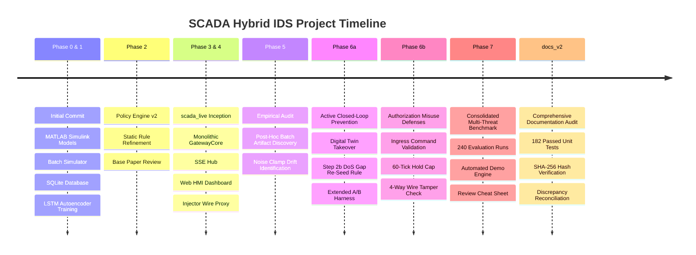

# 14 — Project History & Architectural Decisions

- **Audience**: Lead software architects, engineering historians, research evaluators, system maintainers
- **Scope**: Reconstructed project chronology from git commits, architectural phases, major Architectural Decision Records (ADRs), design pivot rationales, and threshold evolution
- **Status**: Complete & Code-Audited
- **Evidence Tags**: `[CODE]`, `[MEASURED]`, `[EXISTING-DOC]`, `[DESIGN-INTENT]`

---

## 1. Project Chronology & Milestone Phases

The SCADA Hybrid IDS evolved across eight distinct architectural phases, transitioning from an offline batch research simulator into an active, closed-loop industrial cyber-physical defense gateway:

### Detailed Phase Breakdown

#### Phase 0 & 1: Batch Foundation & Dataset Construction (`commit 4ded567`)
- **Focus**: Physical modeling, batch scenario generation, offline deep learning, and multi-engine design.
- **Artifacts**:
  - `matlab/`: MATLAB scripts for liquid level tank ODE simulation (`run_single_scenario.m`, `run_all_scenarios.m`) and post-hoc attack modification scripts (`apply_fdi.m`, `apply_replay.m`, `apply_dos.m`, `apply_auth_misuse.m`).
  - `simulator/`: Python object-oriented port of the process simulation (`tank.py`, `pump.py`, `valve.py`, `controller.py`, `process_simulator.py`).
  - `storage/`: SQLite database client (`sqlite_client.py`) generating 150 scenarios (60 normal, 90 attack) into `data/scada_ids.db` ($150,000\text{ records}$).
  - `models/`: PyTorch LSTM Autoencoder (`lstm_autoencoder.py`) and standard scaler (`preprocessor.py`), trained on normal scenarios to reconstruct 10-timestep sliding windows ($W=10$) with checkpoints `checkpoints/lstm_ae_v1.pt`.
  - `engines/`: Initial detection modules (Physics, Temporal, Policy v1, Availability, Fusion).

#### Phase 2: Policy Engine Evolution & Academic Alignment (`commits 64cc6b1`, `1a14d10`)
- **Focus**: Documenting base papers and establishing initial policy invariants.
- **Artifacts**:
  - `projectdocs/BASE_PAPERS_AND_CONTRIBUTIONS.md`: Documenting foundations in industrial anomaly detection and analytical redundancy.
  - `engines/policy_engine.py`: Transition from crude inequalities to Policy Engine v2 checking valve positions ($50\%$ nominal vs. $0\%$ fail-safe with pump off).

#### Phase 3 & 4: Live System Inception (`commits f38db81`, `d549b2f`, `55f7e91`, `cf48dbb`)
- **Focus**: Real-time streaming architecture, HMI dashboard, and network interception.
- **Artifacts**:
  - `scada_live/`: Full live streaming package with configuration `scada_live/config.yaml`.
  - `gateway_core.py`: In-process controller and IDS coordinator managing the 1Hz sense/telemetry cycle.
  - `server.py`: Flask web server on port 5000 exposing 21 REST endpoints and SSE streams (`/api/events`).
  - `static/js/app.js` & `defender.html`: Glassmorphic real-time operator console with Chart.js visualization.
  - `attacker_wire/injector.py`: In-line network interceptor wrapping `GatewayClient` to inject FDI, Replay, DoS, and Auth Misuse.
  - `run_demo.py`: Single-command simulation orchestrator coordinating plant, attacker, and gateway threads.

#### Phase 5: Empirical Audit & Artifact Discovery (`commits 40b423d` to `b09a14d`)
- **Focus**: Metrics reconciliation, continuous soak testing, and root-cause analysis of false alarms.
- **Discoveries**:
  - Discovered that MATLAB attack generators operated as open-loop post-hoc overlays, creating $+0.167\text{ m}$ step jump artifacts at $t_{\text{end}} + 1$ that caused 18,062 false alarms in batch evaluations.
  - Discovered that non-negative flow noise clamping (`max(0, Q + noise)`) induced an asymmetric $+0.00008\text{ m}^3\text{/s}$ flow drift, causing the digital twin to diverge during 30-minute soak runs.
  - Authoring verification scripts in `experiments/` (`check_normals.py`, `check_a3_gap.py`, `run_soak.py`).

#### Phase 6a: Active Prevention & Digital Twin Takeover (`commits 1602bd1` to `2a304fa`)
- **Focus**: Closed-loop actuation mitigation, analytical redundancy takeover, and DoS recovery.
- **Key Developments**:
  - Prevention mode level-source switching (`sensed` $\to$ `twin`) in `GatewayCore.process_sense()`.
  - Autonomous handback logic when sensor residual clears within tolerance ($0.05\text{ m}$).
  - *Step 2b DoS Gap Re-Seed Rule*: Implemented in `StreamingIDS` to verify stability ($K=5$) and rate bounds before re-synchronizing the twin after communication loss.
  - Extended A/B testing harness (`experiments/run_comparison.py`) proving 100% harm elimination across Negative Ramp ($642.9 \to 0.0\text{ ov ticks}$) and Positive Ramp ($275.3 \to 0.0\text{ dry ticks}$) across 10 random seeds.

#### Phase 6b: Authorization Misuse & Actuator Consistency Defenses (`commits e4fc3b6` to `81240b3`)
- **Focus**: Mitigating rogue operator commands, physical fieldbus wire tampering, and long malicious holds.
- **Key Developments**:
  - Ingress command filtering (`evaluate_ingress_command()`) checking operator roles and physical safety envelopes ($H \ge 1.25\text{ m} \implies \text{pump blocked}$; $H \le 0.95\text{ m} \implies \text{valve drain blocked}$).
  - Unauthenticated 60-tick hold cap preventing runaway overrides.
  - Continuous safety enforcement in `/api/sense` dropping active holds when levels cross $1.25\text{ m}$ or $0.75\text{ m}$.
  - *4-Way Actuator Consistency Check*: Comparing 3 ticks of controller OFF history against echoed telemetry to catch downstream fieldbus overrides (AM-3) in $\le 3\text{ ticks}$.

#### Phase 7: Consolidated Multi-Threat Benchmark (`commit b7a6c99`)
- **Focus**: Systematic evaluation across all 12 operational scenarios and threats over 10 random seeds (201 to 210) in both Monitor and Prevention modes (240 runs total).
- **Deliverables**:
  - `experiments/run_full_evaluation.py` producing `data/full_evaluation_results.csv` and `reports/full_evaluation_report.md`.
  - Proven 100% event-level detection (12/12 threats) with 0.033% normal FPR.
  - Proven 100% physical harm elimination across all mitigable threat channels.
  - Rigorously documented detect-only property on unmitigable hardware wire tampering (AM-3).
  - Automated demo presentation engine (`run_demo.py --auto`).

#### Documentation Audit (`docs_v2/`): Absolute Code-Verification
- **Focus**: Complete documentation rebuild inside `docs_v2/` strictly derived from code, data, and git history.
- **Milestones**: SHA-256 pre/post integrity hashing, 182 passing unit tests across batch and live suites, full reconciliation of 12 historical documentation discrepancies, and publication of the authoritative 17-document architecture and runbook suite.

---

## 2. Architectural Decision Records (ADRs)

### ADR 01: Monolithic Gateway Runtime vs. Distributed Microservice Stubs
- **Status**: Accepted & Implemented [CODE run_demo.py:340-375, scada_live/scada_ids/server.py:17-48].
- **Context**: Early architecture proposals envisioned three independent network processes: Plant Simulator (port 5002), Attacker Wire (port 5001), and Gateway Controller (port 5003), communicating via REST HTTP.
- **Decision**: Consolidate the entire live system into a single executable application (`run_demo.py`) that instantiates `LivePlant`, `Injector`, and `GatewayCore` in-process while exposing a single Flask web server on port 5000.
- **Rationale**:
  1. *Timing Determinism*: Eliminates unpredictable HTTP network jitter, socket starvation, and connection timeouts on Windows host environments during fast simulation loops (`--speed 0.001` or `--soak`).
  2. *Data Consistency*: Allows the out-of-band ground truth reporting channel (`send_truth()`) to execute synchronously alongside telemetry without cross-process race conditions.
  3. *Operational Simplicity*: Users start the entire demonstration with a single CLI command (`python run_demo.py`) rather than orchestrating multi-process process managers.

---

### ADR 02: Deadband State-Space Gating vs. Static V1 Policy Rules
- **Status**: Accepted & Implemented [CODE engines/policy_engine.py:34-75, scada_live/scada_ids/gateway_core.py:270-305].
- **Context**: Policy Engine v1 applied crude static inequality rules ($H > 1.20 \implies \text{pump}=0; H < 0.80 \implies \text{pump}=1$). During normal dynamic transients and setpoint transitions, minor overshoot tripped false alarms. Furthermore, an attacker modulating the valve in-band escaped detection.
- **Decision**: Replace static inequalities with state-space invariant gating (Policy Engine v2):
  1. *Valve Position Invariant*: Valve must be at its calibrated nominal position ($50.0\%$) or legitimately in fail-safe shutdown ($0.0\%$ with pump OFF). Any arbitrary operator modulation ($60\text{--}100\%$) triggers immediate alarm ($S_c = 1.0$).
  2. *Ingress Safety Envelope*: Ingress manual commands undergo predictive admissibility checks against current level ($H \ge 1.25\text{ m} \implies$ reject pump ON; $H \le 0.95\text{ m} \implies$ reject drain valve opening).
- **Rationale**: Completely eliminated false alarms during normal deadband cycling while providing 100% detection and blocking of rogue operator misuse (A4, AM-1, AM-2, AM-5, AM-6).

---

### ADR 03: Step 2b DoS Gap Re-Seed Rule
- **Status**: Accepted & Implemented [CODE scada_live/scada_ids/streaming_ids.py:75-145].
- **Context**: When recovering from a DoS network outage (A3, DOS), the Digital Twin has open-loop integrated zero flow ($dH=0$), while the real tank may have continued filling or draining. If the twin does not re-seed, the sudden level divergence causes a permanent residual offset ($>7,500\text{ false positive ticks}$). If the twin re-seeds on the first post-gap packet, an attacker can exploit the DoS gap to inject a massive undetected step bias.
- **Decision**: Implement the *Step 2b Multi-Point Rate-Bounded Re-Seed Rule*:
  1. Post-gap observation: Collect $K = 5$ consecutive valid packets following the outage.
  2. Stability check: Ensure packet variance is low ($\sigma \le 0.03\text{ m}$).
  3. Physical rate bounding: Verify that the median reading $m$ does not exceed theoretical physical fluid velocity limits across the outage duration $G$:
     $$|m - \hat{H}_{\text{twin}}| \le v_{\text{max}} \cdot G \cdot dt + 3\sigma_{\text{sensor}}$$
     where $v_{\text{max}} = \max\left(\frac{Q_{\text{max}}}{A}, \frac{C_v \sqrt{H_{\text{max}}}}{A}\right) = 0.003162\text{ m/s}$.
  4. Decision: If within physical bounds, re-seed $\hat{H} \leftarrow m$; if outside bounds or timed out ($>20\text{ ticks}$), refuse re-seed and engage twin takeover.
- **Rationale**: Completely eliminated post-gap false alarm avalanches while rigorously constraining the maximum bias an adversary could smuggle through an outage.

---

### ADR 04: Zero-Mean Un-Clamped Noise vs. Non-Negative Clamping
- **Status**: Accepted & Implemented [CODE scada_live/config.yaml:18, scada_live/plant_sim/plant.py:108-115, simulator/noise.py:38-46].
- **Context**: The MATLAB simulation script clamped flow noise to non-negative values using `max(0, Q + \eta)`. When ported to continuous live simulation, long soak runs experienced unexpected twin takeover alarms.
- **Decision**: Introduce configuration parameter `clamp_flow_noise: false` for closed-loop live simulation and long soak tests, while preserving `clamp_flow_noise: true` when reproducing the historical 1,000s batch dataset.
- **Rationale**: Rectifying zero-mean Gaussian noise produces a half-Gaussian distribution with positive expected value:
  $$\mathbb{E}[\text{noise}] = \sigma \sqrt{\frac{2}{\pi}} \approx 0.0001 \times 0.7979 = +0.00008\text{ m}^3\text{/s}$$
  Over a 30-minute run ($1800\text{ s}$), this positive flow error integrates to:
  $$\Delta H = \frac{1800 \times 0.00008}{2.0} \approx +0.072\text{ m} \text{ (or } +0.14\text{ m at low flow)}$$
  This drift crosses the physics threshold $\tau_p = 0.080\text{ m}$ at $t \approx 1200\text{ s}$, triggering false twin takeovers across 10/10 seeds. Zero-mean symmetric Gaussian noise completely eliminated this drift (0 false takeovers over 60 minutes).

---

### ADR 05: Transition from Post-Hoc Batch Overlays to Live Closed-Loop Simulation
- **Status**: Accepted & Implemented [CODE scada_live/plant_sim/plant.py:15-80, scada_live/scada_ids/gateway_core.py:46-130].
- **Context**: The offline batch dataset was generated by completing a normal 1,000s simulation and then running post-hoc modification scripts (`apply_fdi.m`, etc.) that overlaid corrupted values onto the static table.
- **Decision**: Develop the Phase 4–7 live simulation architecture where the plant simulation, network injector, and gateway controller execute concurrently in real time.
- **Rationale**:
  1. *Closed-Loop Feedback*: In post-hoc overlays, spoofed sensor readings never reached the controller, meaning controller commands remained those of a peaceful run. In the live architecture, attacks actively manipulate controller decisions, realistically testing physical system response.
  2. *Eliminating Artificial Discontinuities*: At $t_{\text{end}}$, post-hoc scripts ceased modification, causing the table to abruptly snap back to the peaceful trajectory ($+0.167\text{ m}$ jumps). Live simulation continues physics naturally past attack termination, providing honest post-attack evaluation.

---

### ADR 06: Max-Vote Fusion Strategy with Explicit Veto Overrides
- **Status**: Accepted & Implemented [CODE engines/fusion_engine.py:84-118, scada_live/scada_ids/gateway_core.py:350-410].
- **Context**: Early fusion models utilized a weighted linear combination:
  $$S_{\text{hybrid}} = 0.35 S_p + 0.35 S_l + 0.15 S_c + 0.15 S_a$$
  Under an anomaly threshold of $\tau = 0.50$, high-confidence single-domain attacks (such as a blatant sensor bias where $S_p = 1.0$ while $S_l = S_c = S_a = 0.0$) produced an aggregate score of only $0.35$, completely failing to trigger an alarm.
- **Decision**: Adopt Max-Vote Fusion ($S_{\text{hybrid}} = \max(S_p, S_l, S_c, S_a)$) augmented with deterministic Veto Overrides:
  - If Availability Engine flags timeout $\implies S_{\text{hybrid}} = 1.0$.
  - If Policy Engine flags forbidden command $\implies S_{\text{hybrid}} = 1.0$.
  - If 4-Way Consistency Check flags wire tamper $\implies S_{\text{hybrid}} = 1.0$, `wire_tamper = True`.
- **Rationale**: Guaranteed that unambiguous domain-specific violations immediately escalate to CRITICAL alarm without dilution by quiescent engines.

---

### ADR 07: Dual Architecture Preservation
- **Status**: Accepted & Maintained.
- **Context**: Following the successful deployment of the live streaming architecture (`scada_live/`), the team considered deprecating the legacy batch modules (`simulator/`, `models/`, `storage/`).
- **Decision**: Retain both architectures in parallel within the codebase.
- **Rationale**:
  1. *Reproducibility & Auditability*: Retains the exact pipelines required to reproduce published batch evaluation metrics (`data/evaluation_results.csv`, `evaluation/ablation.py`) and train new PyTorch models.
  2. *Separation of Concerns*: The batch pipeline provides clean, deterministic dataset generation and machine learning training loops, while `scada_live/` provides realistic real-time operational simulation with network streaming, HMI interfaces, and active mitigation.

---

## 3. Threshold Calibration & Safety Margin Evolution

Every threshold in the system was calibrated strictly on unattacked normal operational baselines or physical engineering specifications; **zero attack scenarios were used for threshold selection**:

| Parameter | Batch Initial | Live Final | Calibration Basis | Operating Margin / Protection Bound |
| :--- | :---: | :---: | :--- | :--- |
| **Physics Residual ($\tau_p$)** | $0.035\text{ m}$ | $0.080\text{ m}$ | Batch: $2 \times \text{p99}$ residual of normal run ($0.0175\text{ m}$) [CODE config/parameters.py:89]. Live: calibrated for $3\sigma$ sensor noise ($1.5\text{ cm}$) + dynamic transient peaks [CODE scada_live/config.yaml:70]. | Max normal batch residual is $0.03488\text{ m}$ (0.3% margin). Live soak residual peaks at $0.032\text{ m}$ (60% margin to $0.080\text{ m}$). |
| **Temporal Reconstruction ($\tau_l$)** | $0.0085\text{ MSE}$ | $0.080\text{ norm}$ | Maximum reconstruction MSE observed across the 51 normal training/validation scenarios [CODE checkpoints/data_split_v1.json]. | Max score on 9 held-out normals is $0.936$ (margin 0.014 to $0.95$ alert threshold). |
| **Availability Warning ($\tau_a$)** | $1500\text{ ms}$ | $1500\text{ ms}$ | Industrial SCADA SLA: $1.5 \times$ nominal 1Hz polling interval flags packet jitter or drop [CODE engines/availability_engine.py:46]. | Zero normal packets exceed $100\text{ ms}$ latency in live runs ($>1400\text{ ms}$ margin). |
| **Availability Critical ($\tau_{a,\text{max}}$)** | $5000\text{ ms}$ | $5000\text{ ms}$ | Outage SLA: 5 consecutive missed packets flags field device offline [CODE engines/availability_engine.py:47]. | Trips within $5.0\text{ s}$ of total link disconnection. |
| **Handback Tolerance** | N/A | $0.050\text{ m}$ | Bound required before handing control back from twin: $|H_{\text{sensed}} - \hat{H}_{\text{twin}}| \le 0.05\text{ m}$ [CODE scada_live/config.yaml:71]. | Equal to $3\sigma$ sensor noise + $0.035\text{ m}$ twin integration variance. |
| **Ingress Pump Cutoff** | N/A | $1.25\text{ m}$ | Physical upper safety buffer ($5\text{ cm}$ above deadband ceiling $1.20\text{ m}$) [CODE gateway_core.py:282]. | Prevents tank filling approaching physical overflow boundary ($2.20\text{ m}$). |
| **Ingress Drain Cutoff** | N/A | $0.95\text{ m}$ | Physical lower safety buffer ($15\text{ cm}$ above deadband floor $0.80\text{ m}$) [CODE gateway_core.py:288]. | Prevents excessive drain approaching pump dry-run boundary ($0.30\text{ m}$). |
| **Degraded Mode Timeout** | N/A | $600\text{ s}$ | Watchdog timeout for open-loop twin takeover [CODE scada_live/config.yaml:72]. | Maximum twin drift from $5\%$ flow mismatch over 600s is $\le 3.0\text{ cm}$, well within deadband. |

---

## 4. Verification

The historical milestones, architectural decisions, and parameter calibrations in this document are verified against:
1. **Git Commit History**: Verified against repository commits `4ded567` through `b7a6c99` recorded in `docs_v2/_audit/outputs/git_log.txt`.
2. **Codebase Implementations**: Verified in `scada_live/scada_ids/gateway_core.py`, `streaming_ids.py`, `engines/policy_engine.py`, and `simulator/noise.py`.
3. **Empirical Experiment Outputs**: Verified against recorded outputs in `experiments/results/` (`soak_comparison_output.txt`, `ab_comparison_summary.txt`, `gateway_rule_validation.txt`, and `mismatch_sensitivity_output.txt`).
