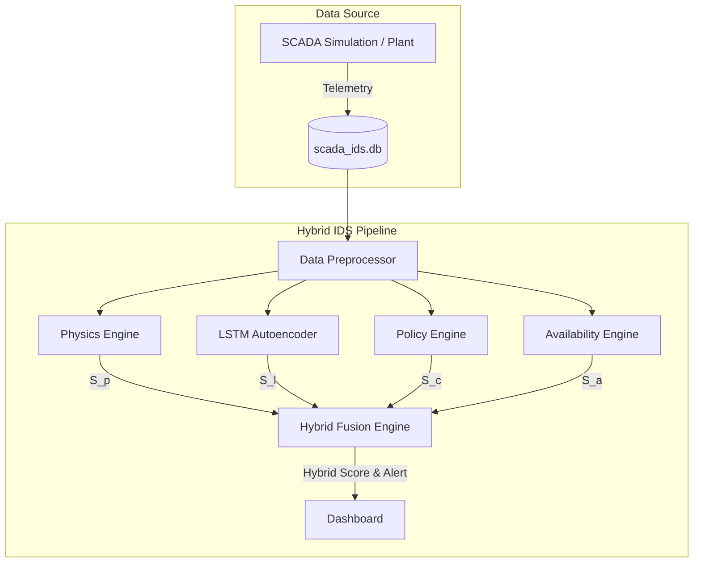

# System Architecture

This document outlines the architectural design of the SCADA Hybrid Intrusion Detection System.

## High-Level Architecture Diagram

## The Four Detection Engines

The core philosophy of this project is that machine learning (like LSTMs) is excellent at capturing subtle, transient temporal anomalies, but it fundamentally lacks an understanding of physical laws and deterministic control logic.

By splitting the detection load across 4 specialized engines, we ensure robust defense-in-depth:

### 1. Physics Engine (Digital Twin)
- **Target:** False Data Injection (FDI)
- **Mechanism:** Maintains a mathematical model of the tank's physics. It reads the raw inflow (`q_in`) and outflow (`q_out`) commands to independently calculate what the true tank level *should* be. It then computes the residual (difference) between its calculated level and the *observed* tank level.
- **Why it works:** If a hacker spoofs the sensor reading to hide the fact that the tank is overflowing, the physical laws in the Digital Twin will still predict the overflow. The residual diverges, triggering an anomaly.

### 2. Temporal Engine (LSTM-AE)
- **Target:** Covert or stealthy anomalies, complex multi-variable deviations.
- **Mechanism:** A Deep Learning Long Short-Term Memory Autoencoder. It compresses a sliding window (10 seconds) of 5 variables down to a latent space, and attempts to reconstruct it. High reconstruction loss indicates an anomaly.
- **Why it works:** It captures the normal temporal covariance between all sensors. It excels at finding subtle noise-floor attacks that don't violate hard physical laws.

### 3. Policy Engine
- **Target:** Authorization Misuse, Logic Bombs
- **Mechanism:** A deterministic rule engine that encodes the standard operating procedures of the SCADA controller (e.g., "Pump MUST be OFF when Level > 1.2m").
- **Why it works:** It instantly detects if the controller is issuing malicious commands that contradict its own hysteresis logic, bypassing the need for machine learning to infer these rules.

### 4. Availability Engine
- **Target:** Denial of Service (DoS), Replay Attacks
- **Mechanism:** Monitors network timing constraints (e.g., packet timestamps and reception flags).
- **Why it works:** Replay attacks freeze data values, while DoS attacks drop packets. Both fundamentally disrupt the real-time constraints of SCADA systems, which this engine flags directly.

## Fusion Engine (Max-Vote)
The 4 individual anomaly scores (`S_p`, `S_l`, `S_c`, `S_a`) are normalized to a `[0, 1]` scale using their respective optimal thresholds.

The Fusion Engine combines them using a **Max-Vote** strategy (`S_hybrid = max(S_p, S_l, S_c, S_a)`). 
- If `S_hybrid > 0.95`, an anomaly is declared.
- This ensures that if *any* single specialized engine detects a blatant violation of its domain (e.g., a massive physics violation, or a blatant packet drop), the system alerts instantly without waiting for confirmation from the other engines.
